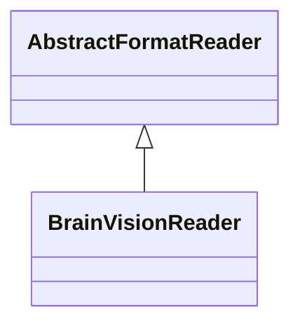

# BrainVisionReader

**Namespace:** `BIDSLIB` &nbsp;·&nbsp; **Library:** BIDS Library &nbsp;·&nbsp; **Source:** [`bids/readers/bids_brain_vision_reader.h`](https://github.com/mne-tools/mne-cpp/blob/staging/src/libraries/bids/readers/bids_brain_vision_reader.h)

`#include <bids/bids_brain_vision_reader.h>`

```cpp
class BIDSLIB::BrainVisionReader
```

The [`BrainVisionReader`](/docs/api/bids/brain-vision-reader) reads BrainVision file triplets (.vhdr/.vmrk/.eeg) and exposes them through the [`AbstractFormatReader`](/docs/api/bids/abstract-format-reader) interface.

BrainVision is the most common format for iEEG (sEEG/ECoG) recordings in BIDS datasets. The format stores data as little-endian binary (INT_16, INT_32, or IEEE_FLOAT_32), either MULTIPLEXED (channels interleaved per time point) or VECTORIZED (channels contiguous).

```cpp title="src/examples/ex_bids/main.cpp"
BrainVisionReader brainVision;
const bool bvOpen = brainVision.open(vhdr);
const MatrixXf bvHead = brainVision.readRawSegment(0, 200); // calibrated, volts
```

### Inheritance



---

## Public Methods

### BrainVisionReader()

Default constructor.

---

### ~BrainVisionReader()

---

### open(sFilePath)

Open and parse the file header.

Must be called before reading data.

**Parameters:**

- **sFilePath** : *const QString &*
  Absolute path to the primary data file.

**Returns:**

- *bool* — True if the file was opened and parsed successfully.

---

### getInfo()

Return measurement metadata as [FiffInfo](/docs/api/fiff/fiff-info).

**Returns:**

- *[FiffInfo](/docs/api/fiff/fiff-info)* — FiffInfo populated from the native format header.

---

### readRawSegment(iStartSampleIdx, iEndSampleIdx)

Read a segment of raw data.

**Parameters:**

- **iStartSampleIdx** : *int*
  First sample index (0-based, inclusive).

- **iEndSampleIdx** : *int*
  Last sample index (0-based, exclusive).

**Returns:**

- *Eigen::MatrixXf* — Matrix of shape (n_channels x n_samples) with calibrated physical values.

---

### getSampleCount()

Return total number of samples across the recording.

**Returns:**

- *long* — Number of samples per channel in the whole recording.

---

### getFrequency()

Return the sampling frequency in Hz.

**Returns:**

- *float* — Sampling frequency in Hz.

---

### getChannelCount()

Return the number of measurement channels.

**Returns:**

- *int* — Number of measurement channels (rows returned by readRawSegment).

---

### toFiffRawData()

Convert the entire dataset to a [FiffRawData](/docs/api/fiff/fiff-raw-data) structure.

**Returns:**

- *[FiffRawData](/docs/api/fiff/fiff-raw-data)* — FiffRawData populated with info, calibrations, and sample bounds.

---

### formatName()

Return a descriptive name for the format (e.g.

"EDF", "BrainVision").

**Returns:**

- *QString* — Human-readable format name.

---

### supportsExtension(sExtension)

Check whether this reader can handle the given file extension.

**Parameters:**

- **sExtension** : *const QString &*
  File extension including dot (e.g. ".edf", ".vhdr").

**Returns:**

- *bool* — True if this reader supports the extension.

---

### getMarkers()

Return all parsed markers from the .vmrk file.

**Returns:**

- *QVector&lt; [BrainVisionMarker](/docs/api/bids/brain-vision-marker) &gt;* — Markers in file order; empty if no marker file was parsed.

---

### getChannelInfos()

Return all channel infos.

**Returns:**

- *QVector&lt; [BrainVisionChannelInfo](/docs/api/bids/brain-vision-channel-info) &gt;* — Channel infos parsed from the .vhdr header, in channel order.

---

## Static Methods

### unitScale(sUnit)

---

### isVoltageUnit(sUnit)

---

## Example

- Start here: [ex_bids](../../examples/bids/ex_bids.mdx) — BIDS library: paths, sidecar TSVs, BrainVision/EDF readers and a raw-data round trip.
- Full source: [`src/examples/ex_bids/main.cpp`](https://github.com/mne-tools/mne-cpp/tree/staging/src/examples/ex_bids/main.cpp)
- Build target: `ex_bids` (runs under CTest)
- Data: [mne-cpp-test-data](https://github.com/mne-tools/mne-cpp-test-data)

## Used in examples

### [ex_bids](../../examples/bids/ex_bids.mdx)

BIDS library: paths, sidecar TSVs, BrainVision/EDF readers and a raw-data round trip.

````cpp title="src/examples/ex_bids/main.cpp, line 119"
BrainVisionReader brainVision;
const bool bvOpen = brainVision.open(vhdr);
const MatrixXf bvHead = brainVision.readRawSegment(0, 200); // calibrated, volts
// mne.io.read_raw_brainvision: 32 channels at 1000 Hz, 7900 samples; data[0, 0] = -23.5 uV, data[5, 100] = 38.5 uV
ok &= expect(bvOpen && brainVision.getChannelCount() == 32 && brainVision.getSampleCount() == 7900 && brainVision.getFrequency() == 1000.0f && near(bvHead(0, 0), -2.35e-5, 1e-4) && near(bvHead(5, 100), 3.85e-5, 1e-4),
             QString("BrainVision: %1 x %2 samples, (0,0) = %3 V match mne").arg(brainVision.getChannelCount()).arg(brainVision.getSampleCount()).arg(bvHead(0, 0)));
````

## Authors of this file

- Christoph Dinh &lt;christoph.dinh@mne-cpp.org&gt;
