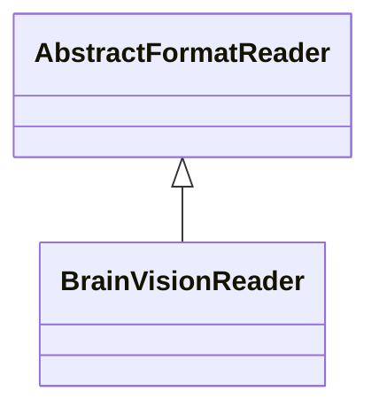

# BrainVisionReader

**Namespace:** `mne` &nbsp;·&nbsp; **Library:** BIDS Library &nbsp;·&nbsp; **Source:** [`bids/readers/bids_brain_vision_reader.h`](https://github.com/mne-tools/mne-cpp/blob/staging/src/libraries/bids/readers/bids_brain_vision_reader.h)

`#include <bids/bids_brain_vision_reader.h>`

```cpp
class mne::BrainVisionReader
```

The [`BrainVisionReader`](/docs/api/bids/brain-vision-reader) reads BrainVision file triplets (.vhdr/.vmrk/.eeg) and exposes them through the [`AbstractFormatReader`](/docs/api/bids/abstract-format-reader) interface.

BrainVision is the most common format for iEEG (sEEG/ECoG) recordings in BIDS datasets. The format stores data as little-endian binary (INT_16, INT_32, or IEEE_FLOAT_32), either MULTIPLEXED (channels interleaved per time point) or VECTORIZED (channels contiguous).

```cpp title="src/examples/ex_bids/main.cpp"
BrainVisionReader brainVision;
const bool bvOpen = brainVision.open(vhdr);
const MatrixXf bvHead = brainVision.read_raw_segment(0, 200); // calibrated, volts
```

### Inheritance



---

## Public Methods

### BrainVisionReader()

---

### ~BrainVisionReader()

---

### open(path)

Open and parse the file header.

Must be called before reading data.

**Parameters:**

- **path** : *const std::filesystem::path &*
  Path to the primary data file.

**Returns:**

- *bool* — True if the file was opened and parsed successfully.

---

### info()

**Returns:**

- *[FiffInfo](/docs/api/fiff/fiff-info)* — Measurement metadata populated from the native format header.

---

### read_raw_segment(first, last)

Read a segment of raw data.

**Parameters:**

- **first** : *long*
  First sample index (0-based, inclusive).

- **last** : *long*
  Last sample index (0-based, exclusive).

**Returns:**

- *Eigen::MatrixXf* — Matrix of shape (n_channels x n_samples) in SI units; empty for an invalid range.

---

### sample_count()

**Returns:**

- *long* — Number of samples per channel in the whole recording.

---

### sfreq()

**Returns:**

- *float* — Sampling frequency in Hz.

---

### channel_count()

**Returns:**

- *int* — Number of measurement channels (rows returned by read_raw_segment).

---

### format_name()

**Returns:**

- *std::string_view* — Human-readable format name (e.g. "EDF", "BrainVision").

---

### supports_extension(extension)

**Parameters:**

- **extension** : *std::string_view*
  File extension including the dot (e.g. ".edf", ".vhdr"), in any letter case.

**Returns:**

- *bool* — True if this reader supports the extension.

---

### markers()

**Returns:**

- *const std::vector&lt; [BrainVisionMarker](/docs/api/bids/brain-vision-marker) &gt; &* — Markers in file order; empty if no marker file was parsed.

---

### channel_infos()

**Returns:**

- *const std::vector&lt; [BrainVisionChannelInfo](/docs/api/bids/brain-vision-channel-info) &gt; &* — Channel infos parsed from the .vhdr header, in channel order.

---

## Static Methods

### unit_scale(unit)

**Parameters:**

- **unit** : *std::string_view*
  Unit from the header in UTF-8, e.g. "µV".

**Returns:**

- *float* — Factor from the unit into SI (V for voltages, S for siemens); unknown units scale by 1, like mne.

---

### is_voltage_unit(unit)

**Parameters:**

- **unit** : *std::string_view*
  Unit from the header in UTF-8.

**Returns:**

- *bool* — Whether the unit is a voltage (V, mV, µV, uV, nV); other channels are typed misc, like mne.

---

## Example

- Start here: [ex_bids](../../examples/bids/ex_bids.mdx) — BIDS library: paths, sidecar TSVs, BrainVision/EDF readers and a raw-data round trip.
- Full source: [`src/examples/ex_bids/main.cpp`](https://github.com/mne-tools/mne-cpp/tree/staging/src/examples/ex_bids/main.cpp)
- Build target: `ex_bids` (runs under CTest)
- Data: [mne-cpp-test-data](https://github.com/mne-tools/mne-cpp-test-data)

## Used in examples

### [ex_bids](../../examples/bids/ex_bids.mdx)

BIDS library: paths, sidecar TSVs, BrainVision/EDF readers and a raw-data round trip.

````cpp title="src/examples/ex_bids/main.cpp, line 121"
BrainVisionReader brainVision;
const bool bvOpen = brainVision.open(vhdr);
const MatrixXf bvHead = brainVision.read_raw_segment(0, 200); // calibrated, volts
// mne.io.read_raw_brainvision: 32 channels at 1000 Hz, 7900 samples; data[0, 0] = -23.5 uV, data[5, 100] = 38.5 uV
ok &= expect(bvOpen && brainVision.channel_count() == 32 && brainVision.sample_count() == 7900 && brainVision.sfreq() == 1000.0f && near(bvHead(0, 0), -2.35e-5, 1e-4) && near(bvHead(5, 100), 3.85e-5, 1e-4),
             std::format("BrainVision: {} x {} samples, (0,0) = {:g} V match mne", brainVision.channel_count(), brainVision.sample_count(), bvHead(0, 0)));
````

## Authors of this file

- Christoph Dinh &lt;christoph.dinh@mne-cpp.org&gt;
