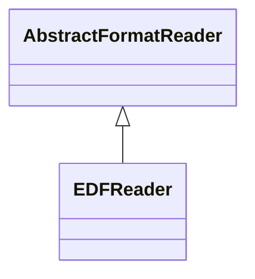

# EDFReader

**Namespace:** `mne` &nbsp;·&nbsp; **Library:** BIDS Library &nbsp;·&nbsp; **Source:** [`bids/readers/bids_edf_reader.h`](https://github.com/mne-tools/mne-cpp/blob/staging/src/libraries/bids/readers/bids_edf_reader.h)

`#include <bids/bids_edf_reader.h>`

```cpp
class mne::EDFReader
```

The [`EDFReader`](/docs/api/bids/edf-reader) reads European Data Format (EDF/EDF+) files and exposes them through the [`AbstractFormatReader`](/docs/api/bids/abstract-format-reader) interface.

EDF stores data as 16-bit (BDF: 24-bit) little-endian integers in fixed-duration "data records", with channels interleaved within each record.

```cpp title="src/examples/ex_bids/main.cpp"
std::unique_ptr<AbstractFormatReader> edf = BidsRawData::create_reader(".edf"); // or construct EDFReader directly
const bool edfOpen = edf->open(BIDSPath(root, "02", "01", "rest", "eeg", "eeg", ".edf").file_path());
const mne::FiffInfo edfInfo = edf->info();
const MatrixXf edfHead = edf->read_raw_segment(0, 201);
```

### Inheritance



---

## Public Methods

### EDFReader()

---

### ~EDFReader()

---

### open(path)

Open and parse the file header.

Must be called before reading data.

**Parameters:**

- **path** : *const std::filesystem::path &*
  Path to the primary data file.

**Returns:**

- *bool* — True if the file was opened and parsed successfully.

---

### info()

**Returns:**

- *[FiffInfo](/docs/api/fiff/fiff-info)* — Measurement metadata populated from the native format header.

---

### read_raw_segment(first, last)

Read a segment of raw data.

**Parameters:**

- **first** : *long*
  First sample index (0-based, inclusive).

- **last** : *long*
  Last sample index (0-based, exclusive).

**Returns:**

- *Eigen::MatrixXf* — Matrix of shape (n_channels x n_samples) in SI units; empty for an invalid range.

---

### sample_count()

**Returns:**

- *long* — Number of samples per channel in the whole recording.

---

### sfreq()

**Returns:**

- *float* — Sampling frequency in Hz.

---

### channel_count()

**Returns:**

- *int* — Number of measurement channels (rows returned by read_raw_segment).

---

### format_name()

**Returns:**

- *std::string_view* — Human-readable format name (e.g. "EDF", "BrainVision").

---

### supports_extension(extension)

**Parameters:**

- **extension** : *std::string_view*
  File extension including the dot (e.g. ".edf", ".vhdr"), in any letter case.

**Returns:**

- *bool* — True if this reader supports the extension.

---

### all_channel_infos()

**Returns:**

- *const std::vector&lt; [EDFChannelInfo](/docs/api/bids/edf-channel-info) &gt; &* — Infos for every signal in the EDF header, including annotation/extra channels.

---

### measurement_channel_infos()

**Returns:**

- *const std::vector&lt; [EDFChannelInfo](/docs/api/bids/edf-channel-info) &gt; &* — Infos for the measurement channels only, in channel order.

---

## Example

- Start here: [ex_bids](../../examples/bids/ex_bids.mdx) — BIDS library: paths, sidecar TSVs, BrainVision/EDF readers and a raw-data round trip.
- Full source: [`src/examples/ex_bids/main.cpp`](https://github.com/mne-tools/mne-cpp/tree/staging/src/examples/ex_bids/main.cpp)
- Build target: `ex_bids` (runs under CTest)
- Data: [mne-cpp-test-data](https://github.com/mne-tools/mne-cpp-test-data)

## Used in examples

### [ex_bids](../../examples/bids/ex_bids.mdx)

BIDS library: paths, sidecar TSVs, BrainVision/EDF readers and a raw-data round trip.

````cpp title="src/examples/ex_bids/main.cpp, line 138"
std::unique_ptr<AbstractFormatReader> edf = BidsRawData::create_reader(".edf"); // or construct EDFReader directly
const bool edfOpen = edf->open(BIDSPath(root, "02", "01", "rest", "eeg", "eeg", ".edf").file_path());
const mne::FiffInfo edfInfo = edf->info();
const MatrixXf edfHead = edf->read_raw_segment(0, 201);
// mne.io.read_raw_edf: 25 channels at 128 Hz, 1228 samples, first channel "EEG Fp1"; data[3, 200] = 0.1757724
ok &= expect(edfOpen && dynamic_cast<EDFReader*>(edf.get()) != nullptr && edf->format_name() == "EDF" && edfInfo.nchan == 25 && edfInfo.ch_names.front() == "EEG Fp1" && edf->sample_count() == 1228 && near(edfHead(0, 0), 0.17594066, 1e-5) && near(edfHead(3, 200), 0.17577240650034331, 1e-5),
             std::format("EDF: {} channels, {} samples, (3,200) = {:.8g} match mne", edfInfo.nchan, edf->sample_count(), edfHead(3, 200)));
````

## Authors of this file

- Christoph Dinh &lt;christoph.dinh@mne-cpp.org&gt;
- Simon Heinke &lt;Simon.Heinke@tu-ilmenau.de&gt;
- Matti Hamalainen &lt;msh@nmr.mgh.harvard.edu&gt;
