# AbstractMetric

**Namespace:** `mne` &nbsp;·&nbsp; **Library:** Connectivity Library &nbsp;·&nbsp; **Source:** [`connectivity/metrics/abstractmetric.h`](https://github.com/mne-tools/mne-cpp/blob/staging/src/libs/mne/connectivity/metrics/abstractmetric.h)

`#include <mne/connectivity/abstractmetric.h>`

```cpp
class mne::AbstractMetric
```

Common base of the connectivity metrics.

```cpp title="src/examples/ex_connectivity_metrics/main.cpp"
settings.setConnectivityMethods({"COH", "PLV", "WPLI"});
std::vector<Network> networks = compute_connectivity(settings);
for (Network network : networks) {
    network.set_frequency_range(8.0f, 12.0f); // average the per-bin weights over the alpha band
    std::println("{} 0-1: {:g}", network.method(), edgeWeight(network, 0, 1));
}
```

### Inheritance

```mermaid
classDiagram
    AbstractMetric <|-- Coherence
    click Coherence href "../../connectivity/coherence/"
    AbstractMetric <|-- Coherency
    click Coherency href "../../connectivity/coherency/"
    AbstractMetric <|-- Correlation
    click Correlation href "../../connectivity/correlation/"
    AbstractMetric <|-- CrossCorrelation
    click CrossCorrelation href "../../connectivity/cross-correlation/"
    AbstractMetric <|-- DebiasedSquaredWeightedPhaseLagIndex
    click DebiasedSquaredWeightedPhaseLagIndex href "../../connectivity/debiased-squared-weighted-phase-lag-index/"
    AbstractMetric <|-- DirectedTransferFunction
    click DirectedTransferFunction href "../../connectivity/directed-transfer-function/"
    AbstractMetric <|-- GrangerCausality
    click GrangerCausality href "../../connectivity/granger-causality/"
    AbstractMetric <|-- ImagCoherence
    click ImagCoherence href "../../connectivity/imag-coherence/"
    AbstractMetric <|-- PartialDirectedCoherence
    click PartialDirectedCoherence href "../../connectivity/partial-directed-coherence/"
    AbstractMetric <|-- PhaseLagIndex
    click PhaseLagIndex href "../../connectivity/phase-lag-index/"
    AbstractMetric <|-- PhaseLockingValue
    click PhaseLockingValue href "../../connectivity/phase-locking-value/"
    AbstractMetric <|-- UnbiasedSquaredPhaseLagIndex
    click UnbiasedSquaredPhaseLagIndex href "../../connectivity/unbiased-squared-phase-lag-index/"
    AbstractMetric <|-- WeightedPhaseLagIndex
    click WeightedPhaseLagIndex href "../../connectivity/weighted-phase-lag-index/"
```



---

## Public Methods

### AbstractMetric()

Constructs a [`AbstractMetric`](/docs/api/connectivity/abstract-metric) object.

---

## Example

- Start here: [ex_connectivity_metrics](../../examples/connectivity/ex_connectivity_metrics.mdx) — Connectivity metrics on synthetic data with a known coupling.
- Full source: [`src/examples/ex_connectivity_metrics/main.cpp`](https://github.com/mne-tools/mne-cpp/tree/staging/src/examples/ex_connectivity_metrics/main.cpp)
- Build target: `ex_connectivity_metrics` (runs under CTest)

## Authors of this file

- Lorenz Esch &lt;lorenz.esch@tu-ilmenau.de&gt;
- Gabriel Motta &lt;gabrielbenmotta@gmail.com&gt;
- Christoph Dinh &lt;christoph.dinh@mne-cpp.org&gt;
