# AbstractMetric

**Namespace:** `CONNECTIVITYLIB` &nbsp;·&nbsp; **Library:** Connectivity Library &nbsp;·&nbsp; **Source:** [`connectivity/metrics/abstractmetric.h`](https://github.com/mne-tools/mne-cpp/blob/staging/src/libraries/connectivity/metrics/abstractmetric.h)

`#include <connectivity/abstractmetric.h>`

```cpp
class CONNECTIVITYLIB::AbstractMetric
```

Static base for every estimator in ``CONNECTIVITYLIB``.

Holds the two pieces of global state that the dispatcher (`Connectivity::calculate`) must set before any metric runs:

- `CONNECTIVITYLIB::AbstractMetric::m_bStorageModeIsActive` "m_bStorageModeIsActive" enables caching of per-trial tapered spectra and CSDs in `ConnectivitySettings::IntermediateTrialData`, which lets a second metric reuse the FFT work done by the first.
- `CONNECTIVITYLIB::AbstractMetric::m_iNumberBinStart` "m_iNumberBinStart" and `CONNECTIVITYLIB::AbstractMetric::m_iNumberBinAmount` "m_iNumberBinAmount" define the frequency-bin window over which each metric averages its spectral output into the single scalar weight stored on each network edge.

Static control knobs (storage mode, frequency band) shared by all `CONNECTIVITYLIB` metrics.

```cpp title="src/examples/ex_connectivity_metrics/main.cpp"
// Spectral metrics evaluate the bins [start, start + amount); -1 means the full half spectrum.
AbstractMetric::m_iNumberBinStart = -1;
AbstractMetric::m_iNumberBinAmount = -1;
AbstractMetric::m_bStorageModeIsActive = false;
```

### Inheritance

```mermaid
classDiagram
    AbstractMetric <|-- Coherence
    click Coherence href "../../connectivity/coherence/"
    AbstractMetric <|-- Coherency
    click Coherency href "../../connectivity/coherency/"
    AbstractMetric <|-- Correlation
    click Correlation href "../../connectivity/correlation/"
    AbstractMetric <|-- CrossCorrelation
    click CrossCorrelation href "../../connectivity/cross-correlation/"
    AbstractMetric <|-- DebiasedSquaredWeightedPhaseLagIndex
    click DebiasedSquaredWeightedPhaseLagIndex href "../../connectivity/debiased-squared-weighted-phase-lag-index/"
    AbstractMetric <|-- DirectedTransferFunction
    click DirectedTransferFunction href "../../connectivity/directed-transfer-function/"
    AbstractMetric <|-- GrangerCausality
    click GrangerCausality href "../../connectivity/granger-causality/"
    AbstractMetric <|-- ImagCoherence
    click ImagCoherence href "../../connectivity/imag-coherence/"
    AbstractMetric <|-- PartialDirectedCoherence
    click PartialDirectedCoherence href "../../connectivity/partial-directed-coherence/"
    AbstractMetric <|-- PhaseLagIndex
    click PhaseLagIndex href "../../connectivity/phase-lag-index/"
    AbstractMetric <|-- PhaseLockingValue
    click PhaseLockingValue href "../../connectivity/phase-locking-value/"
    AbstractMetric <|-- UnbiasedSquaredPhaseLagIndex
    click UnbiasedSquaredPhaseLagIndex href "../../connectivity/unbiased-squared-phase-lag-index/"
    AbstractMetric <|-- WeightedPhaseLagIndex
    click WeightedPhaseLagIndex href "../../connectivity/weighted-phase-lag-index/"
```



---

## Public Methods

### AbstractMetric()

Constructs a [`AbstractMetric`](/docs/api/connectivity/abstract-metric) object.

---

## Example

- Start here: [ex_connectivity_metrics](../../examples/connectivity/ex_connectivity_metrics.mdx) — Connectivity metrics on synthetic data with a known coupling.
- Full source: [`src/examples/ex_connectivity_metrics/main.cpp`](https://github.com/mne-tools/mne-cpp/tree/staging/src/examples/ex_connectivity_metrics/main.cpp)
- Build target: `ex_connectivity_metrics` (runs under CTest)

## Used in examples

### [ex_connectivity_performance](../../examples/connectivity/ex_connectivity_performance.mdx)

Benchmark the run time of connectivity methods over channel and sample counts.

````cpp title="src/examples/ex_connectivity_performance/main.cpp, line 143"
AbstractMetric::m_bStorageModeIsActive = iStorageModeActive;
AbstractMetric::m_iNumberBinStart = 8;
AbstractMetric::m_iNumberBinAmount = 4;
````

### [ex_connectivity](../../examples/connectivity/ex_connectivity.mdx)

Sensor- or source-level functional connectivity of averaged MEG/EEG data with a selectable metric, shown as a 3D network.

````cpp title="src/examples/ex_connectivity/main.cpp, line 103"
AbstractMetric::m_bStorageModeIsActive = false;
AbstractMetric::m_iNumberBinStart = 0;
AbstractMetric::m_iNumberBinAmount = 50;
````

### [ex_connectivity_metrics](../../examples/connectivity/ex_connectivity_metrics.mdx)

Connectivity metrics on synthetic data with a known coupling.

````cpp title="src/examples/ex_connectivity_metrics/main.cpp, line 165"
// Spectral metrics evaluate the bins [start, start + amount); -1 means the full half spectrum.
AbstractMetric::m_iNumberBinStart = -1;
AbstractMetric::m_iNumberBinAmount = -1;
AbstractMetric::m_bStorageModeIsActive = false;
````

Also used in [ex_connectivity_comparison](../../examples/connectivity/ex_connectivity_comparison.mdx).

## Authors of this file

- Lorenz Esch &lt;lorenz.esch@tu-ilmenau.de&gt;
- Gabriel Motta &lt;gabrielbenmotta@gmail.com&gt;
- Christoph Dinh &lt;christoph.dinh@mne-cpp.org&gt;
