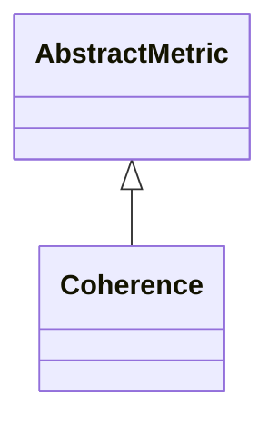

# Coherence

**Namespace:** `CONNECTIVITYLIB` &nbsp;·&nbsp; **Library:** Connectivity Library &nbsp;·&nbsp; **Source:** [`connectivity/metrics/coherence.h`](https://github.com/mne-tools/mne-cpp/blob/staging/src/libraries/connectivity/metrics/coherence.h)

:::info[Python equivalent]
`mne_connectivity.spectral_connectivity_epochs (method='coh')` in MNE-Python.
:::

`#include <connectivity/coherence.h>`

<Connections topics={["connectivity"]} context="api" current="Coherence" />

```cpp
class CONNECTIVITYLIB::Coherence
```

Computes magnitude-squared coherence between every pair of channels.

The actual cross-spectral and auto-spectral accumulation is shared with [`Coherency`](/docs/api/connectivity/coherency); this class only wraps the absolute-value branch and exposes a single `calculate` entry point that returns a [`Network`](/docs/api/connectivity/network) whose edge weights are the band-averaged |coherency|^2 values in [0, 1].

Magnitude-squared coherence estimator (symmetric, sensitive to zero-lag coupling).

```cpp title="src/examples/ex_connectivity_metrics/main.cpp"
Network coherence = Coherence::calculate(settings);
coherence.setFrequencyRange(8.0f, 12.0f);
const double coh01 = edgeWeight(coherence, 0, 1);
const double coh02 = edgeWeight(coherence, 0, 2);
```

### Inheritance



---

## Public Methods

### Coherence()

Constructs a [`Coherence`](/docs/api/connectivity/coherence) object.

---

## Static Methods

### calculate(connectivitySettings)

Calculates the coherence between the rows of the data matrix.

**Parameters:**

- **connectivitySettings** : *[ConnectivitySettings](/docs/api/connectivity/connectivity-settings) &*
  The input data and parameters.

**Returns:**

- *[Network](/docs/api/connectivity/network)* — The connectivity information in form of a network structure.

---

## Example

- Start here: [ex_connectivity_metrics](../../examples/connectivity/ex_connectivity_metrics.mdx) — Connectivity metrics on synthetic data with a known coupling.
- Full source: [`src/examples/ex_connectivity_metrics/main.cpp`](https://github.com/mne-tools/mne-cpp/tree/staging/src/examples/ex_connectivity_metrics/main.cpp)
- Build target: `ex_connectivity_metrics` (runs under CTest)

## Used in examples

### [ex_connectivity_metrics](../../examples/connectivity/ex_connectivity_metrics.mdx)

Connectivity metrics on synthetic data with a known coupling.

````cpp title="src/examples/ex_connectivity_metrics/main.cpp, line 182"
Network coherence = Coherence::calculate(settings);
coherence.setFrequencyRange(8.0f, 12.0f);
const double coh01 = edgeWeight(coherence, 0, 1);
const double coh02 = edgeWeight(coherence, 0, 2);
ok &= expect(coh01 > coh02 + 0.3, QString("COH 0-1 %1 > 0-2 %2 + 0.3").arg(coh01).arg(coh02));
````

## Authors of this file

- Daniel Strohmeier &lt;daniel.strohmeier@gmail.com&gt;
- Lorenz Esch &lt;lorenz.esch@tu-ilmenau.de&gt;
- Juan GPC &lt;jgarciaprieto@mgh.harvard.edu&gt;
- Gabriel Motta &lt;gabrielbenmotta@gmail.com&gt;
- Christoph Dinh &lt;christoph.dinh@mne-cpp.org&gt;
