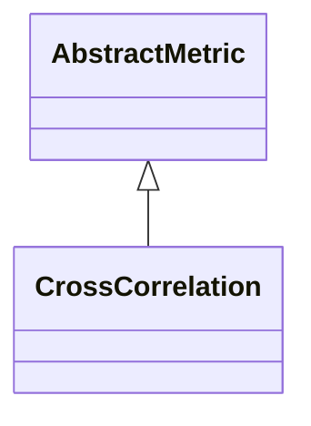

# CrossCorrelation

**Namespace:** `CONNECTIVITYLIB` &nbsp;·&nbsp; **Library:** Connectivity Library &nbsp;·&nbsp; **Source:** [`connectivity/metrics/crosscorrelation.h`](https://github.com/mne-tools/mne-cpp/blob/staging/src/libraries/connectivity/metrics/crosscorrelation.h)

`#include <connectivity/crosscorrelation.h>`

```cpp
class CONNECTIVITYLIB::CrossCorrelation
```

Computes the time-lagged cross-correlation between every channel pair via the inverse FFT of the DPSS-tapered cross-spectrum, and reduces it to the maximum absolute correlation over the lag axis.

Per-trial computations are dispatched through `QtConcurrent::mapped` and accumulated under a single `QMutex`. The estimator is broadband and does not reject zero-lag mixing, but - unlike [`Correlation`](/docs/api/connectivity/correlation) - is sensitive to delayed coupling because the lag axis is searched.

Time-lagged cross-correlation estimator; broadband, sensitive to delayed coupling.

```cpp title="src/examples/ex_connectivity_metrics/main.cpp"
Network crossCorrelation = CrossCorrelation::calculate(settings);
const double xcor01 = edgeWeight(crossCorrelation, 0, 1);
```

### Inheritance



---

## Public Methods

### CrossCorrelation()

Constructs a [`CrossCorrelation`](/docs/api/connectivity/cross-correlation) object.

---

## Static Methods

### calculate(connectivitySettings)

Calculates the cross correlation between the rows of the data matrix.

**Parameters:**

- **connectivitySettings** : *[ConnectivitySettings](/docs/api/connectivity/connectivity-settings) &*
  The input data and parameters.

**Returns:**

- *[Network](/docs/api/connectivity/network)* — The connectivity information in form of a network structure.

---

## Example

- Start here: [ex_connectivity_metrics](../../examples/connectivity/ex_connectivity_metrics.mdx) — Connectivity metrics on synthetic data with a known coupling.
- Full source: [`src/examples/ex_connectivity_metrics/main.cpp`](https://github.com/mne-tools/mne-cpp/tree/staging/src/examples/ex_connectivity_metrics/main.cpp)
- Build target: `ex_connectivity_metrics` (runs under CTest)

## Used in examples

### [ex_connectivity_metrics](../../examples/connectivity/ex_connectivity_metrics.mdx)

Connectivity metrics on synthetic data with a known coupling.

````cpp title="src/examples/ex_connectivity_metrics/main.cpp, line 240"
const double cor01 = edgeWeight(correlation, 0, 1);
Network crossCorrelation = CrossCorrelation::calculate(settings);
const double xcor01 = edgeWeight(crossCorrelation, 0, 1);
// Zero-lag Pearson r of the model: 0.5 cos(2 pi 10 Hz 12 ms) / sqrt(0.75 * 1.0) = 0.42
ok &= expect(std::fabs(cor01 - 0.42) < 0.05 && std::fabs(edgeWeight(correlation, 0, 2)) < 0.1,
             QString("COR 0-1 %1 within 0.05 of 0.42, |0-2| < 0.1").arg(cor01));
ok &= expect(xcor01 > 2.0 * std::fabs(edgeWeight(crossCorrelation, 0, 2)),
             QString("XCOR 0-1 %1 > 2 x |0-2|").arg(xcor01));
````

## Authors of this file

- Lorenz Esch &lt;lorenz.esch@tu-ilmenau.de&gt;
- Juan GPC &lt;jgarciaprieto@mgh.harvard.edu&gt;
- Gabriel Motta &lt;gabrielbenmotta@gmail.com&gt;
- Christoph Dinh &lt;christoph.dinh@mne-cpp.org&gt;
