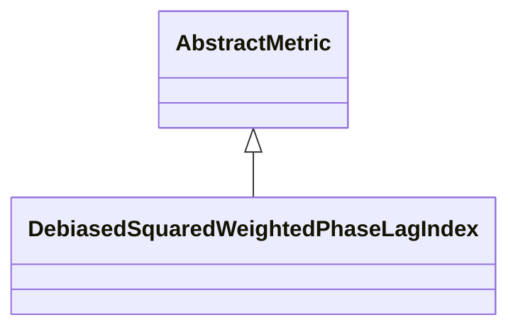

# DebiasedSquaredWeightedPhaseLagIndex

**Namespace:** `CONNECTIVITYLIB` &nbsp;·&nbsp; **Library:** Connectivity Library &nbsp;·&nbsp; **Source:** [`connectivity/metrics/debiasedsquaredweightedphaselagindex.h`](https://github.com/mne-tools/mne-cpp/blob/staging/src/libraries/connectivity/metrics/debiasedsquaredweightedphaselagindex.h)

`#include <connectivity/debiasedsquaredweightedphaselagindex.h>`

```cpp
class CONNECTIVITYLIB::DebiasedSquaredWeightedPhaseLagIndex
```

Computes the debiased squared Weighted Phase Lag Index of Vinck et al.

(NeuroImage 2011) for every channel pair.

The estimator subtracts the analytically known diagonal variance from both numerator and denominator of [`WeightedPhaseLagIndex`](/docs/api/connectivity/weighted-phase-lag-index), producing an estimator whose expectation equals `wPLI^2` even for very small trial counts. It is the preferred PLI-family metric when the number of trials is low and is the volume-conduction-robust counterpart of magnitude-squared coherence.

Debiased squared Weighted Phase Lag Index (Vinck et al. 2011); low-bias volume-conduction-robust estimator.

```cpp title="src/examples/ex_connectivity_metrics/main.cpp"
Network dswpli = DebiasedSquaredWeightedPhaseLagIndex::calculate(settings);
dswpli.setFrequencyRange(8.0f, 12.0f);
```

### Inheritance



---

## Public Methods

### DebiasedSquaredWeightedPhaseLagIndex()

Constructs a [`DebiasedSquaredWeightedPhaseLagIndex`](/docs/api/connectivity/debiased-squared-weighted-phase-lag-index) object.

---

## Static Methods

### calculate(connectivitySettings)

Calculates the debiased squared weighted phase lag index between the rows of the data matrix.

**Parameters:**

- **connectivitySettings** : *[ConnectivitySettings](/docs/api/connectivity/connectivity-settings) &*
  The input data and parameters.

**Returns:**

- *[Network](/docs/api/connectivity/network)* — The connectivity information in form of a network structure.

---

## Example

- Start here: [ex_connectivity_metrics](../../examples/connectivity/ex_connectivity_metrics.mdx) — Connectivity metrics on synthetic data with a known coupling.
- Full source: [`src/examples/ex_connectivity_metrics/main.cpp`](https://github.com/mne-tools/mne-cpp/tree/staging/src/examples/ex_connectivity_metrics/main.cpp)
- Build target: `ex_connectivity_metrics` (runs under CTest)

## Used in examples

### [ex_connectivity_metrics](../../examples/connectivity/ex_connectivity_metrics.mdx)

Connectivity metrics on synthetic data with a known coupling.

````cpp title="src/examples/ex_connectivity_metrics/main.cpp, line 221"
uspli.setFrequencyRange(8.0f, 12.0f);
Network dswpli = DebiasedSquaredWeightedPhaseLagIndex::calculate(settings);
dswpli.setFrequencyRange(8.0f, 12.0f);
Network plv = PhaseLockingValue::calculate(settings);
plv.setFrequencyRange(8.0f, 12.0f);
for (const Network* network : {&pli, &wpli, &uspli, &dswpli, &plv}) {
    const double w01 = edgeWeight(*network, 0, 1);
    const double w02 = edgeWeight(*network, 0, 2);
    ok &= expect(w01 > w02 + 0.3,
````

## Authors of this file

- Daniel Strohmeier &lt;daniel.strohmeier@gmail.com&gt;
- Lorenz Esch &lt;lorenz.esch@tu-ilmenau.de&gt;
- Juan GPC &lt;jgarciaprieto@mgh.harvard.edu&gt;
- Gabriel Motta &lt;gabrielbenmotta@gmail.com&gt;
- Christoph Dinh &lt;christoph.dinh@mne-cpp.org&gt;
