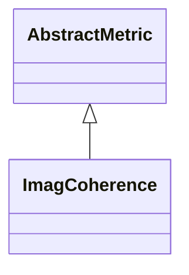

# ImagCoherence

**Namespace:** `CONNECTIVITYLIB` &nbsp;·&nbsp; **Library:** Connectivity Library &nbsp;·&nbsp; **Source:** [`connectivity/metrics/imagcoherence.h`](https://github.com/mne-tools/mne-cpp/blob/staging/src/libraries/connectivity/metrics/imagcoherence.h)

`#include <connectivity/imagcoherence.h>`

```cpp
class CONNECTIVITYLIB::ImagCoherence
```

Computes the imaginary part of complex coherency for every channel pair.

The estimator inherits the volume-conduction rejection property derived by Nolte et al. (NeuroImage, 2004): zero-lag mixing of independent sources contributes only to the real axis and is removed, so the returned edge weights reflect interactions with non-zero conduction delay only. The cross-spectral accumulation is delegated to `Coherency::calculateImag`; this class is the public entry point used by the dispatcher in [`Connectivity`](/docs/api/connectivity/connectivity-class).

Imaginary-coherence estimator (Nolte et al. 2004); rejects zero-lag volume-conduction mixing.

```cpp title="src/examples/ex_connectivity_metrics/main.cpp"
Network imagCoherence = ImagCoherence::calculate(settings);
imagCoherence.setFrequencyRange(8.0f, 12.0f);
const double icoh01 = std::fabs(edgeWeight(imagCoherence, 0, 1));
```

### Inheritance



---

## Public Methods

### ImagCoherence()

Constructs a [`ImagCoherence`](/docs/api/connectivity/imag-coherence) object.

---

## Static Methods

### calculate(connectivitySettings)

Calculates the imaginary coherence between the rows of the data matrix.

**Parameters:**

- **connectivitySettings** : *[ConnectivitySettings](/docs/api/connectivity/connectivity-settings) &*
  The input data and parameters.

**Returns:**

- *[Network](/docs/api/connectivity/network)* — The connectivity information in form of a network structure.

---

## Example

- Start here: [ex_connectivity_metrics](../../examples/connectivity/ex_connectivity_metrics.mdx) — Connectivity metrics on synthetic data with a known coupling.
- Full source: [`src/examples/ex_connectivity_metrics/main.cpp`](https://github.com/mne-tools/mne-cpp/tree/staging/src/examples/ex_connectivity_metrics/main.cpp)
- Build target: `ex_connectivity_metrics` (runs under CTest)

## Used in examples

### [ex_connectivity_metrics](../../examples/connectivity/ex_connectivity_metrics.mdx)

Connectivity metrics on synthetic data with a known coupling.

````cpp title="src/examples/ex_connectivity_metrics/main.cpp, line 190"
Network imagCoherence = ImagCoherence::calculate(settings);
imagCoherence.setFrequencyRange(8.0f, 12.0f);
const double icoh01 = std::fabs(edgeWeight(imagCoherence, 0, 1));
ok &= expect(icoh01 > 0.2, QString("|ImCOH| 0-1 %1 > 0.2 (12 ms lag)").arg(icoh01));
````

## Authors of this file

- Daniel Strohmeier &lt;daniel.strohmeier@gmail.com&gt;
- Lorenz Esch &lt;lorenz.esch@tu-ilmenau.de&gt;
- Juan GPC &lt;jgarciaprieto@mgh.harvard.edu&gt;
- Gabriel Motta &lt;gabrielbenmotta@gmail.com&gt;
- Christoph Dinh &lt;christoph.dinh@mne-cpp.org&gt;
