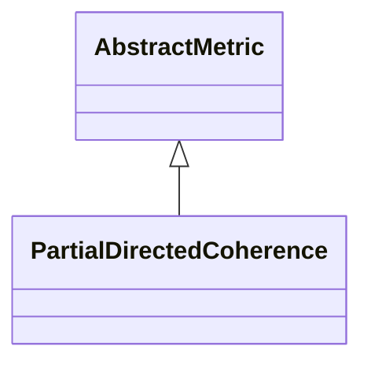

# PartialDirectedCoherence

**Namespace:** `CONNECTIVITYLIB` &nbsp;·&nbsp; **Library:** Connectivity Library &nbsp;·&nbsp; **Source:** [`connectivity/metrics/partial_directed_coherence.h`](https://github.com/mne-tools/mne-cpp/blob/staging/src/libraries/connectivity/metrics/partial_directed_coherence.h)

:::info[Python equivalent]
`mne_connectivity.spectral_connectivity_epochs (method='pdc')` in MNE-Python.
:::

`#include <connectivity/partial_directed_coherence.h>`

```cpp
class CONNECTIVITYLIB::PartialDirectedCoherence
```

Partial Directed [`Coherence`](/docs/api/connectivity/coherence) estimator of Baccala & Sameshima (2001).

Computes `PDC_{ij}`(f) = |A_\{ij\}(f)| / sqrt( sum_k |A_\{kj\}(f)|^2 ) from the MVAR coefficients delivered by [`MvarModel`](/docs/api/connectivity/mvar-model), where `A(f)` is the frequency-domain inverse of the transfer matrix. Unlike [`DirectedTransferFunction`](/docs/api/connectivity/directed-transfer-function) this estimator counts only direct causal paths - relayed interactions `j` -&gt; k -&gt; i contribute 0 - so PDC and DTF together separate direct from indirect flow.

Partial Directed [`Coherence`](/docs/api/connectivity/coherence) estimator (Baccala & Sameshima 2001); directional, direct paths only. 
```cpp title="src/examples/ex_connectivity_metrics/main.cpp"
Network pdc = PartialDirectedCoherence::calculate(settings);
```

### Inheritance



---

## Public Methods

### PartialDirectedCoherence()

Constructs a [`PartialDirectedCoherence`](/docs/api/connectivity/partial-directed-coherence) object.

---

## Static Methods

### calculate(connectivitySettings)

Calculates Partial Directed [`Coherence`](/docs/api/connectivity/coherence) between all channel pairs.

**Parameters:**

- **connectivitySettings** : *[ConnectivitySettings](/docs/api/connectivity/connectivity-settings) &*
  The input data and parameters.

**Returns:**

- *[Network](/docs/api/connectivity/network)* — The connectivity information in form of a network structure.

---

## Example

- Start here: [ex_connectivity_metrics](../../examples/connectivity/ex_connectivity_metrics.mdx) — Connectivity metrics on synthetic data with a known coupling.
- Full source: [`src/examples/ex_connectivity_metrics/main.cpp`](https://github.com/mne-tools/mne-cpp/tree/staging/src/examples/ex_connectivity_metrics/main.cpp)
- Build target: `ex_connectivity_metrics` (runs under CTest)

## Used in examples

### [ex_connectivity_metrics](../../examples/connectivity/ex_connectivity_metrics.mdx)

Connectivity metrics on synthetic data with a known coupling.

````cpp title="src/examples/ex_connectivity_metrics/main.cpp, line 272"
Network dtf = DirectedTransferFunction::calculate(settings);
Network pdc = PartialDirectedCoherence::calculate(settings);
for (const Network* network : {&granger, &dtf, &pdc}) {
    const double forward = edgeWeight(*network, 0, 1);
    const double backward = edgeWeight(*network, 1, 0);
    ok &= expect(forward > 2.0 * backward,
                 QString("%1 0->1 %2 > 2 x 1->0 %3").arg(network->getConnectivityMethod()).arg(forward).arg(backward));
}
````

## Authors of this file

- Christoph Dinh &lt;christoph.dinh@mne-cpp.org&gt;
