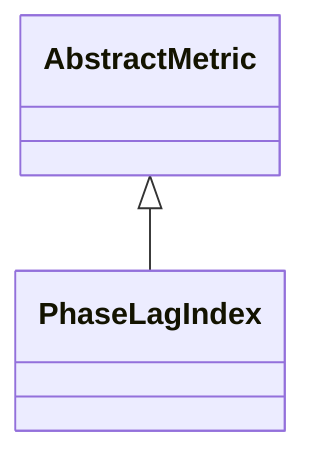

# PhaseLagIndex

**Namespace:** `CONNECTIVITYLIB` &nbsp;·&nbsp; **Library:** Connectivity Library &nbsp;·&nbsp; **Source:** [`connectivity/metrics/phaselagindex.h`](https://github.com/mne-tools/mne-cpp/blob/staging/src/libraries/connectivity/metrics/phaselagindex.h)

:::info[Python equivalent]
`mne_connectivity.spectral_connectivity_epochs (method='pli')` in MNE-Python.
:::

`#include <connectivity/phaselagindex.h>`

<Connections topics={["connectivity"]} context="api" current="PhaseLagIndex" />

```cpp
class CONNECTIVITYLIB::PhaseLagIndex
```

Computes the Phase Lag Index of Stam, Nolte & Daffertshofer (2007).

For every channel pair the estimator averages `sign`(Im(S_\{xy\}(f))) across DPSS-tapered trial spectra and returns the magnitude of that average. Zero-lag mixing (volume conduction, common reference) yields sign = 0 and is rejected; consistently lagged or leading interactions yield magnitudes close to 1. The per-trial accumulation is parallelised over trials via `QtConcurrent` and reduced under a single `QMutex`.

Phase Lag Index estimator (Stam et al. 2007); rejects zero-lag volume-conduction mixing.

```cpp title="src/examples/ex_connectivity_metrics/main.cpp"
Network pli = PhaseLagIndex::calculate(settings);
pli.setFrequencyRange(8.0f, 12.0f);
```

### Inheritance



---

## Public Methods

### PhaseLagIndex()

Constructs a [`PhaseLagIndex`](/docs/api/connectivity/phase-lag-index) object.

---

## Static Methods

### calculate(connectivitySettings)

Calculates the PLI between the rows of the data matrix.

**Parameters:**

- **connectivitySettings** : *[ConnectivitySettings](/docs/api/connectivity/connectivity-settings) &*
  The input data and parameters.

**Returns:**

- *[Network](/docs/api/connectivity/network)* — The connectivity information in form of a network structure.

---

## Example

- Start here: [ex_connectivity_metrics](../../examples/connectivity/ex_connectivity_metrics.mdx) — Connectivity metrics on synthetic data with a known coupling.
- Full source: [`src/examples/ex_connectivity_metrics/main.cpp`](https://github.com/mne-tools/mne-cpp/tree/staging/src/examples/ex_connectivity_metrics/main.cpp)
- Build target: `ex_connectivity_metrics` (runs under CTest)

## Used in examples

### [ex_connectivity_metrics](../../examples/connectivity/ex_connectivity_metrics.mdx)

Connectivity metrics on synthetic data with a known coupling.

````cpp title="src/examples/ex_connectivity_metrics/main.cpp, line 206"
Network pli = PhaseLagIndex::calculate(settings);
pli.setFrequencyRange(8.0f, 12.0f);
Network wpli = WeightedPhaseLagIndex::calculate(settings);
wpli.setFrequencyRange(8.0f, 12.0f);
Network uspli = UnbiasedSquaredPhaseLagIndex::calculate(settings);
uspli.setFrequencyRange(8.0f, 12.0f);
Network dswpli = DebiasedSquaredWeightedPhaseLagIndex::calculate(settings);
dswpli.setFrequencyRange(8.0f, 12.0f);
````

## Authors of this file

- Lorenz Esch &lt;lorenz.esch@tu-ilmenau.de&gt;
- Daniel Strohmeier &lt;daniel.strohmeier@gmail.com&gt;
- Juan GPC &lt;jgarciaprieto@mgh.harvard.edu&gt;
- Gabriel Motta &lt;gabrielbenmotta@gmail.com&gt;
- Christoph Dinh &lt;christoph.dinh@mne-cpp.org&gt;
