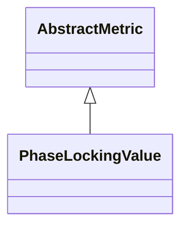

# PhaseLockingValue

**Namespace:** `CONNECTIVITYLIB` &nbsp;·&nbsp; **Library:** Connectivity Library

:::info[Python equivalent]
`mne_connectivity.spectral_connectivity_epochs (method='plv')` in MNE-Python.
:::

`#include <connectivity/phaselockingvalue.h>`

```cpp
class CONNECTIVITYLIB::PhaseLockingValue
```

Computes the Phase Locking Value of Lachaux et al.

(HBM 1999).

Each cross-spectral sample is divided by its magnitude (yielding a unit complex number that encodes only the instantaneous phase difference) and averaged across trials; PLV is the magnitude of that average. Per- trial normalised cross-spectra are accumulated in `ConnectivitySettings::IntermediateSumData` and the resulting edge weights are averaged over the frequency window defined on [`AbstractMetric`](/docs/api/connectivity/abstract-metric).

Phase Locking Value estimator (Lachaux et al. 1999); amplitude-independent phase coupling, sensitive to zero-lag.

```cpp title="src/examples/ex_connectivity_metrics/main.cpp"
Network plv = PhaseLockingValue::calculate(settings);
plv.setFrequencyRange(8.0f, 12.0f);
```

### Inheritance



---

## Public Methods

### PhaseLockingValue()

Constructs a [`PhaseLockingValue`](/docs/api/connectivity/phase-locking-value) object.

---

## Static Methods

### calculate(connectivitySettings)

Calculates the phase locking value between the rows of the data matrix.

**Parameters:**

- **connectivitySettings** : *[ConnectivitySettings](/docs/api/connectivity/connectivity-settings) &*
  The input data and parameters.

**Returns:**

- *[Network](/docs/api/connectivity/network)* — The connectivity information in form of a network structure.

---

## Example

- Full source: [`src/examples/ex_connectivity_metrics/main.cpp`](https://github.com/mne-tools/mne-cpp/tree/staging/src/examples/ex_connectivity_metrics/main.cpp)
- Build target: `ex_connectivity_metrics` (runs under CTest)

## Used in examples

### [ex_connectivity_metrics](../../examples/connectivity/ex_connectivity_metrics.mdx)

Connectivity metrics on synthetic data with a known coupling.

````cpp title="src/examples/ex_connectivity_metrics/main.cpp, line 219"
dswpli.setFrequencyRange(8.0f, 12.0f);
Network plv = PhaseLockingValue::calculate(settings);
plv.setFrequencyRange(8.0f, 12.0f);
for (const Network* network : {&pli, &wpli, &uspli, &dswpli, &plv}) {
    const double w01 = edgeWeight(*network, 0, 1);
    const double w02 = edgeWeight(*network, 0, 2);
    ok &= expect(w01 > w02 + 0.3,
                 QString("%1 0-1 %2 > 0-2 %3 + 0.3").arg(network->getConnectivityMethod()).arg(w01).arg(w02));
}
````

## Authors of this file

- Daniel Strohmeier &lt;daniel.strohmeier@gmail.com&gt;
- Lorenz Esch &lt;lorenz.esch@tu-ilmenau.de&gt;
- Juan GPC &lt;jgarciaprieto@mgh.harvard.edu&gt;
- Gabriel Motta &lt;gabrielbenmotta@gmail.com&gt;
- Christoph Dinh &lt;christoph.dinh@mne-cpp.org&gt;
