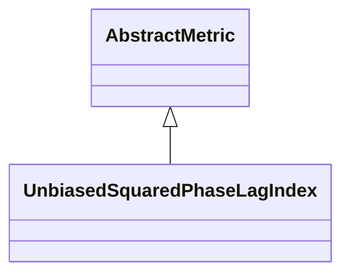

# UnbiasedSquaredPhaseLagIndex

**Namespace:** `CONNECTIVITYLIB` &nbsp;·&nbsp; **Library:** Connectivity Library &nbsp;·&nbsp; **Source:** [`connectivity/metrics/unbiasedsquaredphaselagindex.h`](https://github.com/mne-tools/mne-cpp/blob/staging/src/libraries/connectivity/metrics/unbiasedsquaredphaselagindex.h)

`#include <connectivity/unbiasedsquaredphaselagindex.h>`

```cpp
class CONNECTIVITYLIB::UnbiasedSquaredPhaseLagIndex
```

Computes the unbiased estimator of squared PLI for every channel pair.

The estimator subtracts the analytically known diagonal contribution from the squared sum of cross-spectral sign samples, yielding an estimate whose expectation equals `PLI^2` for any trial count `N` &gt;= 2 and is therefore free of the upward small-sample bias that affects the plain [`PhaseLagIndex`](/docs/api/connectivity/phase-lag-index). The construction preserves the zero-lag rejection property of the PLI family.

Unbiased squared Phase Lag Index estimator; removes the small-sample bias of [`PhaseLagIndex`](/docs/api/connectivity/phase-lag-index).

```cpp title="src/examples/ex_connectivity_metrics/main.cpp"
Network uspli = UnbiasedSquaredPhaseLagIndex::calculate(settings);
uspli.setFrequencyRange(8.0f, 12.0f);
```

### Inheritance



---

## Public Methods

### UnbiasedSquaredPhaseLagIndex()

Constructs a [`UnbiasedSquaredPhaseLagIndex`](/docs/api/connectivity/unbiased-squared-phase-lag-index) object.

---

## Static Methods

### calculate(connectivitySettings)

Calculates the USPLI between the rows of the data matrix.

**Parameters:**

- **connectivitySettings** : *[ConnectivitySettings](/docs/api/connectivity/connectivity-settings) &*
  The input data and parameters.

**Returns:**

- *[Network](/docs/api/connectivity/network)* — The connectivity information in form of a network structure.

---

## Example

- Start here: [ex_connectivity_metrics](../../examples/connectivity/ex_connectivity_metrics.mdx) — Connectivity metrics on synthetic data with a known coupling.
- Full source: [`src/examples/ex_connectivity_metrics/main.cpp`](https://github.com/mne-tools/mne-cpp/tree/staging/src/examples/ex_connectivity_metrics/main.cpp)
- Build target: `ex_connectivity_metrics` (runs under CTest)

## Used in examples

### [ex_connectivity_metrics](../../examples/connectivity/ex_connectivity_metrics.mdx)

Connectivity metrics on synthetic data with a known coupling.

````cpp title="src/examples/ex_connectivity_metrics/main.cpp, line 217"
wpli.setFrequencyRange(8.0f, 12.0f);
Network uspli = UnbiasedSquaredPhaseLagIndex::calculate(settings);
uspli.setFrequencyRange(8.0f, 12.0f);
Network dswpli = DebiasedSquaredWeightedPhaseLagIndex::calculate(settings);
dswpli.setFrequencyRange(8.0f, 12.0f);
Network plv = PhaseLockingValue::calculate(settings);
plv.setFrequencyRange(8.0f, 12.0f);
````

## Authors of this file

- Daniel Strohmeier &lt;daniel.strohmeier@gmail.com&gt;
- Lorenz Esch &lt;lorenz.esch@tu-ilmenau.de&gt;
- Juan GPC &lt;jgarciaprieto@mgh.harvard.edu&gt;
- Gabriel Motta &lt;gabrielbenmotta@gmail.com&gt;
- Christoph Dinh &lt;christoph.dinh@mne-cpp.org&gt;
