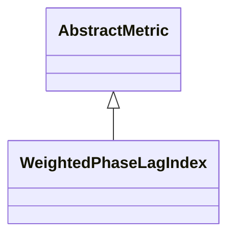

# WeightedPhaseLagIndex

**Namespace:** `CONNECTIVITYLIB` &nbsp;·&nbsp; **Library:** Connectivity Library &nbsp;·&nbsp; **Source:** [`connectivity/metrics/weightedphaselagindex.h`](https://github.com/mne-tools/mne-cpp/blob/staging/src/libraries/connectivity/metrics/weightedphaselagindex.h)

`#include <connectivity/weightedphaselagindex.h>`

```cpp
class CONNECTIVITYLIB::WeightedPhaseLagIndex
```

Computes the Weighted Phase Lag Index of Vinck et al.

(NeuroImage 2011).

Each channel pair is reduced to `|sum` Im(S_\{xy\})| / sum |Im(S_\{xy\})|, weighting every cross-spectrum sample by the magnitude of its imaginary part. This down-weights near-zero-lag samples that dominate the bias of the plain [`PhaseLagIndex`](/docs/api/connectivity/phase-lag-index) and yields higher detection power for true delayed interactions while preserving the volume-conduction rejection property. Per-trial sums are accumulated in `ConnectivitySettings::IntermediateSumData` and shared with [`DebiasedSquaredWeightedPhaseLagIndex`](/docs/api/connectivity/debiased-squared-weighted-phase-lag-index) when both metrics are requested in one batch.

Weighted Phase Lag Index estimator (Vinck et al. 2011); volume-conduction-robust with lower bias than PLI.

```cpp title="src/examples/ex_connectivity_metrics/main.cpp"
Network wpli = WeightedPhaseLagIndex::calculate(settings);
wpli.setFrequencyRange(8.0f, 12.0f);
```

### Inheritance



---

## Public Methods

### WeightedPhaseLagIndex()

Constructs a [`WeightedPhaseLagIndex`](/docs/api/connectivity/weighted-phase-lag-index) object.

---

## Static Methods

### calculate(connectivitySettings)

Calculates the WPLI between the rows of the data matrix.

**Parameters:**

- **connectivitySettings** : *[ConnectivitySettings](/docs/api/connectivity/connectivity-settings) &*
  The input data and parameters.

**Returns:**

- *[Network](/docs/api/connectivity/network)* — The connectivity information in form of a network structure.

---

## Example

- Start here: [ex_connectivity_metrics](../../examples/connectivity/ex_connectivity_metrics.mdx) — Connectivity metrics on synthetic data with a known coupling.
- Full source: [`src/examples/ex_connectivity_metrics/main.cpp`](https://github.com/mne-tools/mne-cpp/tree/staging/src/examples/ex_connectivity_metrics/main.cpp)
- Build target: `ex_connectivity_metrics` (runs under CTest)

## Used in examples

### [ex_connectivity_metrics](../../examples/connectivity/ex_connectivity_metrics.mdx)

Connectivity metrics on synthetic data with a known coupling.

````cpp title="src/examples/ex_connectivity_metrics/main.cpp, line 207"
pli.setFrequencyRange(8.0f, 12.0f);
Network wpli = WeightedPhaseLagIndex::calculate(settings);
wpli.setFrequencyRange(8.0f, 12.0f);
Network uspli = UnbiasedSquaredPhaseLagIndex::calculate(settings);
uspli.setFrequencyRange(8.0f, 12.0f);
Network dswpli = DebiasedSquaredWeightedPhaseLagIndex::calculate(settings);
dswpli.setFrequencyRange(8.0f, 12.0f);
````

## Authors of this file

- Daniel Strohmeier &lt;daniel.strohmeier@gmail.com&gt;
- Lorenz Esch &lt;lorenz.esch@tu-ilmenau.de&gt;
- Juan GPC &lt;jgarciaprieto@mgh.harvard.edu&gt;
- Gabriel Motta &lt;gabrielbenmotta@gmail.com&gt;
- Christoph Dinh &lt;christoph.dinh@mne-cpp.org&gt;
