# AbstractView

**Namespace:** `DISPLIB` &nbsp;·&nbsp; **Library:** Display Library &nbsp;·&nbsp; **Source:** [`disp/viewers/abstractview.h`](https://github.com/mne-tools/mne-cpp/blob/staging/src/libraries/disp/viewers/abstractview.h)

`#include <disp/abstractview.h>`

```cpp
class DISPLIB::AbstractView
```

Base widget for every dockable settings panel in `DISPLIB`; centralises GUI / processing mode and settings persistence.

Subclasses override `updateGuiMode`, `updateProcessingMode` and `saveSettings` / `loadSettings` to react to mode changes and to round-trip their state through `QSettings`. The class deliberately exposes no domain-specific API.

### Inheritance

```mermaid
classDiagram
    QWidget <|-- AbstractView
    AbstractView <|-- ApplyToView
    click ApplyToView href "../../disp/apply-to-view/"
    AbstractView <|-- ArtifactSettingsView
    click ArtifactSettingsView href "../../disp/artifact-settings-view/"
    AbstractView <|-- AverageLayoutView
    click AverageLayoutView href "../../disp/average-layout-view/"
    AbstractView <|-- AverageSelectionView
    click AverageSelectionView href "../../disp/average-selection-view/"
    AbstractView <|-- AveragingSettingsView
    click AveragingSettingsView href "../../disp/averaging-settings-view/"
    AbstractView <|-- BidsView
    click BidsView href "../../disp/bids-view/"
    AbstractView <|-- ChannelDataView
    click ChannelDataView href "../../disp/channel-data-view/"
    AbstractView <|-- ChannelSelectionView
    click ChannelSelectionView href "../../disp/channel-selection-view/"
    AbstractView <|-- CompensatorView
    click CompensatorView href "../../disp/compensator-view/"
    AbstractView <|-- ConnectivitySettingsView
    click ConnectivitySettingsView href "../../disp/connectivity-settings-view/"
    AbstractView <|-- Control3DView
    click Control3DView href "../../disp/control3-d-view/"
    AbstractView <|-- CoregSettingsView
    click CoregSettingsView href "../../disp/coreg-settings-view/"
    AbstractView <|-- CovarianceSettingsView
    click CovarianceSettingsView href "../../disp/covariance-settings-view/"
    AbstractView <|-- DipoleFitView
    click DipoleFitView href "../../disp/dipole-fit-view/"
    AbstractView <|-- FiffRawViewSettings
    click FiffRawViewSettings href "../../disp/fiff-raw-view-settings/"
    AbstractView <|-- FilterDesignView
    click FilterDesignView href "../../disp/filter-design-view/"
    AbstractView <|-- FilterSettingsView
    click FilterSettingsView href "../../disp/filter-settings-view/"
    AbstractView <|-- FwdSettingsView
    click FwdSettingsView href "../../disp/fwd-settings-view/"
    AbstractView <|-- HpiSettingsView
    click HpiSettingsView href "../../disp/hpi-settings-view/"
    AbstractView <|-- MinimumNormSettingsView
    click MinimumNormSettingsView href "../../disp/minimum-norm-settings-view/"
    AbstractView <|-- ModalitySelectionView
    click ModalitySelectionView href "../../disp/modality-selection-view/"
    AbstractView <|-- ProgressView
    click ProgressView href "../../disp/progress-view/"
    AbstractView <|-- ProjectSettingsView
    click ProjectSettingsView href "../../disp/project-settings-view/"
    AbstractView <|-- ProjectorsView
    click ProjectorsView href "../../disp/projectors-view/"
    AbstractView <|-- RtFiffRawView
    click RtFiffRawView href "../../disp/rt-fiff-raw-view/"
    AbstractView <|-- ScalingView
    click ScalingView href "../../disp/scaling-view/"
    AbstractView <|-- SpectrumSettingsView
    click SpectrumSettingsView href "../../disp/spectrum-settings-view/"
    AbstractView <|-- SpectrumView
    click SpectrumView href "../../disp/spectrum-view/"
    AbstractView <|-- SpharaSettingsView
    click SpharaSettingsView href "../../disp/sphara-settings-view/"
    AbstractView <|-- TfSettingsView
    click TfSettingsView href "../../disp/tf-settings-view/"
    AbstractView <|-- TriggerDetectionView
    click TriggerDetectionView href "../../disp/trigger-detection-view/"
```



---

## Public Methods

### AbstractView(parent, f)

Constructs a [`AbstractView`](/docs/api/disp/abstract-view) which is a child of parent.

**Parameters:**

- **parent** : *QWidget **
  parent of widget.

- **f** : *Qt::WindowFlags*
  Qt window flags passed to the QWidget constructor.

---

### setGuiMode(mode)

Sets the GUI of this view to a specific mode.

Clinical = 0, Research = 0.

**Parameters:**

- **mode** : *GuiMode*
  The new mode.

---

### setProcessingMode(mode)

Sets the GUI of this view to a specific mode.

RealTime = 0, Offline = 0.

**Parameters:**

- **mode** : *ProcessingMode*
  The new mode.

---

### saveSettings()

Saves all important settings of this view via QSettings.

---

### loadSettings()

Loads and inits all important settings of this view via QSettings.

---

### updateGuiMode(mode)

Update the views GUI based on the set GuiMode (Clinical=0, Research=1).

**Parameters:**

- **mode** : *GuiMode*
  The new mode (Clinical=0, Research=1).

---

### updateProcessingMode(mode)

Update the views GUI based on the set ProcessingMode (RealTime=0, Offline=1).

**Parameters:**

- **mode** : *ProcessingMode*
  The new mode (RealTime=0, Offline=1).

---

### clearView()

Clears the view.

---

## Authors of this file

- Lorenz Esch &lt;lorenz.esch@tu-ilmenau.de&gt;
- Gabriel Motta &lt;gabrielbenmotta@gmail.com&gt;
- Juan GPC &lt;jgarciaprieto@mgh.harvard.edu&gt;
- Christoph Dinh &lt;christoph.dinh@mne-cpp.org&gt;
