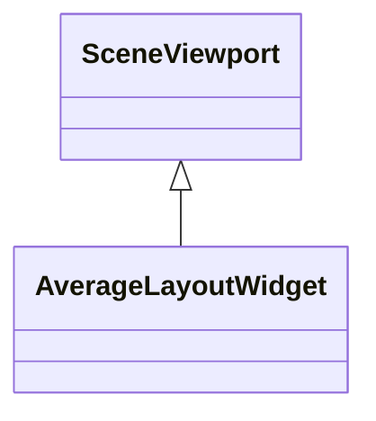

# AverageLayoutWidget

**Namespace:** `mne::disp` &nbsp;·&nbsp; **Library:** Display Library &nbsp;·&nbsp; **Source:** [`disp_widgets/viewers/helpers/averagelayoutwidget.h`](https://github.com/mne-tools/mne-cpp/blob/staging/src/libs/mne/disp_widgets/viewers/helpers/averagelayoutwidget.h)

`#include <mne/disp/averagelayoutwidget.h>`

```cpp
class mne::disp::AverageLayoutWidget
```

Evoked responses, one tile per channel at its layout position, as MNE-Python's plot_evoked_topo.

The widget shows views of data it does not own: each average of a channel points into a column-major evoked matrix that must outlive the next repaint. Pressing a tile enlarges its name until the button is released.

### Inheritance



---

## Public Methods

### AverageLayoutWidget(parent)

Constructs an empty layout.

**Parameters:**

- **parent** : *QWidget **
  Parent widget.

---

### setChannels(channels)

Sets the channels and refits the view if it is kept fitted.

**Parameters:**

- **channels** : *std::vector&lt; Channel &gt;*
  The channels.

---

### channels()

**Returns:**

- *const std::vector&lt; Channel &gt; &* — The channels.

---

### channels()

Gives access to the channels to change their data; call update() afterwards.

**Returns:**

- *std::vector&lt; Channel &gt; &* — The channels.

---

### setScaleMap(scaleMap)

**Parameters:**

- **scaleMap** : *const std::map&lt; int, float &gt; &*
  Value at the top edge of a tile, by channel kind or unit.

---

### setAverageActivation(activation)

**Parameters:**

- **activation** : *const std::map&lt; std::string, bool &gt; &*
  Whether each average, by comment, is drawn; averages missing here are.

---

### setAverageColors(colors)

**Parameters:**

- **colors** : *const std::map&lt; std::string, QColor &gt; &*
  Colour of each average, by comment; averages missing here take the signal colour.

---

### setSignalColor(color)

**Parameters:**

- **color** : *const QColor &*
  Colour of averages without their own colour.

---

### signalColor()

**Returns:**

- *QColor* — The colour of averages without their own colour.

---

### averageLayout()

**Returns:**

- *[AverageLayout](/docs/api/scene/average-layout)* — The tiles as they are drawn.

---

## Static Methods

### channelsFrom(selection)

**Parameters:**

- **selection** : *const [SelectionItem](/docs/api/disp/selection-item) &*
  Channels with names, numbers, kinds, units and positions.

**Returns:**

- *std::vector&lt; Channel &gt;* — One channel per entry of `selection`, without averages.

---

## Example

No example of its own: The tile view inside AverageLayoutView and mne_browse; it shows evoked data owned by a model, exercised by test_disp_viewers2.

## Authors of this file

- Christoph Dinh &lt;christoph.dinh@mne-cpp.org&gt;
