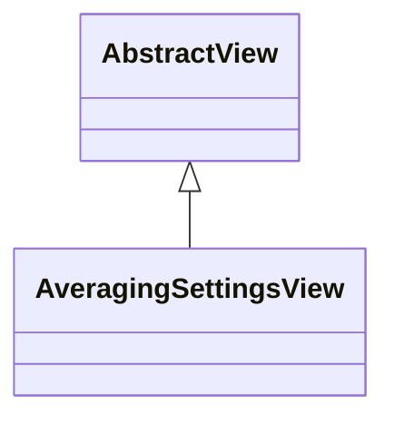

# AveragingSettingsView

**Namespace:** `mne::disp` &nbsp;·&nbsp; **Library:** Display Library &nbsp;·&nbsp; **Source:** [`disp/viewers/averagingsettingsview.h`](https://github.com/mne-tools/mne-cpp/blob/staging/src/libs/mne/disp/viewers/averagingsettingsview.h)

`#include <mne/disp/averagingsettingsview.h>`

```cpp
class mne::disp::AveragingSettingsView
```

Settings panel driving the on-line / off-line averaging engine.

Holds stim-channel and trigger-type pickers, pre / post-stimulus spinboxes (ms), baseline-correction toggles and an embedded [`ArtifactSettingsView`](/docs/api/disp/artifact-settings-view). Parameter edits are forwarded as Qt signals to the `rtprocessing` averaging job.

### Inheritance



---

## Public Methods

### AveragingSettingsView(sSettingsPath, mapStimChsIndexNames, parent)

---

### ~AveragingSettingsView()

Destroys the [`AveragingSettingsView`](/docs/api/disp/averaging-settings-view).

---

### setStimChannels(mapStimChsIndexNames)

---

### getCurrentStimCh()

---

### getDoBaselineCorrection()

---

### getNumAverages()

---

### getBaselineFromSeconds()

---

### getBaselineToSeconds()

---

### getStimChannelIdx()

---

### getPreStimMSeconds()

---

### getPostStimMSeconds()

---

### getCurrentSelectGroup()

---

### setDetectedEpochs(evokedSet)

---

### getAutoComputeStatus()

---

### clearSelectionGroup()

---

### saveSettings()

Saves all important settings of this view via QSettings.

---

### loadSettings()

Loads and inits all important settings of this view via QSettings.

---

### updateGuiMode(mode)

Update the views GUI based on the set GuiMode (Clinical=0, Research=1).

**Parameters:**

- **mode** : *GuiMode*
  The new mode (Clinical=0, Research=1).

---

### updateProcessingMode(mode)

Update the views GUI based on the set ProcessingMode (RealTime=0, Offline=1).

**Parameters:**

- **mode** : *ProcessingMode*
  The new mode (RealTime=0, Offline=1).

---

### clearView()

Clears the view.

---

## Authors of this file

- Christoph Dinh &lt;christoph.dinh@mne-cpp.org&gt;
- Lorenz Esch &lt;lorenz.esch@tu-ilmenau.de&gt;
- Matti Hamalainen &lt;msh@nmr.mgh.harvard.edu&gt;
- Gabriel Motta &lt;gabrielbenmotta@gmail.com&gt;
- Juan GPC &lt;jgarciaprieto@mgh.harvard.edu&gt;
