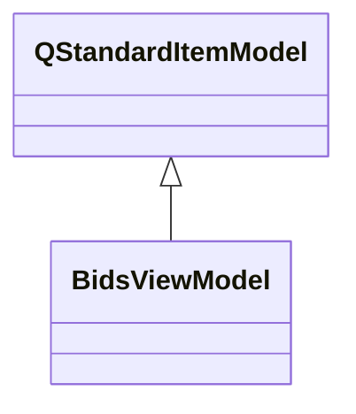

# BidsViewModel

**Namespace:** `mne::disp` &nbsp;·&nbsp; **Library:** Display Library &nbsp;·&nbsp; **Source:** [`disp/viewers/helpers/bidsviewmodel.h`](https://github.com/mne-tools/mne-cpp/blob/staging/src/libs/mne/disp/viewers/helpers/bidsviewmodel.h)

`#include <mne/disp/bidsviewmodel.h>`

```cpp
class mne::disp::BidsViewModel
```

QStandardItemModel mirroring the BIDS dataset hierarchy (subjects / sessions / runs / derivatives).

Rebuilds itself from a top-level dataset path; item roles carry the absolute path, BIDS entity type and loadable-by-this-app flag so the host [`BidsView`](/docs/api/disp/bids-view) can dispatch double-clicks without re-walking the file system.

### Inheritance



---

## Public Methods

### BidsViewModel(pParent)

Constructs the Analyze Data Model.

**Parameters:**

- **pParent** : *QObject **
  Parent QObject (default nullptr).

---

### ~BidsViewModel()

Destroys the Analyze Data Model.

---

## Authors of this file

- Lorenz Esch &lt;lorenz.esch@tu-ilmenau.de&gt;
- Gabriel Motta &lt;gabrielbenmotta@gmail.com&gt;
- Juan GPC &lt;jgarciaprieto@mgh.harvard.edu&gt;
- Christoph Dinh &lt;christoph.dinh@mne-cpp.org&gt;
