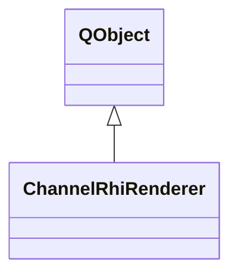

# ChannelRhiRenderer

**Namespace:** `mne::disp` &nbsp;·&nbsp; **Library:** Display Library &nbsp;·&nbsp; **Source:** [`disp/viewers/helpers/channelrhirenderer.h`](https://github.com/mne-tools/mne-cpp/blob/staging/src/libs/mne/disp/viewers/helpers/channelrhirenderer.h)

`#include <mne/disp/channelrhirenderer.h>`

```cpp
class mne::disp::ChannelRhiRenderer
```

Widgets-free QRhi renderer and input handler of the raw-data channel trace view.

Draws the channel traces, the per-second bands and grid, events, annotations and epoch markers, and, as a textured alpha-blended quad on top, the crosshair, scalebars, ruler and annotation-selection overlay. Mouse and wheel events of the host are handled by the handle*() functions.

### Inheritance



---

## Public Methods

### ChannelRhiRenderer(host, parent)

Constructs the renderer.

**Parameters:**

- **host** : *[ChannelRhiHost](/docs/api/disp/channel-rhi-host) **
  Host surface services; not owned, may be nullptr (then the view size is empty).

- **parent** : *QObject **
  Optional QObject parent.

---

### ~ChannelRhiRenderer()

Destroys the renderer and its GPU resources.

Call `releaseResources()` before the QRhi goes away.

---

### setHost(host)

Sets the host surface services.

**Parameters:**

- **host** : *[ChannelRhiHost](/docs/api/disp/channel-rhi-host) **
  Host; not owned, may be nullptr.

---

### host()

Returns the host surface services.

**Returns:**

- *[ChannelRhiHost](/docs/api/disp/channel-rhi-host) ** — The host or nullptr.

---

### initializeResources()

Marks all GPU resources for (re)creation, e.g.

after the host obtained a new QRhi.

---

### releaseResources()

Releases all GPU resources.

Must be called before the QRhi that created them is destroyed.

---

### renderFrame(rhi, target, cb)

Records one frame (traces, bands/events/annotations overlay and the crosshair/scalebar/ruler overlay) into `target`.

**Parameters:**

- **rhi** : *QRhi **
  The QRhi that owns `target` and the renderer's GPU resources.

- **target** : *QRhiRenderTarget **
  Render target sized like the host's logical size times its device pixel ratio.

- **cb** : *QRhiCommandBuffer **
  Command buffer of the current frame.

---

### hudVisible()

Returns whether the crosshair, scalebar, ruler or annotation-selection overlay is currently shown, i.e.

whether `renderFrame()` draws the overlay quad.

**Returns:**

- *bool* — True if the overlay quad is drawn.

---

### paintHud(painter)

Paints the crosshair, scalebars, ruler and annotation-selection overlay in logical coordinates.

**Parameters:**

- **painter** : *QPainter &*
  Painter on a device of the host's logical size.

---

### hudImage()

Returns the overlay image (crosshair, scalebars, ruler, annotation selection) uploaded by the last `renderFrame()` that drew the overlay quad.

**Returns:**

- *const QImage &* — The overlay image (premultiplied alpha is not used), or a null image.

---

### handleWheel(event)

Handles a wheel event: Ctrl zooms, horizontal swipes scroll time, the vertical wheel scrolls channels or time.

**Parameters:**

- **event** : *QWheelEvent **
  The wheel event in host coordinates.

**Returns:**

- *bool* — True if the event was handled.

---

### handleMousePress(event)

Handles a mouse press (ruler, annotation selection, panning, annotation boundary drag, clicks).

**Parameters:**

- **event** : *QMouseEvent **
  The mouse event in host coordinates.

**Returns:**

- *bool* — True if the event was handled; otherwise the host passes it to its base class.

---

### handleMouseMove(event)

Handles a mouse move (drags, ruler, crosshair tracking, annotation boundary hover).

**Parameters:**

- **event** : *QMouseEvent **
  The mouse event in host coordinates.

**Returns:**

- *bool* — True if the event was handled; otherwise the host passes it to its base class.

---

### handleMouseRelease(event)

Handles a mouse release (ends drags, emits clicks and selections, starts inertial scrolling).

**Parameters:**

- **event** : *QMouseEvent **
  The mouse event in host coordinates.

**Returns:**

- *bool* — True if the event was handled; otherwise the host passes it to its base class.

---

### handleMouseDoubleClick(event)

Handles a double click: toggles the bad state of the channel under the cursor.

**Parameters:**

- **event** : *QMouseEvent **
  The mouse event in host coordinates.

**Returns:**

- *bool* — True if the event was handled; otherwise the host passes it to its base class.

---

### handleResize()

Must be called by the host after its surface was resized; emits `viewResized()`.

---

### setModel(model)

Attach the data model.

The renderer does NOT take ownership.

**Parameters:**

- **model** : *[ChannelDataModel](/docs/api/disp/channel-data-model) **
  The channel data model to render.

---

### model()

Returns the attached data model.

**Returns:**

- *[ChannelDataModel](/docs/api/disp/channel-data-model) ** — The model or nullptr.

---

### setEvents(events)

Set the list of stimulus / event markers to overlay on the traces.

**Parameters:**

- **events** : *const std::vector&lt; EventMarker &gt; &*
  List of `EventMarker` objects; empty to clear.

---

### setEpochMarkers(triggerSamples)

Set the epoch trigger samples drawn as dashed vertical lines.

**Parameters:**

- **triggerSamples** : *const std::vector&lt; int &gt; &*
  Absolute trigger sample indices.

---

### setEpochMarkersVisible(visible)

Show or hide the epoch trigger markers.

**Parameters:**

- **visible** : *bool*
  True to draw them.

---

### epochMarkersVisible()

Returns whether the epoch trigger markers are drawn.

**Returns:**

- *bool* — True if visible.

---

### setClippingVisible(visible)

Show or hide the red highlight of clipped trace segments.

**Parameters:**

- **visible** : *bool*
  True to highlight clipping.

---

### clippingVisible()

Returns whether clipped segments are highlighted.

**Returns:**

- *bool* — True if highlighted.

---

### setZScoreMode(enabled)

Toggle z-score display: every trace is normalised to (y - mean) / std over the loaded window.

**Parameters:**

- **enabled** : *bool*
  True to enable z-score mode.

---

### zScoreMode()

Returns whether z-score mode is on.

**Returns:**

- *bool* — True if enabled.

---

### setAnnotations(annotations)

Set the list of time-span annotations to overlay on the traces.

**Parameters:**

- **annotations** : *const std::vector&lt; AnnotationSpan &gt; &*
  List of `AnnotationSpan` objects.

---

### setAnnotationSelectionEnabled(enabled)

Enable or disable annotation range selection (right-drag) and boundary dragging.

**Parameters:**

- **enabled** : *bool*
  True to enable annotation editing.

---

### setEventsVisible(visible)

Show or hide the event markers.

**Parameters:**

- **visible** : *bool*
  True to draw them.

---

### eventsVisible()

Returns whether event markers are drawn.

**Returns:**

- *bool* — True if visible.

---

### setAnnotationsVisible(visible)

Show or hide the annotation spans.

**Parameters:**

- **visible** : *bool*
  True to draw them.

---

### annotationsVisible()

Returns whether annotation spans are drawn.

**Returns:**

- *bool* — True if visible.

---

### scrollSample()

Returns the absolute sample at the left edge.

**Returns:**

- *float* — The scroll position in samples.

---

### samplesPerPixel()

Returns the horizontal zoom.

**Returns:**

- *float* — Samples per logical pixel.

---

### setScrollSample(sample)

Set the left-edge scroll position (clamped to the file bounds).

**Parameters:**

- **sample** : *float*
  Absolute sample index for the left viewport edge.

---

### setSamplesPerPixel(spp)

Set the horizontal zoom (samples per screen pixel).

**Parameters:**

- **spp** : *float*
  Samples per pixel (&gt; 1 = zoomed out, &lt; 1 = zoomed in).

---

### scrollTo(targetSample, durationMs)

Smoothly animate the scroll position.

**Parameters:**

- **targetSample** : *float*
  Target left-edge sample index.

- **durationMs** : *int*
  Animation duration in milliseconds (0 = instant).

---

### scrollBy(deltaSamples, durationMs)

Smoothly scroll by a number of samples; steps during a running animation add up.

**Parameters:**

- **deltaSamples** : *float*
  Samples to scroll (negative = earlier).

- **durationMs** : *int*
  Animation duration in milliseconds (0 = instant).

---

### zoomTo(targetSpp, durationMs)

Smoothly animate the zoom level.

**Parameters:**

- **targetSpp** : *float*
  Target samples-per-pixel.

- **durationMs** : *int*
  Animation duration in milliseconds (0 = instant).

---

### setBackgroundColor(color)

Background colour of the render surface.

**Parameters:**

- **color** : *const QColor &*
  The new background colour.

---

### backgroundColor()

Returns the background colour.

**Returns:**

- *QColor* — The background colour.

---

### setPrefetchFactor(factor)

How many visible windows to prefetch on each side of the viewport.

Default = 1.0.

**Parameters:**

- **factor** : *float*
  Prefetch factor.

---

### visibleFirstSample()

Returns the absolute sample index shown at the left edge.

**Returns:**

- *int* — scrollSample() truncated to int.

---

### visibleSampleCount()

Returns the number of samples currently visible.

**Returns:**

- *int* — Logical width times samples per pixel, truncated to int.

---

### setChannelIndices(indices)

Restrict rendering to a subset of channel indices; empty shows all channels.

**Parameters:**

- **indices** : *const std::vector&lt; int &gt; &*
  Ordered list of model channel indices to display.

---

### totalLogicalChannels()

Total number of logical channels available for scrolling (respects filter and bad hiding).

**Returns:**

- *int* — Number of logical channels.

---

### setFirstVisibleChannel(ch)

Set the index of the first visible channel row.

**Parameters:**

- **ch** : *int*
  Zero-based logical channel index.

---

### firstVisibleChannel()

Returns the first visible logical channel row.

**Returns:**

- *int* — Zero-based logical channel index.

---

### setVisibleChannelCount(count)

Set how many channel rows are displayed simultaneously.

**Parameters:**

- **count** : *int*
  Number of rows (at least 1).

---

### visibleChannelCount()

Returns the number of displayed channel rows.

**Returns:**

- *int* — Row count.

---

### setFrozen(frozen)

Freeze or unfreeze drag-panning (mouse drag and inertia).

**Parameters:**

- **frozen** : *bool*
  True to disable drag-panning.

---

### isFrozen()

Returns whether drag-panning is frozen.

**Returns:**

- *bool* — True if frozen.

---

### setGridVisible(visible)

Show or hide the time grid and alternating per-second bands.

**Parameters:**

- **visible** : *bool*
  True to draw the grid.

---

### gridVisible()

Returns whether the grid is drawn.

**Returns:**

- *bool* — True if visible.

---

### setSfreq(sfreq)

Set the sampling frequency (Hz) used for time labels, bands and grid.

**Parameters:**

- **sfreq** : *float*
  Sampling frequency in Hz.

---

### setFirstFileSample(first)

Set the absolute sample index of the first sample in the file.

**Parameters:**

- **first** : *int*
  Absolute sample index of the file's first sample.

---

### setLastFileSample(last)

Set the absolute sample index of the last sample in the file (-1 = unlimited).

**Parameters:**

- **last** : *int*
  Absolute sample index of the file's last sample.

---

### lastFileSample()

Returns the last file sample used to clamp scrolling.

**Returns:**

- *int* — Absolute sample index or -1.

---

### setWheelScrollsChannels(channelsMode)

Control whether the vertical mouse wheel scrolls channels (true) or time (false).

**Parameters:**

- **channelsMode** : *bool*
  true = vertical wheel → channels.

---

### wheelScrollsChannels()

Returns whether the vertical wheel scrolls channels.

**Returns:**

- *bool* — True for channel scrolling.

---

### setScrollSpeedFactor(factor)

Set the multiplier for wheel scrolling (clamped to 0.25–4).

**Parameters:**

- **factor** : *float*
  Scroll speed factor.

---

### scrollSpeedFactor()

Returns the wheel scroll multiplier.

**Returns:**

- *float* — Scroll speed factor.

---

### setHideBadChannels(hide)

Remove bad channels from the logical channel list (true) or show them (false).

**Parameters:**

- **hide** : *bool*
  True to hide bad channels.

---

### hideBadChannels()

Returns whether bad channels are hidden.

**Returns:**

- *bool* — True if hidden.

---

### setCrosshairEnabled(enabled)

Enable or disable the crosshair cursor; while enabled, mouse moves emit `cursorDataChanged()`.

**Parameters:**

- **enabled** : *bool*
  True to show the crosshair.

---

### crosshairEnabled()

Returns whether the crosshair is enabled.

**Returns:**

- *bool* — True if enabled.

---

### setClockTimeFormat(useClock)

Set whether the crosshair label uses clock time (mm:ss.ms) or seconds.

**Parameters:**

- **useClock** : *bool*
  True for clock time, false for float seconds.

---

### clockTimeFormat()

Returns whether the crosshair label uses clock time.

**Returns:**

- *bool* — True for clock time.

---

### renderToImage(size)

Render the current view into an image with QPainter, without the GPU.

**Parameters:**

- **size** : *const QSize &*
  Output size in pixels; an invalid size uses the host's logical size.

**Returns:**

- *QImage* — The rendered image, or a null image if there is no model or the size is empty.

---

### setScalebarsVisible(visible)

Show or hide per-channel-type scalebars in the bottom-right corner.

**Parameters:**

- **visible** : *bool*
  True to draw the scalebars.

---

### scalebarsVisible()

Returns whether scalebars are drawn.

**Returns:**

- *bool* — True if visible.

---

### setButterflyMode(enabled)

Toggle butterfly mode: all channels of the same type are overlaid in a single lane.

**Parameters:**

- **enabled** : *bool*
  True to enable butterfly mode.

---

### butterflyMode()

Returns whether butterfly mode is on.

**Returns:**

- *bool* — True if enabled.

---

## Example

No example of its own: Rendering core used through the ChannelRhiView and ChannelWindow hosts rather than on its own.

## Authors of this file

- Christoph Dinh &lt;christoph.dinh@mne-cpp.org&gt;
