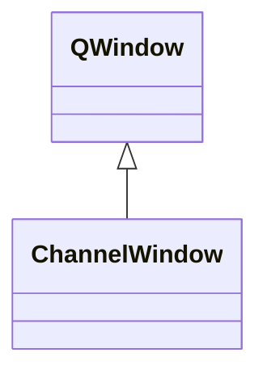

# ChannelWindow

**Namespace:** `mne::disp` &nbsp;·&nbsp; **Library:** Display Library &nbsp;·&nbsp; **Source:** [`disp/viewers/helpers/channelwindow.h`](https://github.com/mne-tools/mne-cpp/blob/staging/src/libs/mne/disp/viewers/helpers/channelwindow.h)

`#include <mne/disp/channelwindow.h>`

```cpp
class mne::disp::ChannelWindow
```

Widgets-free QWindow host of the GPU raw-data channel trace view.

The view state and API live in `renderer()`; the window re-emits the renderer's signals. Embed it in a widget layout with `createWindowContainer()` of Qt Widgets.

### Inheritance



---

## Public Methods

### ChannelWindow(api, parent)

Constructs the window.

**Parameters:**

- **api** : *Api*
  Graphics API of the QRhi created on first expose.

- **parent** : *QWindow **
  Optional parent window.

---

### ~ChannelWindow()

Releases the renderer's GPU resources, the swap chain and the QRhi.

---

### setApi(api)

Selects the graphics API.

Only effective before the window is created (shown) for the first time.

**Parameters:**

- **api** : *Api*
  Graphics API.

---

### api()

Returns the selected graphics API (Default resolved to the platform API).

**Returns:**

- *Api* — The graphics API.

---

### renderer()

Returns the renderer that holds the view state and API (model, scroll, zoom, overlays, ...).

**Returns:**

- *[ChannelRhiRenderer](/docs/api/disp/channel-rhi-renderer) ** — The renderer owned by this window.

---

### rhi()

Returns the window's QRhi.

**Returns:**

- *QRhi ** — The QRhi, or nullptr before the first expose or if its creation failed.

---

### swapChain()

Returns the window's swap chain.

**Returns:**

- *QRhiSwapChain ** — The swap chain, or nullptr before the first expose.

---

### frameCount()

Returns the number of frames rendered so far.

**Returns:**

- *int* — Frame count.

---

## Example

No example of its own: GPU window that needs a display or the offscreen platform; covered by its unit test instead of an example.

## Authors of this file

- Christoph Dinh &lt;christoph.dinh@mne-cpp.org&gt;
