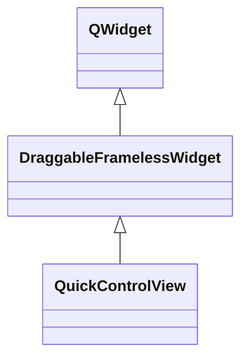

# DraggableFramelessWidget

**Namespace:** `mne::disp` &nbsp;·&nbsp; **Library:** Display Library &nbsp;·&nbsp; **Source:** [`disp/viewers/helpers/draggableframelesswidget.h`](https://github.com/mne-tools/mne-cpp/blob/staging/src/libs/mne/disp/viewers/helpers/draggableframelesswidget.h)

`#include <mne/disp/draggableframelesswidget.h>`

```cpp
class mne::disp::DraggableFramelessWidget
```

Frameless QWidget that can be dragged anywhere on its body.

Base class of [`QuickControlView`](/docs/api/disp/quick-control-view) and any other floating popup that wants to look like an in-app palette rather than a system window.

### Inheritance



---

## Public Methods

### DraggableFramelessWidget(parent, flags, bRoundEdges, bDraggable, bFrameless)

Constructs a [`DraggableFramelessWidget`](/docs/api/disp/draggable-frameless-widget) which is a child of parent.

**Parameters:**

- **parent** : *QWidget **
  The parent of the widget.

- **flags** : *Qt::WindowFlags*
  The window flags.

- **bRoundEdges** : *bool*
  Flag specifying whether to round the edges.

- **bDraggable** : *bool*
  Flag specifying whether this widget is draggable.

- **bFrameless** : *bool*
  Flag specifying whether this widget is frameless.

---

### ~DraggableFramelessWidget()

Destructs a [`DraggableFramelessWidget`](/docs/api/disp/draggable-frameless-widget).

---

### setDraggable(bFlag)

Set the draggable flag of this widget.

**Parameters:**

- **bFlag** : *bool*
  the flag to set.

---

## Authors of this file

- Lorenz Esch &lt;lorenz.esch@tu-ilmenau.de&gt;
- Juan GPC &lt;jgarciaprieto@mgh.harvard.edu&gt;
- Andreas Griesshammer &lt;ag@fieldlineinc.com&gt;
- Gabriel Motta &lt;gabrielbenmotta@gmail.com&gt;
- Christoph Dinh &lt;christoph.dinh@mne-cpp.org&gt;
