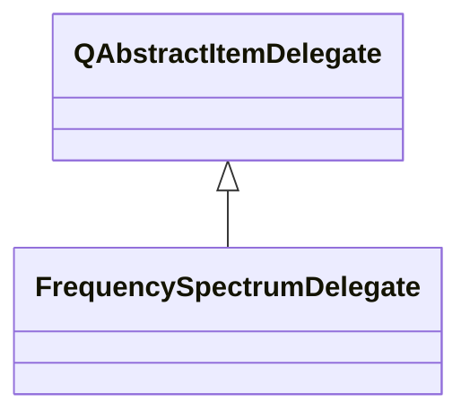

# FrequencySpectrumDelegate

**Namespace:** `mne::disp` &nbsp;·&nbsp; **Library:** Display Library &nbsp;·&nbsp; **Source:** [`disp/viewers/helpers/frequencyspectrumdelegate.h`](https://github.com/mne-tools/mne-cpp/blob/staging/src/libs/mne/disp/viewers/helpers/frequencyspectrumdelegate.h)

`#include <mne/disp/frequencyspectrumdelegate.h>`

```cpp
class mne::disp::FrequencySpectrumDelegate
```

QAbstractItemDelegate painting one [`SpectrumView`](/docs/api/disp/spectrum-view) row as a horizontal frequency band.

Maps the per-row FFT amplitudes through a Hot / Jet colour table and draws the resulting pixel strip plus the lower / upper frequency cursors during ``paint()``.

### Inheritance



---

## Public Methods

### FrequencySpectrumDelegate(m_pTableView, parent)

Creates a new abstract item delegate with the given parent.

**Parameters:**

- **m_pTableView** : *QTableView **
  Table view the delegate paints into.

- **parent** : *QObject **
  Parent of the delegate.

---

### setScaleType(ScaleType)

Set scale type.

**Parameters:**

- **ScaleType** : *qint8*
  Frequency axis scale type.

---

### paint(painter, option, index)

Use the painter and style option to render the item specified by the item index.

(`sizeHint()` must be implemented also)

**Parameters:**

- **painter** : *QPainter **
  Low-level painting on widgets and other paint devices.

- **option** : *const QStyleOptionViewItem &*
  Describes the parameters used to draw an item in a view widget.

- **index** : *const QModelIndex &*
  Used to locate data in a data model.

---

### sizeHint(option, index)

Item size.

**Parameters:**

- **option** : *const QStyleOptionViewItem &*
  Describes the parameters used to draw an item in a view widget.

- **index** : *const QModelIndex &*
  Used to locate data in a data model.

**Returns:**

- *QSize* — 20 pixels wide by the row height for column 0, an invalid QSize otherwise.

---

### rcvMouseLoc(row, x, y, visRect)

Receive Mouse location.

**Parameters:**

- **row** : *int*
  The select row of tableview.

- **x** : *int*
  mouse x pos.

- **y** : *int*
  mouse y pos.

- **visRect** : *QRect*
  visual rect of row_tableview.

---

## Authors of this file

- Christoph Dinh &lt;christoph.dinh@mne-cpp.org&gt;
- Matti Hamalainen &lt;msh@nmr.mgh.harvard.edu&gt;
- Lorenz Esch &lt;lorenz.esch@tu-ilmenau.de&gt;
- Juan GPC &lt;jgarciaprieto@mgh.harvard.edu&gt;
- Gabriel Motta &lt;gabrielbenmotta@gmail.com&gt;
- Limin Sun &lt;limin.sun@childrens.harvard.edu&gt;
