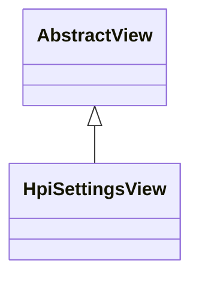

# HpiSettingsView

**Namespace:** `mne::disp` &nbsp;·&nbsp; **Library:** Display Library &nbsp;·&nbsp; **Source:** [`disp/viewers/hpisettingsview.h`](https://github.com/mne-tools/mne-cpp/blob/staging/src/libraries/disp/viewers/hpisettingsview.h)

`#include <disp/hpisettingsview.h>`

```cpp
class mne::disp::HpiSettingsView
```

Continuous HPI head-position-indicator configuration panel.

Coil-frequency table, GoF threshold spinbox, continuous HPI toggle and single-shot `Fit` trigger; emits coil-list and head-movement vectors back to the live pipeline.

### Inheritance



---

## Public Methods

### HpiSettingsView(sSettingsPath, parent, f)

Constructs a [`HpiSettingsView`](/docs/api/disp/hpi-settings-view) object.

**Parameters:**

- **sSettingsPath** : *const QString &*
  Settings path under which the widget persists its state (empty = no persistence).

- **parent** : *QWidget **
  The parent widget.

- **f** : *Qt::WindowFlags*
  Qt window flags passed to the QWidget constructor.

---

### ~HpiSettingsView()

---

### setErrorLabels(vError, dMeanErrorDist)

Updates the error related labels.

**Parameters:**

- **vError** : *const QVector&lt; double &gt; &*
  the new error values.

- **dMeanErrorDist** : *const double*
  the mean error value.

---

### setGoFLabels(vGoF, dMeanGof)

Updates the gof related labels.

**Parameters:**

- **vGoF** : *const Eigen::VectorXd &*
  the new gof values.

- **dMeanGof** : *const double*
  the mean gof value.

---

### setMovementResults(dMovement, dRotation)

Updates the movement refered to last reference head position.

**Parameters:**

- **dMovement** : *double*
  the movement refered to last fit.

- **dRotation** : *double*
  the rotation refered to last fit.

---

### getSspStatusChanged()

Get the SSP checked status.

**Returns:**

- *bool* — The current SSP checked status.

---

### getCompStatusChanged()

Get the Comp checked status.

**Returns:**

- *bool* — The current Comp checked status.

---

### getAllowedMeanErrorDistChanged()

Get the allowed mean error distance.

**Returns:**

- *double* — The current allowed mean error distance.

---

### getAllowedMovementChanged()

Get the allowed head movement.

**Returns:**

- *double* — The current allowed head movement.

---

### getAllowedRotationChanged()

Get the allowed head rotation.

**Returns:**

- *double* — The current allowed head rotation.

---

### continuousHPIChecked()

Returns whether continuous fitting is checked.

**Returns:**

- *bool* — Whether continuous fitting is checked.

---

### getFittingWindowSize()

Get number of fits per second to do when performing continuous hpi.

**Returns:**

- *int* — Number of fits per second

---

### newDigitizerList(digitizers)

Displays the metadata of digitizer points.

**Parameters:**

- **digitizers** : *const [FiffDigPointSet](/docs/api/fiff/fiff-dig-point-set) &*
  The digitizer points.

---

### loadCoilPresets(sFilePath)

Replaces the coil presets, by default the Neuromag VectorView frequencies, with those of a JSON file: an object mapping the number of coils ("4", "5", ...) to an array of \{"name": ..., "coils": [Hz, ...]\}.

**Parameters:**

- **sFilePath** : *const QString &*
  Path to the JSON file.

**Returns:**

- *bool* — Whether the file could be read and parsed; if not, the presets are left unchanged.

---

### saveSettings()

Saves all important settings of this view via QSettings.

---

### loadSettings()

Loads and inits all important settings of this view via QSettings.

---

### clearView()

Clears the view.

---

## Authors of this file

- Lorenz Esch &lt;lorenz.esch@tu-ilmenau.de&gt;
- Ruben Doerfel &lt;doerfelruben@aol.com&gt;
- Gabriel Motta &lt;gabrielbenmotta@gmail.com&gt;
- Juan GPC &lt;jgarciaprieto@mgh.harvard.edu&gt;
- Andreas Griesshammer &lt;ag@fieldlineinc.com&gt;
- Christoph Dinh &lt;christoph.dinh@mne-cpp.org&gt;
