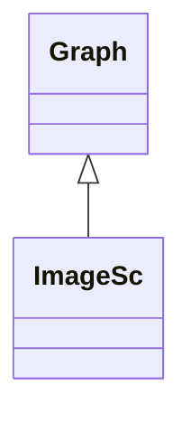

# ImageSc

**Namespace:** `DISPLIB` &nbsp;·&nbsp; **Library:** Display Library &nbsp;·&nbsp; **Source:** [`disp/plots/imagesc.h`](https://github.com/mne-tools/mne-cpp/blob/staging/src/libraries/disp/plots/imagesc.h)

`#include <disp/imagesc.h>`

```cpp
class DISPLIB::ImageSc
```

False-colour heat-map QWidget visualising an Eigen matrix with selectable colour map.

Accepts `MatrixXd`, `MatrixXf` and `MatrixXi` inputs; ``init()`` rebuilds the cached `QImage` from the current matrix and the active colour map, and ``updateData()`` / ``paintEvent()`` keep the rendering in sync with the data.

```cpp title="src/examples/ex_disp_plots/main.cpp"
MatrixXd ramp(4, 8);
for (int r = 0; r < ramp.rows(); ++r) {
    for (int c = 0; c < ramp.cols(); ++c) {
        ramp(r, c) = c; // rises left to right
    }
}
ImageSc image(ramp); // min..max mapped to 0..1, "Hot" by default
image.setColorMap("Viridis");
image.setTitle("ramp");
```

### Inheritance



---

## Public Methods

### ImageSc(parent)

Creates the scaled image view.

**Parameters:**

- **parent** : *QWidget **
  Parent QObject (optional).

---

### ImageSc(p_dMat, parent)

Creates the scaled image view with a given double matrix.

**Parameters:**

- **p_dMat** : *Eigen::MatrixXd &*
  The double data matrix.

- **parent** : *QWidget **
  Parent QObject (optional).

---

### ImageSc(p_fMat, parent)

Creates the scaled image view with a given float matrix.

**Parameters:**

- **p_fMat** : *Eigen::MatrixXf &*
  The float data matrix.

- **parent** : *QWidget **
  Parent QObject (optional).

---

### ImageSc(p_iMat, parent)

Creates the scaled image view with a given integer matrix.

**Parameters:**

- **p_iMat** : *Eigen::MatrixXi &*
  The integer data matrix.

- **parent** : *QWidget **
  Parent QObject (optional).

---

### ~ImageSc()

Destructs the [`ImageSc`](/docs/api/disp/image-sc) object.

---

### init()

Initializes the [`ImageSc`](/docs/api/disp/image-sc) object.

---

### updateData(p_dMat)

Updates the scaled image view with a given double matrix.

**Parameters:**

- **p_dMat** : *Eigen::MatrixXd &*
  The double data matrix.

---

### updateData(p_fMat)

Updates the scaled image view with a given float matrix.

**Parameters:**

- **p_fMat** : *Eigen::MatrixXf &*
  The float data matrix.

---

### updateData(p_iMat)

Updates the scaled image view with a given integer matrix.

**Parameters:**

- **p_iMat** : *Eigen::MatrixXi &*
  The integer data matrix.

---

### setColorMap(p_sColorMap)

Sets the color map to use, e.g.

"Jet", "Hot", "Bone"

**Parameters:**

- **p_sColorMap** : *const QString &*
  The colormap to use.

---

## Example

- Start here: [ex_disp_plots](../../examples/disp/ex_disp_plots.mdx) — Disp plots: colour maps, bar and spline histograms, line plots, image and time-frequency maps.
- Full source: [`src/examples/ex_disp_plots/main.cpp`](https://github.com/mne-tools/mne-cpp/tree/staging/src/examples/ex_disp_plots/main.cpp)
- Build target: `ex_disp_plots` (runs under CTest)

## Used in examples

### [ex_disp_plots](../../examples/disp/ex_disp_plots.mdx)

Disp plots: colour maps, bar and spline histograms, line plots, image and time-frequency maps.

````cpp title="src/examples/ex_disp_plots/main.cpp, line 175"
ImageSc image(ramp); // min..max mapped to 0..1, "Hot" by default
image.setColorMap("Viridis");
image.setTitle("ramp");
const QImage scImage = render(image);
// Data area: x in [60, 340); first and last columns are the colour map ends
ok &= expect(close(scImage.pixel(70, 150), qRgb(68, 1, 84), 4) && close(scImage.pixel(330, 150), qRgb(253, 231, 37), 4),
             "ImageSc maps the minimum and maximum columns to the ends of viridis");
````

### [ex_disp](../../examples/disp/ex_disp.mdx)

Disp library widgets: image map, line plot and time-frequency plot of raw data.

````cpp title="src/examples/ex_disp/main.cpp, line 200"
//ImageSc example: one row per channel, one column per sample
ImageSc imagesc(data);
imagesc.setTitle("MEG channels over time");
imagesc.setXLabel("Sample");
imagesc.setYLabel("Channel");
imagesc.setColorMap("Hot"); // also "Jet", "RedBlue", "Bone", "Viridis"
````

### [ex_connectivity](../../examples/connectivity/ex_connectivity.mdx)

Sensor- or source-level functional connectivity of averaged MEG/EEG data with a selectable metric, shown as a 3D network.

````cpp title="src/examples/ex_connectivity/connectivitysettingsmanager.h, line 111"
DISPLIB::Plot* m_pEvokedSignalCoursePlot = nullptr;
DISPLIB::Plot* m_pEpochSignalCoursePlot = nullptr;
DISPLIB::Plot* m_pEvokedSourceSignalCoursePlot = nullptr;
DISPLIB::ImageSc* m_pImageConnWeights = nullptr;
````

## Authors of this file

- Lorenz Esch &lt;lorenz.esch@tu-ilmenau.de&gt;
- Juan GPC &lt;jgarciaprieto@mgh.harvard.edu&gt;
- Gabriel Motta &lt;gabrielbenmotta@gmail.com&gt;
- Christoph Dinh &lt;christoph.dinh@mne-cpp.org&gt;
