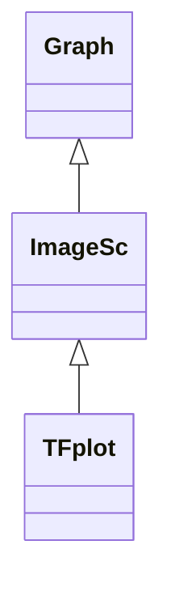

# ImageSc

**Namespace:** `DISPLIB` &nbsp;·&nbsp; **Library:** Display Library &nbsp;·&nbsp; **Source:** [`disp/plots/imagesc.h`](https://github.com/mne-tools/mne-cpp/blob/staging/src/libraries/disp/plots/imagesc.h)

`#include <disp/imagesc.h>`

```cpp
class DISPLIB::ImageSc
```

False-colour heat-map QWidget visualising an Eigen matrix with selectable colour map.

Accepts `MatrixXd`, `MatrixXf` and `MatrixXi` inputs; ``init()`` rebuilds the cached `QImage` from the current matrix and the active colour map, and ``updateData()`` / ``paintEvent()`` keep the rendering in sync with the data.

```cpp title="src/examples/ex_disp_plots/main.cpp"
MatrixXd ramp(4, 8);
for (int r = 0; r < ramp.rows(); ++r) {
    for (int c = 0; c < ramp.cols(); ++c) {
        ramp(r, c) = c; // rises left to right
    }
}
ImageSc image(ramp); // min..max mapped to 0..1, "Hot" by default
image.setColorMap("Viridis");
image.setTitle("ramp");
image.setExtent(0.0, 0.7, 4.0, 1.0); // columns at 0 .. 0.7 s, rows 1 .. 4 from the top
image.setXLabel("Time [s]");
image.setYLabel("Trial");
image.setColorbarLabel("Value");
```

### Inheritance



---

## Public Methods

### ImageSc(parent)

Creates the scaled image view.

**Parameters:**

- **parent** : *QWidget **
  Parent QObject (optional).

---

### ImageSc(p_dMat, parent)

Creates the scaled image view with a given double matrix.

**Parameters:**

- **p_dMat** : *Eigen::MatrixXd &*
  The double data matrix.

- **parent** : *QWidget **
  Parent QObject (optional).

---

### ImageSc(p_fMat, parent)

Creates the scaled image view with a given float matrix.

**Parameters:**

- **p_fMat** : *Eigen::MatrixXf &*
  The float data matrix.

- **parent** : *QWidget **
  Parent QObject (optional).

---

### ImageSc(p_iMat, parent)

Creates the scaled image view with a given integer matrix.

**Parameters:**

- **p_iMat** : *Eigen::MatrixXi &*
  The integer data matrix.

- **parent** : *QWidget **
  Parent QObject (optional).

---

### ~ImageSc()

Destructs the [`ImageSc`](/docs/api/disp/image-sc) object.

---

### init()

Initializes the [`ImageSc`](/docs/api/disp/image-sc) object.

---

### updateData(p_dMat)

Updates the scaled image view with a given double matrix.

**Parameters:**

- **p_dMat** : *Eigen::MatrixXd &*
  The double data matrix.

---

### updateData(p_fMat)

Updates the scaled image view with a given float matrix.

**Parameters:**

- **p_fMat** : *Eigen::MatrixXf &*
  The float data matrix.

---

### updateData(p_iMat)

Updates the scaled image view with a given integer matrix.

**Parameters:**

- **p_iMat** : *Eigen::MatrixXi &*
  The integer data matrix.

---

### setColorMap(p_sColorMap)

Sets the color map to use, e.g.

"Jet", "Hot", "Bone"

**Parameters:**

- **p_sColorMap** : *const QString &*
  The colormap to use.

---

### setExtent(left, right, bottom, top)

Labels the axes in data units instead of column and row indices, as matplotlib's `imshow`(extent=...).

**Parameters:**

- **left** : *double*
  X value of the first column.

- **right** : *double*
  X value of the last column.

- **bottom** : *double*
  Y value of the last row, drawn at the bottom.

- **top** : *double*
  Y value of the first row, drawn at the top.

---

### setColorRange(min, max)

Maps `min` and `max` to the ends of the colour map instead of the data minimum and maximum; values outside are clipped.

A range symmetric around zero centres diverging maps such as "RedBlue".

**Parameters:**

- **min** : *double*
  Value drawn with the low end of the colour map.

- **max** : *double*
  Value drawn with the high end of the colour map.

---

### setColorbarLabel(label)

Names the quantity the colour bar shows, e.g.

"Power (normalized)".

**Parameters:**

- **label** : *const QString &*
  The colour bar label; empty hides it.

---

## Example

- Start here: [ex_disp_plots](../../examples/disp/ex_disp_plots.mdx) — Disp plots: colour maps, bar and spline histograms, line plots, image and time-frequency maps.
- Full source: [`src/examples/ex_disp_plots/main.cpp`](https://github.com/mne-tools/mne-cpp/tree/staging/src/examples/ex_disp_plots/main.cpp)
- Build target: `ex_disp_plots` (runs under CTest)

## Used in examples

### [ex_disp_plots](../../examples/disp/ex_disp_plots.mdx)

Disp plots: colour maps, bar and spline histograms, line plots, image and time-frequency maps.

````cpp title="src/examples/ex_disp_plots/main.cpp, line 179"
ImageSc image(ramp); // min..max mapped to 0..1, "Hot" by default
image.setColorMap("Viridis");
image.setTitle("ramp");
image.setExtent(0.0, 0.7, 4.0, 1.0); // columns at 0 .. 0.7 s, rows 1 .. 4 from the top
image.setXLabel("Time [s]");
image.setYLabel("Trial");
image.setColorbarLabel("Value");
const QImage scImage = render(image);
// Along the middle row the first viridis-dark pixel sits left of the first viridis-yellow pixel
int darkX = -1;
int brightX = -1;
for (int px = 0; px < scImage.width(); ++px) {
    if (darkX < 0 && close(scImage.pixel(px, 150), qRgb(68, 1, 84), 4)) {
````

### [ex_disp](../../examples/disp/ex_disp.mdx)

Disp library widgets: image map, line plot and time-frequency plot of raw data.

````cpp title="src/examples/ex_disp/main.cpp, line 211"
const double limit = gradData.cwiseAbs().maxCoeff();
ImageSc imagesc(gradData);
imagesc.setTitle(QString("%1 gradiometers").arg(grads.size()));
imagesc.setXLabel("Time [s]");
imagesc.setYLabel("Gradiometer");
imagesc.setColorbarLabel("fT/cm");
imagesc.setColorMap("RedBlue"); // also "Jet", "Hot", "Bone", "Viridis"
imagesc.setColorRange(-limit, limit);
imagesc.setExtent(times(0, 0), times(0, times.cols() - 1), grads.size(), 1);
````

### [ex_connectivity](../../examples/connectivity/ex_connectivity.mdx)

Sensor- or source-level functional connectivity of averaged MEG/EEG data with a selectable metric, shown as a 3D network.

````cpp title="src/examples/ex_connectivity/connectivitysettingsmanager.h, line 111"
DISPLIB::Plot* m_pEvokedSignalCoursePlot = nullptr;
DISPLIB::Plot* m_pEpochSignalCoursePlot = nullptr;
DISPLIB::Plot* m_pEvokedSourceSignalCoursePlot = nullptr;
DISPLIB::ImageSc* m_pImageConnWeights = nullptr;
````

Also used in [ex_connectivity_metrics](../../examples/connectivity/ex_connectivity_metrics.mdx), [ex_dsp_spectral](../../examples/dsp/ex_dsp_spectral.mdx), [ex_read_epochs](../../examples/mne/ex_read_epochs.mdx).

## Authors of this file

- Lorenz Esch &lt;lorenz.esch@tu-ilmenau.de&gt;
- Juan GPC &lt;jgarciaprieto@mgh.harvard.edu&gt;
- Gabriel Motta &lt;gabrielbenmotta@gmail.com&gt;
- Christoph Dinh &lt;christoph.dinh@mne-cpp.org&gt;
