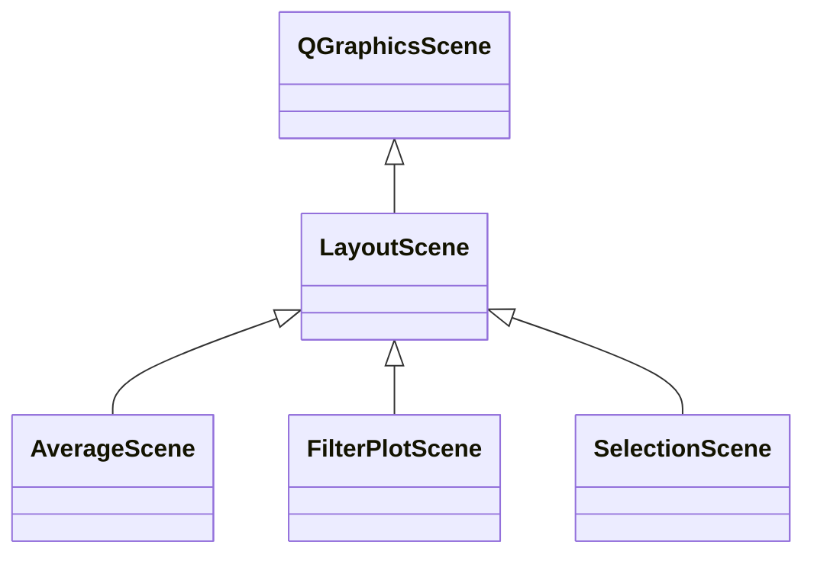

# LayoutScene

**Namespace:** `DISPLIB` &nbsp;·&nbsp; **Library:** Display Library &nbsp;·&nbsp; **Source:** [`disp/viewers/helpers/layoutscene.h`](https://github.com/mne-tools/mne-cpp/blob/staging/src/libraries/disp/viewers/helpers/layoutscene.h)

`#include <disp/layoutscene.h>`

```cpp
class DISPLIB::LayoutScene
```

Base QGraphicsScene providing pan, pinch-zoom and swipe gesture handling for sensor-layout scenes.

Installs gesture recognisers on the active view and translates pan / pinch / swipe events into view-zoom / view-pan operations regardless of input device.

### Inheritance



---

## Public Methods

### LayoutScene(view, parent)

Constructs a [`LayoutScene`](/docs/api/disp/layout-scene).

**Parameters:**

- **view** : *QGraphicsView **
  Graphics view that displays this scene and is zoomed/panned by it.

- **parent** : *QObject **
  Parent QObject (default 0).

---

## Authors of this file

- Lorenz Esch &lt;lorenz.esch@tu-ilmenau.de&gt;
- Juan GPC &lt;jgarciaprieto@mgh.harvard.edu&gt;
- Gabriel Motta &lt;gabrielbenmotta@gmail.com&gt;
- Christoph Dinh &lt;christoph.dinh@mne-cpp.org&gt;
