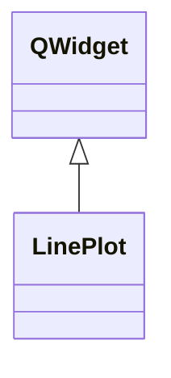

# LinePlot

**Namespace:** `DISPLIB` &nbsp;·&nbsp; **Library:** Display Library &nbsp;·&nbsp; **Source:** [`disp/plots/lineplot.h`](https://github.com/mne-tools/mne-cpp/blob/staging/src/libraries/disp/plots/lineplot.h)

`#include <disp/lineplot.h>`

```cpp
class DISPLIB::LinePlot
```

Simple x / y line-series QWidget rendered with QPainter (no Qt Charts dependency).

Supports multiple series, a settable title and x / y labels and auto-ranging axes. Series are stored as `QVector<double>` pairs and re-drawn during `paintEvent`.

```cpp title="src/examples/ex_disp_plots/main.cpp"
QVector<double> x;
QVector<double> y;
for (int i = 0; i <= 100; ++i) {
    x.append(i / 100.0);
    y.append(std::sin(2.0 * M_PI * x.last()));
}
LinePlot line(x, y, "sin(2 pi t)");
line.setXLabel("t [s]");
line.setYLabel("amplitude");
```

### Inheritance



---

## Public Methods

### LinePlot(parent)

Constructs a line series plot.

**Parameters:**

- **parent** : *QWidget **
  If parent is nullptr, the new widget becomes a window.

---

### LinePlot(y, title, parent)

Constructs a line series plot.

**Parameters:**

- **y** : *const QVector&lt; double &gt; &*
  The double data vector.

- **title** : *const QString &*
  [`Plot`](/docs/api/disp/plot) title.

- **parent** : *QWidget **
  If parent is nullptr, the new widget becomes a window.

---

### LinePlot(x, y, title, parent)

Constructs a line series plot.

**Parameters:**

- **x** : *const QVector&lt; double &gt; &*
  X-Axis data to plot.

- **y** : *const QVector&lt; double &gt; &*
  Y-Axis data to plot.

- **title** : *const QString &*
  [`Plot`](/docs/api/disp/plot) title.

- **parent** : *QWidget **
  If parent is nullptr, the new widget becomes a window.

---

### ~LinePlot()

Destructs the line series plot.

---

### setTitle(p_sTitle)

Sets the plot title.

**Parameters:**

- **p_sTitle** : *const QString &*
  The title.

---

### setXLabel(p_sXLabel)

Sets the label of the x axis.

**Parameters:**

- **p_sXLabel** : *const QString &*
  The x axis label.

---

### setYLabel(p_sYLabel)

Sets the label of the y axis.

**Parameters:**

- **p_sYLabel** : *const QString &*
  The y axis label.

---

### updateData(y)

Updates the plot using a given double vector without given X data.

**Parameters:**

- **y** : *const QVector&lt; double &gt; &*
  The double data vector.

---

### updateData(x, y)

Updates the plot using the given vectors.

**Parameters:**

- **x** : *const QVector&lt; double &gt; &*
  X-Axis data to plot.

- **y** : *const QVector&lt; double &gt; &*
  Y-Axis data to plot.

---

### addSeries(x, y, label, color)

Adds a series to the plot; the axes grow to include it and a legend lists the labelled series.

**Parameters:**

- **x** : *const QVector&lt; double &gt; &*
  X-Axis data to plot.

- **y** : *const QVector&lt; double &gt; &*
  Y-Axis data to plot.

- **label** : *const QString &*
  Legend entry; series without a label are not listed.

- **color** : *const QColor &*
  Line colour; an invalid colour takes the next colour of the default palette.

---

### seriesCount()

Returns the number of series in the plot.

**Returns:**

- *int* — The number of series.

---

## Example

- Start here: [ex_disp_plots](../../examples/disp/ex_disp_plots.mdx) — Disp plots: colour maps, bar and spline histograms, line plots, image and time-frequency maps.
- Full source: [`src/examples/ex_disp_plots/main.cpp`](https://github.com/mne-tools/mne-cpp/tree/staging/src/examples/ex_disp_plots/main.cpp)
- Build target: `ex_disp_plots` (runs under CTest)

## Used in examples

### [ex_disp_plots](../../examples/disp/ex_disp_plots.mdx)

Disp plots: colour maps, bar and spline histograms, line plots, image and time-frequency maps.

````cpp title="src/examples/ex_disp_plots/main.cpp, line 151"
LinePlot line(x, y, "sin(2 pi t)");
line.setXLabel("t [s]");
line.setYLabel("amplitude");
const QImage lineImage = render(line);
int top = lineImage.height();
int bottom = 0;
for (int py = 0; py < lineImage.height(); ++py) {
    for (int px = 0; px < lineImage.width(); ++px) {
        if (close(lineImage.pixel(px, py), steelBlue, 40)) {
            top = std::min(top, py);
            bottom = std::max(bottom, py);
        }
    }
````

### [ex_spectral](../../examples/disp/ex_spectral.mdx)

Multitaper spectra, power spectral density and cross-spectral density of random test signals.

````cpp title="src/examples/ex_spectral/main.cpp, line 93"
//Plot hanning window
VectorXd hann = matTaps.row(0).transpose();
LinePlot plotWindow(toVector(hann), "Hanning window");
plotWindow.setXLabel("Sample");
plotWindow.setYLabel("Weight");
````

### [ex_averaging](../../examples/mne/ex_averaging.mdx)

Average stimulus-locked epochs of a raw FIFF recording into an evoked response, with event selection and EOG rejection.

````cpp title="src/examples/ex_averaging/main.cpp, line 175"
LinePlot butterfly;
butterfly.setTitle(QString("Evoked response to event %1 (%2 epochs)").arg(event).arg(evoked.nave));
butterfly.setXLabel("Time [ms]");
butterfly.setYLabel("Gradiometers [fT/cm]");
for (int c = 0; c < evoked.data.rows(); ++c) {
    if (evoked.info.chs[c].unit == FIFF_UNIT_T_M && !evoked.info.bads.contains(evoked.info.ch_names[c])) {
        QVector<double> values(times.size());
        for (int s = 0; s < times.size(); ++s) {
            values[s] = 1e13 * evoked.data(c, s);
        }
        butterfly.addSeries(times, values, QString(), QColor(30, 60, 110, 70));
    }
}
FigureExporter::save(butterfly, "evoked", QString("Butterfly plot of the %1 good gradiometers averaged over %2 epochs of event %3, baseline-corrected over the prestimulus interval.")
````

Also used in [ex_inverse_mne](../../examples/inv/ex_inverse_mne.mdx), [ex_read_evoked](../../examples/mne/ex_read_evoked.mdx), [ex_read_raw](../../examples/mne/ex_read_raw.mdx).

## Authors of this file

- Lorenz Esch &lt;lorenz.esch@tu-ilmenau.de&gt;
- Juan GPC &lt;jgarciaprieto@mgh.harvard.edu&gt;
- Andreas Griesshammer &lt;ag@fieldlineinc.com&gt;
- Gabriel Motta &lt;gabrielbenmotta@gmail.com&gt;
- Christoph Dinh &lt;christoph.dinh@mne-cpp.org&gt;
