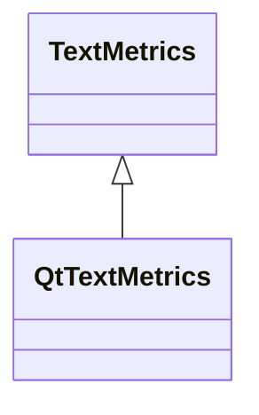

# QtTextMetrics

**Namespace:** `mne::disp` &nbsp;·&nbsp; **Library:** Display Library &nbsp;·&nbsp; **Source:** [`disp/plots/helpers/scenepainter.h`](https://github.com/mne-tools/mne-cpp/blob/staging/src/libs/mne/disp/plots/helpers/scenepainter.h)

`#include <mne/disp/scenepainter.h>`

```cpp
class mne::disp::QtTextMetrics
```

Measures scene text with QFontMetrics, so layouts match what QPainter draws.

Widths and heights are whole pixels, as QFontMetrics reports them.

### Inheritance



---

## Public Methods

### QtTextMetrics(baseFont)

**Parameters:**

- **baseFont** : *const QFont &*
  Font that fills in what a scene font leaves unset, usually the widget's font.

---

### pixel_size(font)

**Parameters:**

- **font** : *const [Font](/docs/api/scene/font) &*
  Font of the text.

**Returns:**

- *double* — The font size in pixels.

---

### advance(font, text)

**Parameters:**

- **font** : *const [Font](/docs/api/scene/font) &*
  Font of the text.

- **text** : *std::string_view*
  UTF-8 text.

**Returns:**

- *double* — The width of `text` in `font`, in pixels.

---

### ascent(font)

**Parameters:**

- **font** : *const [Font](/docs/api/scene/font) &*
  Font of the text.

**Returns:**

- *double* — The distance from the baseline to the top of the tallest glyphs.

---

### descent(font)

**Parameters:**

- **font** : *const [Font](/docs/api/scene/font) &*
  Font of the text.

**Returns:**

- *double* — The distance from the baseline to the bottom of the lowest glyphs.

---

### height(font)

**Parameters:**

- **font** : *const [Font](/docs/api/scene/font) &*
  Font of the text.

**Returns:**

- *double* — The line height, `ascent()` + `descent()` (+ leading).

---

## Example

No example of its own: Measures text for the plot widgets' QPainter backend inside their paintEvent(); not called by applications.

## Authors of this file

- Christoph Dinh &lt;christoph.dinh@mne-cpp.org&gt;
