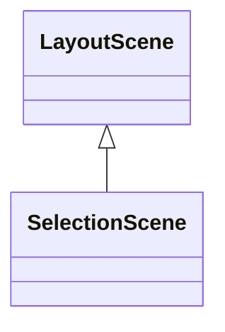

# SelectionScene

**Namespace:** `mne::disp` &nbsp;·&nbsp; **Library:** Display Library &nbsp;·&nbsp; **Source:** [`disp/viewers/helpers/selectionscene.h`](https://github.com/mne-tools/mne-cpp/blob/staging/src/libs/mne/disp/viewers/helpers/selectionscene.h)

`#include <mne/disp/selectionscene.h>`

```cpp
class mne::disp::SelectionScene
```

QGraphicsScene of sensor-layout dots used by [`ChannelSelectionView`](/docs/api/disp/channel-selection-view) for interactive channel picking.

Places one [`SelectionSceneItem`](/docs/api/disp/selection-scene-item) per sensor, supports rubber-band selection and lasso grouping, and emits the resulting channel-name lists so the host view can store them as named .sel groups.

### Inheritance



---

## Public Methods

### SelectionScene(view, parent)

Constructs a [`SelectionScene`](/docs/api/disp/selection-scene).

**Parameters:**

- **view** : *QGraphicsView **
  Graphics view that displays this scene.

- **parent** : *QObject **
  Parent QObject (default 0).

---

### repaintItems(layoutMap, badChannels)

Updates layout data.

**Parameters:**

- **layoutMap** : *const std::map&lt; std::string, QPointF &gt; &*
  layout data map.

- **badChannels** : *const std::vector&lt; std::string &gt; &*
  Names of the bad channels.

---

### hideItems(visibleItems)

Hides all items described in list.

**Parameters:**

- **visibleItems** : *const std::vector&lt; std::string &gt; &*
  string list with items name which are to be hidden.

---

## Authors of this file

- Lorenz Esch &lt;lorenz.esch@tu-ilmenau.de&gt;
- Christoph Dinh &lt;christoph.dinh@mne-cpp.org&gt;
- Matti Hamalainen &lt;msh@nmr.mgh.harvard.edu&gt;
- Juan GPC &lt;jgarciaprieto@mgh.harvard.edu&gt;
- Gabriel Motta &lt;gabrielbenmotta@gmail.com&gt;
