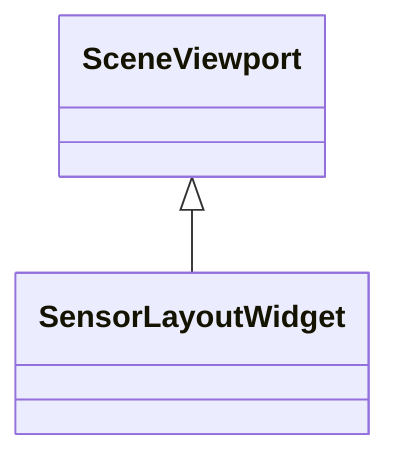

# SensorLayoutWidget

**Namespace:** `mne::disp` &nbsp;·&nbsp; **Library:** Display Library &nbsp;·&nbsp; **Source:** [`disp_widgets/viewers/helpers/sensorlayoutwidget.h`](https://github.com/mne-tools/mne-cpp/blob/staging/src/libs/mne/disp_widgets/viewers/helpers/sensorlayoutwidget.h)

`#include <mne/disp/sensorlayoutwidget.h>`

```cpp
class mne::disp::SensorLayoutWidget
```

The sensors of a layout as labelled dots; clicks and rubber bands select them.

A click selects one sensor, Ctrl+click toggles it, a rubber band selects the sensors it touches and Ctrl adds them to the selection. Only sensors of the current channel kind are shown; those outside the visible group are drawn faint and cannot be selected.

### Inheritance



---

## Public Methods

### SensorLayoutWidget(parent)

Constructs an empty layout.

**Parameters:**

- **parent** : *QWidget **
  Parent widget.

---

### setLayout(layoutMap, badChannels)

Shows the sensors of a layout, all shown and selectable and none selected; EEG sensors are those whose name contains "EEG".

Emits `selectionChanged()` if sensors were selected before.

**Parameters:**

- **layoutMap** : *const std::map&lt; std::string, QPointF &gt; &*
  Sensor name to position in layout units.

- **badChannels** : *const std::vector&lt; std::string &gt; &*
  Names of the bad sensors.

---

### setChannelKind(kind)

Shows only the sensors of one channel kind.

**Parameters:**

- **kind** : *int*
  Channel kind, FIFFV_MEG_CH or FIFFV_EEG_CH.

---

### channelKind()

**Returns:**

- *int* — The channel kind shown.

---

### setSelectable(names)

Lets only the sensors in `names` be selected; the other sensors of the shown kind are drawn faint.

Sensors that are hidden or cannot be selected lose their selection, which emits `selectionChanged()`.

**Parameters:**

- **names** : *const std::vector&lt; std::string &gt; &*
  Names of the selectable sensors.

---

### selectNames(names)

Selects the sensors in `names` and deselects the others.

**Parameters:**

- **names** : *const std::vector&lt; std::string &gt; &*
  Names of the sensors to select.

---

### highlightNames(names)

Rings the sensors in `names`.

**Parameters:**

- **names** : *const std::vector&lt; std::string &gt; &*
  Names of the sensors to highlight.

---

### clear()

Removes all sensors.

---

### selectedNames()

**Returns:**

- *std::vector&lt; std::string &gt;* — The names of the selected sensors, in layout order.

---

### selection()

The selected sensors, or with no selection the shown ones, as a [`SelectionItem`](/docs/api/disp/selection-item).

**Returns:**

- *[SelectionItem](/docs/api/disp/selection-item)* — Names, kinds, units and positions; the channel numbers are 0.

---

### sensorLayout()

**Returns:**

- *const [SensorLayout](/docs/api/scene/sensor-layout) &* — The layout model.

---

## Example

No example of its own: The sensor picker inside ChannelSelectionView; it needs a layout file and user input, exercised by test_disp_viewers2.

## Authors of this file

- Christoph Dinh &lt;christoph.dinh@mne-cpp.org&gt;
