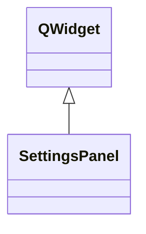

# SettingsPanel

**Namespace:** `mne::disp` &nbsp;·&nbsp; **Library:** Display Library &nbsp;·&nbsp; **Source:** [`disp/viewers/settingspanel.h`](https://github.com/mne-tools/mne-cpp/blob/staging/src/libs/mne/disp/viewers/settingspanel.h)

`#include <mne/disp/settingspanel.h>`

```cpp
class mne::disp::SettingsPanel
```

Qt Widgets for a [`SettingsForm`](/docs/api/scene/settings-form).

The panel shares the form with its host, so it outlives the host's members when Qt deletes it as a child. Fields are laid out in the order of the form, one group box per group (fields without a group come first, without a box). Custom fields get an empty container the host fills with its own widget (`customWidget()`).

### Inheritance



---

## Public Methods

### SettingsPanel(form, parent)

Builds the widgets of a form.

**Parameters:**

- **form** : *std::shared_ptr&lt; [SettingsForm](/docs/api/scene/settings-form) &gt;*
  Form, shared with the host.

- **parent** : *QWidget **
  Parent widget.

---

### ~SettingsPanel()

---

### form()

**Returns:**

- *[SettingsForm](/docs/api/scene/settings-form) &* — The form.

---

### editor(key)

**Parameters:**

- **key** : *const std::string &*
  Field key.

**Returns:**

- *QWidget ** — The editor of a field (or the button of an action, or the container of a custom field), or nullptr.

---

### customWidget(key)

**Parameters:**

- **key** : *const std::string &*
  Key of a Custom field.

**Returns:**

- *QWidget ** — The container to put the host's widget in, with an empty vertical layout, or nullptr.

---

### loadSettings(path)

Reads the values stored under `path`; missing ones keep their current value.

**Parameters:**

- **path** : *const QString &*
  QSettings group of the panel, e.g. "MNESCAN/Averaging"; empty does nothing.

---

### saveSettings(path)

Stores the values under `path`, one QSettings key per field.

**Parameters:**

- **path** : *const QString &*
  QSettings group of the panel; empty does nothing.

---

## Example

No example of its own: Qt Widgets builder of scene::SettingsForm used inside the settings views; exercised by test_disp_viewers.

## Authors of this file

- Christoph Dinh &lt;christoph.dinh@mne-cpp.org&gt;
