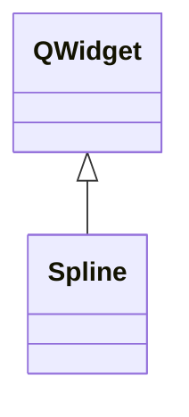

# Spline

**Namespace:** `DISPLIB` &nbsp;·&nbsp; **Library:** Display Library &nbsp;·&nbsp; **Source:** [`disp/plots/spline.h`](https://github.com/mne-tools/mne-cpp/blob/staging/src/libraries/disp/plots/spline.h)

`#include <disp/spline.h>`

```cpp
class DISPLIB::Spline
```

Histogram QWidget with cubic-spline overlay and interactive threshold markers.

Click-drag drops left / middle / right threshold lines that are emitted as data-space coordinates; otherwise the API mirrors [`Bar`](/docs/api/disp/bar) (`setData` / `updatePlot` templates).

```cpp title="src/examples/ex_disp_plots/main.cpp"
Spline spline(nullptr, "Amplitude spline");
spline.setData(classLimits, counts);
spline.setThreshold(QVector3D(1.0f, 2.0f, 3.0f)); // three vertical marker lines
```

### Inheritance



---

## Public Methods

### Spline(parent, title)

The constructor for [`Spline`](/docs/api/disp/spline).

**Parameters:**

- **parent** : *QWidget **
  sets the behaviour of [`Spline`](/docs/api/disp/spline) as an object, defaults to no parent QWidget.

- **title** : *const QString &*
  string to specify the title displayed on the histogram, defaults to "Spline Histogram".

---

### setData(matClassLimitData, matClassFrequencyData)

creates a spline histogram from 2 vectors: class limits and class frequency

**Parameters:**

- **matClassLimitData** : *const Eigen::Matrix&lt; T, Eigen::Dynamic, 1 &gt; &*
  vector input filled with class limits.

- **matClassFrequencyData** : *const Eigen::Matrix&lt; int, Eigen::Dynamic, 1 &gt; &*
  vector input filled with class frequency to the corresponding class.

---

### setData(matClassLimitData, matClassFrequencyData)

---

### updatePlot(matClassLimitData, matClassFrequencyData)

Updates the spline with new data.

**Parameters:**

- **matClassLimitData** : *const Eigen::Matrix&lt; T, Eigen::Dynamic, Eigen::Dynamic &gt; &*
  vector input filled with class limits.

- **matClassFrequencyData** : *const Eigen::VectorXi &*
  vector input filled with class frequency to the corresponding class.

---

### mousePressEvent(event)

constructor for mouse press event behaviour to create threshold lines and signal emit

**Parameters:**

- **event** : *QMouseEvent **
  mouse press input.

---

### splitCoefficientAndExponent(matClassLimitData, iClassAmount, vecCoefficientResults, vecExponentValues)

splitCoefficientAndExponent takes in QVector value of coefficient and exponent and normalizes them.

**Parameters:**

- **matClassLimitData** : *const Eigen::Matrix&lt; T, Eigen::Dynamic, Eigen::Dynamic &gt; &*
  vector input filled with values of class limits.

- **iClassAmount** : *int*
  amount of classes in the histogram.

- **vecCoefficientResults** : *Eigen::VectorXd &*
  vector filled with values of coefficient only.

- **vecExponentValues** : *Eigen::VectorXi &*
  vector filled with values of exponent only.

---

### setThreshold(vecThresholdValues)

setThreshold takes in QVector3D value and creates the corresponding lines in the histogram

**Parameters:**

- **vecThresholdValues** : *const QVector3D &*
  QVector3D consisting of 3 values corresponding to the threshold lines.

---

### getThreshold()

getThreshold retrieves the current threshold values

**Returns:**

- *const QVector3D &* — returns QVector3D corresponding to the x-axis value of the threshold lines.

---

### correctionDisplayTrueValue(vecOriginalValues, upOrDown)

correctionDisplayTrueValue creates necessary adjustment of exponential multiplication with base 10

**Parameters:**

- **vecOriginalValues** : *QVector3D*
  QVector3D consisting of 3 original values.

- **upOrDown** : *QString*
  Choice between "up" or "down" conversion direction.

**Returns:**

- *QVector3D* — returns QVector3D after necessary adjustment.

---

### setColorMap(colorMap)

setColorMap sets the color mapping on the histogram background

**Parameters:**

- **colorMap** : *const QString &*
  qstring of the color gradient from user input.

---

## Example

- Start here: [ex_disp_plots](../../examples/disp/ex_disp_plots.mdx) — Disp plots: colour maps, bar and spline histograms, line plots, image and time-frequency maps.
- Full source: [`src/examples/ex_disp_plots/main.cpp`](https://github.com/mne-tools/mne-cpp/tree/staging/src/examples/ex_disp_plots/main.cpp)
- Build target: `ex_disp_plots` (runs under CTest)

## Used in examples

### [ex_disp_plots](../../examples/disp/ex_disp_plots.mdx)

Disp plots: colour maps, bar and spline histograms, line plots, image and time-frequency maps.

````cpp title="src/examples/ex_disp_plots/main.cpp, line 138"
Spline spline(nullptr, "Amplitude spline");
spline.setData(classLimits, counts);
spline.setThreshold(QVector3D(1.0f, 2.0f, 3.0f)); // three vertical marker lines
ok &= expect(countColor(render(spline), steelBlue, 30) > 50, "Spline draws its curve");
````

### [ex_histogram](../../examples/inv/ex_histogram.mdx)

Histogram of the source amplitudes of a clustered MNE, dSPM or sLORETA estimate of the sample evoked response.

````cpp title="src/examples/ex_histogram/main.cpp, line 213"
//displayObj can be in either Bar or Spline form; uncomment the preferred one and comment the other
Spline* displayObj = new Spline(0, "MNE-CPP Histogram Example (Spline)");
//Bar* displayObj = new Bar("MNE-CPP Histogram Example (Bar)");
````

## Authors of this file

- Lorenz Esch &lt;lorenz.esch@tu-ilmenau.de&gt;
- Juan GPC &lt;jgarciaprieto@mgh.harvard.edu&gt;
- Andreas Griesshammer &lt;ag@fieldlineinc.com&gt;
- Gabriel Motta &lt;gabrielbenmotta@gmail.com&gt;
- Christoph Dinh &lt;christoph.dinh@mne-cpp.org&gt;
