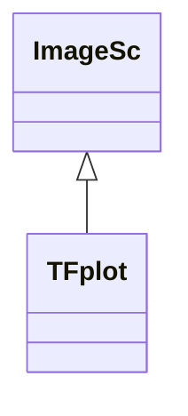

# TFplot

**Namespace:** `DISPLIB` &nbsp;·&nbsp; **Library:** Display Library &nbsp;·&nbsp; **Source:** [`disp/plots/tfplot.h`](https://github.com/mne-tools/mne-cpp/blob/staging/src/libraries/disp/plots/tfplot.h)

`#include <disp/tfplot.h>`

```cpp
class DISPLIB::TFplot
```

Time-frequency power image of a spectrogram: time in seconds, frequency in Hz, normalized power.

Row k of the spectrogram is the FFT bin at k * sample_rate / N Hz, where N, the number of columns, is the FFT length; column j is the time tmin + j / sample_rate s.

```cpp title="src/examples/ex_disp_plots/main.cpp"
MatrixXd tf = MatrixXd::Zero(50, 100);  // 100 samples at 100 Hz: 50 frequency rows of 1 Hz x 100 times
tf.middleRows(20, 10).setConstant(1.0); // power in the 20-29 Hz bins
TFplot tfPlot(tf, 100.0, 0.0, 50.0, Jet);
```

### Inheritance



---

## Public Methods

### TFplot(tf_matrix, sample_rate, lower_frq, upper_frq, cmap, tmin)

Plots the frequency bins from `lower_frq` to `upper_frq`.

**Parameters:**

- **tf_matrix** : *const Eigen::MatrixXd &*
  Spectrogram power, N/2 frequency bins x N time samples.

- **sample_rate** : *qreal*
  Sample rate of the signal in Hz.

- **lower_frq** : *qreal*
  Lowest frequency to plot in Hz.

- **upper_frq** : *qreal*
  Highest frequency to plot in Hz.

- **cmap** : *ColorMaps*
  Colour map.

- **tmin** : *qreal*
  Time of the first sample in s, e.g. the start of an epoch.

---

### TFplot(tf_matrix, sample_rate, cmap, tmin)

Plots all frequency bins.

**Parameters:**

- **tf_matrix** : *const Eigen::MatrixXd &*
  Spectrogram power, N/2 frequency bins x N time samples.

- **sample_rate** : *qreal*
  Sample rate of the signal in Hz.

- **cmap** : *ColorMaps*
  Colour map.

- **tmin** : *qreal*
  Time of the first sample in s, e.g. the start of an epoch.

---

## Example

- Start here: [ex_disp_plots](../../examples/disp/ex_disp_plots.mdx) — Disp plots: colour maps, bar and spline histograms, line plots, image and time-frequency maps.
- Full source: [`src/examples/ex_disp_plots/main.cpp`](https://github.com/mne-tools/mne-cpp/tree/staging/src/examples/ex_disp_plots/main.cpp)
- Build target: `ex_disp_plots` (runs under CTest)

## Used in examples

### [ex_disp_plots](../../examples/disp/ex_disp_plots.mdx)

Disp plots: colour maps, bar and spline histograms, line plots, image and time-frequency maps.

````cpp title="src/examples/ex_disp_plots/main.cpp, line 207"
MatrixXd tf = MatrixXd::Zero(50, 100);  // 100 samples at 100 Hz: 50 frequency rows of 1 Hz x 100 times
tf.middleRows(20, 10).setConstant(1.0); // power in the 20-29 Hz bins
TFplot tfPlot(tf, 100.0, 0.0, 50.0, Jet);
const QImage tfImage = render(tfPlot);
ok &= expect(countColor(tfImage, ColorMap::valueToJet(1.0), 10) > 100 && countColor(tfImage, ColorMap::valueToJet(0.0), 10) > countColor(tfImage, ColorMap::valueToJet(1.0), 10),
             "TFplot draws the 20-30 Hz band in the top colour over a bottom-colour background");
````

### [ex_disp](../../examples/disp/ex_disp.mdx)

Disp library widgets: image map, line plot and time-frequency plot of raw data.

````cpp title="src/examples/ex_disp/main.cpp, line 215"
//tf plot example: spectrogram of the same channel
MatrixXd dataSpectrum = Spectrogram::makeSpectrogram(dataCol, raw.info.sfreq * 0.2);
TFplot tfplot(dataSpectrum, raw.info.sfreq, 0, 100, ColorMaps::Jet, times(0, 0));
````

### [ex_connectivity](../../examples/connectivity/ex_connectivity.mdx)

Sensor- or source-level functional connectivity of averaged MEG/EEG data with a selectable metric, shown as a 3D network.

````cpp title="src/examples/ex_connectivity/connectivitysettingsmanager.h, line 116"
TFplot::SPtr m_pTfPlot;
Eigen::MatrixXd m_matEvoked;
Eigen::MatrixXd m_matEvokedSource;
MNELIB::MNEEpochDataList epochs;
````

Also used in [ex_tf_plot](../../examples/disp/ex_tf_plot.mdx).

## Authors of this file

- Lorenz Esch &lt;lorenz.esch@tu-ilmenau.de&gt;
- Juan GPC &lt;jgarciaprieto@mgh.harvard.edu&gt;
- Gabriel Motta &lt;gabrielbenmotta@gmail.com&gt;
- Christoph Dinh &lt;christoph.dinh@mne-cpp.org&gt;
