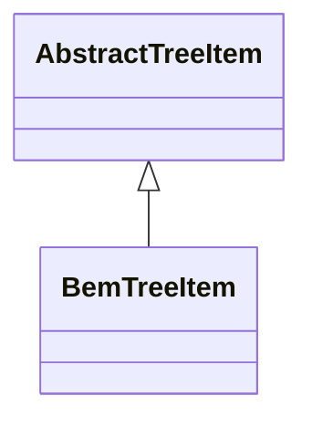

# BemTreeItem

**Namespace:** `DISP3DLIB` &nbsp;·&nbsp; **Library:** 3D Display Library &nbsp;·&nbsp; **Source:** [`disp3D/model/items/bemtreeitem.h`](https://github.com/mne-tools/mne-cpp/blob/staging/src/libraries/disp3D/model/items/bemtreeitem.h)

`#include <disp3D/bemtreeitem.h>`

```cpp
class DISP3DLIB::BemTreeItem
```

Tree item representing a BEM surface layer in the 3-D scene hierarchy.

### Inheritance



---

## Public Methods

### BemTreeItem(text, bemSurf)

---

### ~BemTreeItem()

---

### bemSurfaceData()

---

## Authors of this file

- Christoph Dinh &lt;christoph.dinh@mne-cpp.org&gt;
