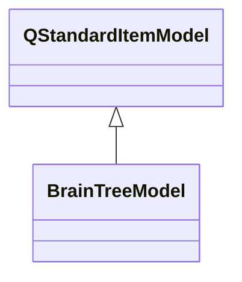

# BrainTreeModel

**Namespace:** `DISP3DLIB` &nbsp;·&nbsp; **Library:** 3D Display Library

`#include <disp3D/braintreemodel.h>`

```cpp
class DISP3DLIB::BrainTreeModel
```

Hierarchical item model organizing all 3-D scene objects (surfaces, sensors, sources, networks) for QTreeView.

### Inheritance



---

## Public Methods

### BrainTreeModel(parent)

---

### ~BrainTreeModel()

---

### addSurface(subject, hemi, surfType, surface)

---

### addAnnotation(subject, hemi, annotation)

---

### addBemSurface(subject, bemName, bemSurf)

---

### addSensors(type, items)

---

### addDipoles(set)

---

### addDigitizerData(digitizerPoints)

---

### addSourceSpace(srcSpace)

---

### addNetwork(network, name)

---

## Used in examples

### [ex_clustered_inverse_mne](../../examples/inv/ex_clustered_inverse_mne.mdx)

Example of a Clustered Inverse Minimum Norm Estimation application.

````cpp title="src/examples/ex_clustered_inverse_mne/main.cpp, line 292"
BrainView* pBrainView = new BrainView();
BrainTreeModel* pModel = new BrainTreeModel();
pBrainView->setModel(pModel);
````

### [ex_clustered_inverse_mne_raw](../../examples/inv/ex_clustered_inverse_mne_raw.mdx)

Example of the computation of a clustered inverse mne raw.

````cpp title="src/examples/ex_clustered_inverse_mne_raw/main.cpp, line 621"
BrainView* pBrainView = new BrainView();
BrainTreeModel* pModel = new BrainTreeModel();
pBrainView->setModel(pModel);
````

### [ex_clustered_inverse_pwl_rap_music_raw](../../examples/inv/ex_clustered_inverse_pwl_rap_music_raw.mdx)

Example of the computation of a raw clustered inverse Powell RAP-MUSIC.

````cpp title="src/examples/ex_clustered_inverse_pwl_rap_music_raw/main.cpp, line 541"
BrainView* pBrainView = new BrainView();
BrainTreeModel* pModel = new BrainTreeModel();
pBrainView->setModel(pModel);
````

Also used in [ex_clustered_inverse_rap_music_raw](../../examples/inv/ex_clustered_inverse_rap_music_raw.mdx), [ex_connectivity](../../examples/connectivity/ex_connectivity.mdx), [ex_connectivity_comparison](../../examples/connectivity/ex_connectivity_comparison.mdx), [ex_coreg](../../examples/disp3D/ex_coreg.mdx), [ex_disp_3D](../../examples/inv/ex_disp_3D.mdx), [ex_fs_surface](../../examples/disp3D/ex_fs_surface.mdx), [ex_inverse_mne_raw](../../examples/inv/ex_inverse_mne_raw.mdx), [ex_inverse_pwl_rap_music](../../examples/inv/ex_inverse_pwl_rap_music.mdx), [ex_inverse_rap_music](../../examples/inv/ex_inverse_rap_music.mdx), [ex_read_fwd_disp_3D](../../examples/disp3D/ex_read_fwd_disp_3D.mdx), [ex_roi_clustered_inverse_pwl_rap_music](../../examples/inv/ex_roi_clustered_inverse_pwl_rap_music.mdx), [ex_st_clustered_inverse_pwl_rap_music](../../examples/inv/ex_st_clustered_inverse_pwl_rap_music.mdx).

## Authors of this file

- Christoph Dinh &lt;christoph.dinh@mne-cpp.org&gt;
