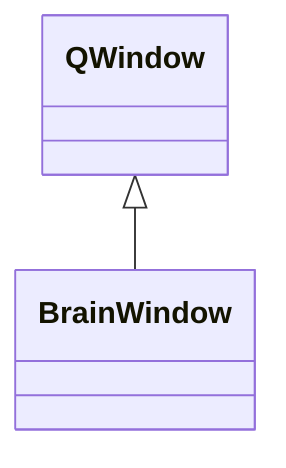

# BrainWindow

**Namespace:** `mne::disp` &nbsp;·&nbsp; **Library:** 3D Display Library &nbsp;·&nbsp; **Source:** [`disp3D/view/brainwindow.h`](https://github.com/mne-tools/mne-cpp/blob/staging/src/libs/mne/disp3D/view/brainwindow.h)

`#include <mne/disp3D/brainwindow.h>`

```cpp
class mne::disp::BrainWindow
```

[`BrainWindow`](/docs/api/disp3-d/brain-window) is a QWindow that renders a [`BrainViewCore`](/docs/api/disp3-d/brain-view-core) through its own QRhi and swap chain.

It needs only QtGui, so it also serves applications without Qt Widgets; widget applications embed it with a window container.

Clicking the name label of a multi-view pane emits `viewportPresetMenuRequested()`; the application may offer the camera presets and apply the choice with `BrainViewCore::setViewportCameraPreset`.

Widgets-free QWindow host of the 3-D brain view with its own QRhi, swap chain and input forwarding.

### Inheritance



---

## Public Methods

### BrainWindow(api, parent)

Constructor.

The QRhi and the swap chain are created when the window is first exposed.

**Parameters:**

- **api** : *GraphicsApi*
  Graphics API of the window's QRhi.

- **parent** : *QWindow **
  Parent window.

---

### ~BrainWindow()

Destructor.

Frees the scene's GPU resources before the QRhi.

---

### core()

**Returns:**

- *[BrainViewCore](/docs/api/disp3-d/brain-view-core) ** — The core holding scene, camera and overlay state; use it to load data and drive the view.

---

### graphicsApi()

**Returns:**

- *GraphicsApi* — The graphics API resolved for this window (never `GraphicsApi::Platform`).

---

### rhi()

**Returns:**

- *QRhi ** — The window's QRhi, or nullptr before the first expose or if it could not be created.

---

### swapChain()

**Returns:**

- *QRhiSwapChain ** — The window's swap chain, or nullptr before the first expose.

---

### hasSwapChain()

**Returns:**

- *bool* — Whether the swap chain has been created with a non-empty size.

---

### frameCount()

**Returns:**

- *int* — Number of frames recorded since the window was created.

---

### grabFrame()

Render a frame now and read the back buffer back, including the 2-D overlay.

`BrainViewCore::takeScreenshot()` and `BrainViewCore::savePng()` leave the overlay out.

**Returns:**

- *QImage* — The frame, or a null image when the window is not exposed or cannot render.

---

## Example

No example of its own: Native QWindow that needs an exposed platform surface; covered by the Null-backend test.

## Authors of this file

- Christoph Dinh &lt;christoph.dinh@mne-cpp.org&gt;
