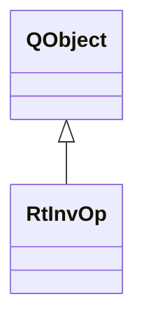

# RtInvOp

**Namespace:** `RTPROCESSINGLIB` &nbsp;·&nbsp; **Library:** DSP Library

`#include <dsp/rt_inv_op.h>`

```cpp
class RTPROCESSINGLIB::RtInvOp
```

Real-time inverse dSPM, sLoreta inverse operator estimation.

Controller that manages [`RtInvOpWorker`](/docs/api/dsp/rt-inv-op-worker) for online inverse operator updates.

```cpp title="src/examples/ex_dsp_rt/main.cpp"
RtInvOp rtInvOp(rawInfo, fwd); // MEG-only operator, loose 0.2, depth 0.8
MNEInverseOperator inverse;
bool inverseDone = false;
QObject::connect(&rtInvOp, &RtInvOp::invOperatorCalculated, [&](const MNEInverseOperator& op) {
    inverse = op;
    inverseDone = true;
});
rtInvOp.append(noiseCov); // e.g. each new RtCov estimate
```

### Inheritance



---

## Public Methods

### RtInvOp(p_pFiffInfo, p_pFwd, parent)

Creates the real-time inverse operator estimation object.

**Parameters:**

- **p_pFiffInfo** : *QSharedPointer&lt;[FiffInfo](/docs/api/fiff/fiff-info)&gt; &*
  Fiff measurement info.

- **p_pFwd** : *QSharedPointer&lt;[MNEForwardSolution](/docs/api/mne/mne-forward-solution)&gt; &*
  Forward solution.

- **parent** : *QObject **
  Parent QObject (optional).

---

### ~RtInvOp()

Destroys the inverse operator estimation object.

---

### append(noiseCov)

Slot to receive incoming noise covariance estimations.

**Parameters:**

- **noiseCov** : *const [FiffCov](/docs/api/fiff/fiff-cov) &*
  Noise covariance estimation.

---

### setFwdSolution(pFwd)

Slot to receive incoming forward solution.

**Parameters:**

- **pFwd** : *QSharedPointer&lt;[MNEForwardSolution](/docs/api/mne/mne-forward-solution)&gt;*
  Forward solution.

---

### restart()

Restarts the thread by interrupting its computation queue, quitting, waiting and then starting it again.

---

### stop()

Stops the thread by interrupting its computation queue, quitting and waiting.

---

## Example

- Full source: [`src/examples/ex_dsp_rt/main.cpp`](https://github.com/mne-tools/mne-cpp/tree/staging/src/examples/ex_dsp_rt/main.cpp)
- Build target: `ex_dsp_rt` (runs under CTest)
- Data: [mne-cpp-test-data](https://github.com/mne-tools/mne-cpp-test-data)

## Used in examples

### [ex_dsp_rt](../../examples/connectivity/ex_dsp_rt.mdx)

DSP real-time workers: averaging, covariance, noise spectrum, connectivity, HPI fitting and inverse operators.

````cpp title="src/examples/ex_dsp_rt/main.cpp, line 318"
RtInvOp rtInvOp(rawInfo, fwd); // MEG-only operator, loose 0.2, depth 0.8
MNEInverseOperator inverse;
bool inverseDone = false;
QObject::connect(&rtInvOp, &RtInvOp::invOperatorCalculated, [&](const MNEInverseOperator& op) {
    inverse = op;
    inverseDone = true;
});
rtInvOp.append(noiseCov); // e.g. each new RtCov estimate
const bool inverseArrived = waitFor(inverseDone, 60000);
// 306 MEG channels in the forward solution, minus the bad MEG2443
ok &= expect(inverseArrived && inverse.nsource == fwd->nsource && inverse.nchan == 305 && rawInfo->bads.contains("MEG2443"),
             QString("RtInvOp builds a %1-channel operator for %2 sources").arg(inverse.nchan).arg(inverse.nsource));
rtInvOp.stop();
````

## Authors of this file

- Christoph Dinh &lt;christoph.dinh@mne-cpp.org&gt;
