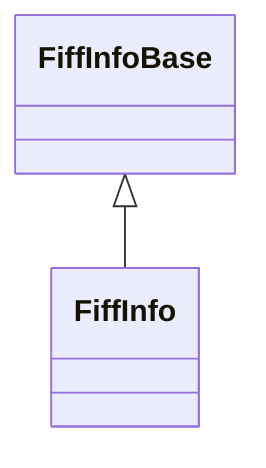

# FiffInfo

**Namespace:** `FIFFLIB` &nbsp;·&nbsp; **Library:** FIFF Library

:::info[Python equivalent]
`mne.Info` in MNE-Python.
:::

`#include <fiff/fiff_info.h>`

```cpp
class FIFFLIB::FiffInfo
```

Full FIFF measurement info: per-channel descriptors, sampling and filter setup, projectors, compensators, transforms and dig points.

Materializes the union of the tags found in `FIFFB_MEAS` / `FIFFB_MEAS_INFO:` `sfreq`, `lowpass` / `highpass` / `line_freq`, `meas_date`, `experimenter`, `projs` ([`FiffProj`](/docs/api/fiff/fiff-proj)), `comps` ([`FiffCtfComp`](/docs/api/fiff/fiff-ctf-comp)), `dig` ([`FiffDigPoint`](/docs/api/fiff/fiff-dig-point)), `hpi_results` / `hpi_meas`, `dev_head_t` / `ctf_head_t`, plus the [`FiffInfoBase`](/docs/api/fiff/fiff-info-base) channel / bads / sfreq subset. Drop-in counterpart of `mne.Info` in MNE-Python.

```cpp title="src/examples/ex_fiff_api/main.cpp"
QFile rawFile(dir + "/sample_audvis_trunc_raw.fif");
FiffRawData raw(rawFile);        // reads the measurement info, raw data is read on demand
const FiffInfo& info = raw.info; // channels, sampling rate, bads, projectors, digitizer, transforms
const FiffChInfo& first = info.chs[0];
const RowVectorXi megPicks = info.pick_types(true, false, false, QStringList(), info.bads); // good MEG channels
```

### Inheritance



---

## Public Methods

### FiffInfo()

Constructors the fiff measurement file information.

---

### FiffInfo(p_FiffInfo)

Copy constructor.

**Parameters:**

- **p_FiffInfo** : *const FiffInfo &*
  FIFF measurement information which should be copied.

---

### operator=(other)

Copy assignment.

Every member has value semantics, so the compiler-generated member-wise assignment is correct. It is declared explicitly because declaring a copy constructor and/or a destructor deprecates the implicitly generated one.

**Parameters:**

- **other** : *const [FiffInfo](/docs/api/fiff/fiff-info) &*
  Object to assign from.

**Returns:**

- *[FiffInfo](/docs/api/fiff/fiff-info) &* — reference to this object.

---

### ~FiffInfo()

Destroys the fiff measurement file information.

---

### clear()

Initializes FIFF measurement information.

---

### make_compensator(from, to, ctf_comp, exclude_comp_chs)

mne_make_compensator

Create a compensation matrix to bring the data from one compensation state to another

**Parameters:**

- **from** : *fiff_int_t*
  compensation in the input data.

- **to** : *fiff_int_t*
  desired compensation in the output.

- **ctf_comp** : *[FiffCtfComp](/docs/api/fiff/fiff-ctf-comp) &*
  Compensation Matrix.

- **exclude_comp_chs** : *bool*
  exclude compensation channels from the output (optional).

**Returns:**

- *bool* — true if succeeded, false otherwise.

---

### get_current_comp()

mne_get_current_comp

Get the current compensation in effect in the data

**Returns:**

- *qint32* — the current compensation.

---

### make_projector(proj)

mne_make_projector_info

Make a SSP operator using the meas info

**Parameters:**

- **proj** : *Eigen::MatrixXd &*
  The projection operator to apply to the data.

**Returns:**

- *qint32* — nproj - How many items in the projector.

---

### make_projector(proj, p_chNames)

mne_make_projector_info

Make a SSP operator using the meas info

**Parameters:**

- **proj** : *Eigen::MatrixXd &*
  The projection operator to apply to the data.

- **p_chNames** : *const QStringList &*
  List of channels to include in the projection matrix.

**Returns:**

- *qint32* — nproj - How many items in the projector.

---

### pick_info(sel)

fiff_pick_info

Pick desired channels from measurement info

**Parameters:**

- **sel** : *const Eigen::RowVectorXi &*
  List of channels to select.

**Returns:**

- *[FiffInfo](/docs/api/fiff/fiff-info)* — Info modified according to sel.

---

### set_current_comp(value)

Set the current compensation value in the channel info structures.

**Parameters:**

- **value** : *fiff_int_t*
  compensation value.

---

### writeToStream(p_pStream)

Writes the fiff information to a FIF stream.

**Parameters:**

- **p_pStream** : *[FiffStream](/docs/api/fiff/fiff-stream) **
  The stream to write to.

---

### print()

Prints class contents.

---

## Static Methods

### set_current_comp(listFiffChInfo, value)

mne_set_current_comp

Consider taking the member function of `set_current_comp(fiff_int_t value)`, when compensation should be applied to the channels of [`FiffInfo`](/docs/api/fiff/fiff-info)

Set the current compensation value in the channel info structures

**Parameters:**

- **listFiffChInfo** : *QList&lt; [FiffChInfo](/docs/api/fiff/fiff-ch-info) &gt; &*
  fiff channel info list.

- **value** : *fiff_int_t*
  compensation value.

**Returns:**

- *QList&lt; [FiffChInfo](/docs/api/fiff/fiff-ch-info) &gt;* — the current compensation.

---

### readMegEegChannels(name, do_meg, do_eeg, bads, chsp, nmegp, neegp)

Read MEG and EEG channel information from a FIFF file, excluding bad channels.

Opens the file, reads measurement info, and splits channels into MEG and EEG lists (in that order), skipping channels in the bads list. EEG channels must pass `FiffChInfo::isValidEeg()`.

**Parameters:**

- **name** : *const QString &*
  Path to the FIFF measurement file.

- **do_meg** : *bool*
  If true, include MEG channels.

- **do_eeg** : *bool*
  If true, include EEG channels.

- **bads** : *const QStringList &*
  List of bad channel names to exclude.

- **chsp** : *QList&lt; [FiffChInfo](/docs/api/fiff/fiff-ch-info) &gt; &*
  Combined list of accepted channels (MEG first, then EEG).

- **nmegp** : *int &*
  Number of MEG channels in chsp.

- **neegp** : *int &*
  Number of EEG channels in chsp.

**Returns:**

- *bool* — true on success, false on error.

---

## Example

- Full source: [`src/examples/ex_fiff_api/main.cpp`](https://github.com/mne-tools/mne-cpp/tree/staging/src/examples/ex_fiff_api/main.cpp)
- Build target: `ex_fiff_api` (runs under CTest)
- Data: [mne-cpp-test-data](https://github.com/mne-tools/mne-cpp-test-data)

## Used in examples

### [ex_dsp_rt](../../examples/connectivity/ex_dsp_rt.mdx)

DSP real-time workers: averaging, covariance, noise spectrum, connectivity, HPI fitting and inverse operators.

````cpp title="src/examples/ex_dsp_rt/main.cpp, line 103"
/** Two MEG magnetometers and one stimulus channel at @p sfreq. */
FiffInfo::SPtr makeInfo(double sfreq)
{
    FiffInfo::SPtr info = FiffInfo::SPtr::create();
    info->sfreq = sfreq;
    for (const QString& name : {QStringLiteral("MEG0111"), QStringLiteral("MEG0121"), QStringLiteral("STI014")}) {
        FiffChInfo ch;
        ch.ch_name = name;
        ch.kind = name.startsWith("STI") ? FIFFV_STIM_CH : FIFFV_MEG_CH;
        ch.unit = name.startsWith("STI") ? FIFF_UNIT_NONE : FIFF_UNIT_T;
        ch.cal = 1.0f;
        ch.range = 1.0f;
        info->chs.append(ch);
        info->ch_names.append(name);
````

### [ex_dsp_artifacts](../../examples/dsp/ex_dsp_artifacts.mdx)

Artifact detection and repair with the dsp library on a recording with planted defects.

````cpp title="src/examples/ex_dsp_artifacts/main.cpp, line 82"
FiffInfo makeInfo()
{
    FiffInfo info;
    info.sfreq = kSFreq;
    for (int i = 0; i < kEeg + 2; ++i) {
        FiffChInfo ch;
        ch.scanNo = ch.logNo = i + 1;
        ch.kind = i < kEeg ? FIFFV_EEG_CH : (i == kEog ? FIFFV_EOG_CH : FIFFV_ECG_CH);
        ch.ch_name = i < kEeg ? QString("EEG%1").arg(i) : (i == kEog ? QString("EOG") : QString("ECG"));
        ch.range = ch.cal = 1.0f;
        ch.unit = FIFF_UNIT_V;
        info.chs.append(ch);
        info.ch_names.append(ch.ch_name);
    }
````

### [ex_fiff_api](../../examples/fiff/ex_fiff_api.mdx)

FIFF library: measurement info, channels, digitizer, transforms, projectors, covariance, events,.

````cpp title="src/examples/ex_fiff_api/main.cpp, line 109"
QFile rawFile(dir + "/sample_audvis_trunc_raw.fif");
FiffRawData raw(rawFile);        // reads the measurement info, raw data is read on demand
const FiffInfo& info = raw.info; // channels, sampling rate, bads, projectors, digitizer, transforms
const FiffChInfo& first = info.chs[0];
const RowVectorXi megPicks = info.pick_types(true, false, false, QStringList(), info.bads); // good MEG channels
// mne.io.read_raw_fif: 376 channels at 300.307 Hz, bads MEG 2443 + EEG 053, 4 projectors
ok &= expect(info.nchan == 376 && near(info.sfreq, 300.3074951171875) && info.bads == QStringList({"MEG2443", "EEG053"}) && info.projs.size() == 4 && megPicks.size() == 305 && raw.first_samp == 12900 && raw.last_samp == 18906,
             "FiffInfo: 376 channels at 300.307 Hz, 2 bads, 4 projectors, 305 good MEG channels");
// ch 0: MEG 0113, planar gradiometer 3012 at (-0.1066, 0.0464, -0.0604) m, cal 3.16e-9
ok &= expect(first.ch_name == "MEG0113" && first.kind == FIFFV_MEG_CH && first.chpos.coil_type == FIFFV_COIL_VV_PLANAR_T1 && (first.chpos.r0 - Vector3f(-0.1066f, 0.0464f, -0.0604f)).norm() < 1e-6f && near(first.cal, 3.1600000394149674e-09),
             "FiffChInfo/FiffChPos: MEG0113 is a 3012 planar gradiometer at (-0.1066, 0.0464, -0.0604) m");
````

Also used in [ex_dsp_maxwell](../../examples/dsp/ex_dsp_maxwell.mdx), [ex_hpiFit](../../examples/inv/ex_hpiFit.mdx), [ex_clustered_inverse_mne](../../examples/inv/ex_clustered_inverse_mne.mdx), [ex_clustered_inverse_mne_raw](../../examples/inv/ex_clustered_inverse_mne_raw.mdx), [ex_compute_forward](../../examples/fwd/ex_compute_forward.mdx), [ex_disp_3D](../../examples/inv/ex_disp_3D.mdx), [ex_fiff_sniffer](../../examples/connectivity/ex_fiff_sniffer.mdx), [ex_fwd_api](../../examples/fwd/ex_fwd_api.mdx), [ex_histogram](../../examples/inv/ex_histogram.mdx), [ex_inv_api](../../examples/inv/ex_inv_api.mdx), [ex_inv_beamformer](../../examples/inv/ex_inv_beamformer.mdx), [ex_inv_hpi](../../examples/inv/ex_inv_hpi.mdx), [ex_inverse_mne_raw](../../examples/inv/ex_inverse_mne_raw.mdx), [ex_make_inverse_operator](../../examples/inv/ex_make_inverse_operator.mdx), [ex_make_layout](../../examples/fiff/ex_make_layout.mdx).

## Authors of this file

- Christoph Dinh &lt;christoph.dinh@mne-cpp.org&gt;
- Christof Pieloth &lt;pieloth@labp.htwk-leipzig.de&gt;
- Lorenz Esch &lt;lorenz.esch@tu-ilmenau.de&gt;
- Ruben Doerfel &lt;doerfelruben@aol.com&gt;
- Juan GPC &lt;jgarciaprieto@mgh.harvard.edu&gt;
- Gabriel Motta &lt;gabrielbenmotta@gmail.com&gt;
