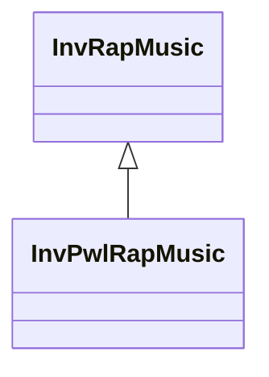

# InvPwlRapMusic

**Namespace:** `INVLIB` &nbsp;·&nbsp; **Library:** Inverse Library &nbsp;·&nbsp; **Source:** [`inv/rap_music/inv_pwl_rap_music.h`](https://github.com/mne-tools/mne-cpp/blob/staging/src/libraries/inv/rap_music/inv_pwl_rap_music.h)

`#include <inv/inv_pwl_rap_music.h>`

<Connections topics={["rap-music"]} context="api" current="InvPwlRapMusic" />

```cpp
class INVLIB::InvPwlRapMusic
```

Powell-accelerated RAP MUSIC variant using gradient-free optimization for refined dipole fitting.

ToDo Detailed description

```cpp title="src/examples/ex_inv_beamformer/main.cpp"
// Noise-free data from the two sources with different time courses; RAP-MUSIC scans source pairs.
const int nSamples = 60;
MatrixXd measured(G.rows(), nSamples);
for (int t = 0; t < nSamples; ++t)
    measured.col(t) = g1 * std::sin(0.21 * t) + g2 * std::sin(0.53 * t + 0.4);
QList<InvDipolePair<double>> pairs;
InvRapMusic rap(fwd, false, 1, 0.5); // one correlated pair, subspace correlation >= 0.5
rap.calculateInverse(measured, pairs);
QList<InvDipolePair<double>> powellPairs;
InvPwlRapMusic pwlRap(fwd, false, 1, 0.5); // Powell coordinate search: far fewer pairs, may stop at a local optimum
pwlRap.calculateInverse(measured, powellPairs);
```

### Inheritance



---

## Public Methods

### InvPwlRapMusic()

Default constructor creates an empty POWELL RAP MUSIC algorithm which still needs to be initialized.

---

### InvPwlRapMusic(p_pFwd, p_bSparsed, p_iN, p_dThr)

Constructor which initializes the POWELL RAP MUSIC algorithm with the given model.

**Parameters:**

- **p_pFwd** : *[MNEForwardSolution](/docs/api/mne/mne-forward-solution) &*
  The model which contains the gain matrix and its corresponding grid matrix.

- **p_bSparsed** : *bool*
  True when sparse matrices should be used.

- **p_iN** : *int*
  The number (default 2) of uncorrelated sources, which should be found. Starting with. the strongest.

- **p_dThr** : *double*
  The correlation threshold (default 0.5) at which the search for sources stops.

---

### ~InvPwlRapMusic()

---

### calculateInverse(p_fiffEvoked, pick_normal)

Note: Since they are virtual they have to be implemented to be called.

Even so the base class RAP MUSIC implementation is called.

**Parameters:**

- **p_fiffEvoked** : *const [FiffEvoked](/docs/api/fiff/fiff-evoked) &*
  Evoked data to localize.

- **pick_normal** : *bool*
  Keep only the component normal to the cortex.

---

### calculateInverse(data, tmin, tstep, pick_normal)

Note: Since they are virtual they have to be implemented to be called.

Even so the base class RAP MUSIC implementation is called.

**Parameters:**

- **data** : *const Eigen::MatrixXd &*
  Measurement data (channels x samples).

- **tmin** : *float*
  Time of the first sample in seconds.

- **tstep** : *float*
  Time between samples in seconds.

- **pick_normal** : *bool*
  Keep only the component normal to the cortex.

---

### calculateInverse(p_matMeasurement, p_RapDipoles)

---

### getName()

---

## Static Methods

### PowellOffset(p_iRow, p_iNumPoints)

---

### PowellIdxVec(p_iRow, p_iNumPoints, p_pVecElements)

---

## Example

- Start here: [ex_inv_beamformer](../../examples/inv/ex_inv_beamformer.mdx) — Inverse library: LCMV and DICS beamformers and the RAP-MUSIC family of dipole scanners.
- Full source: [`src/examples/ex_inv_beamformer/main.cpp`](https://github.com/mne-tools/mne-cpp/tree/staging/src/examples/ex_inv_beamformer/main.cpp)
- Build target: `ex_inv_beamformer` (runs under CTest)
- Data: [mne-cpp-test-data](https://github.com/mne-tools/mne-cpp-test-data)

## Used in examples

### [ex_inv_beamformer](../../examples/inv/ex_inv_beamformer.mdx)

Inverse library: LCMV and DICS beamformers and the RAP-MUSIC family of dipole scanners.

````cpp title="src/examples/ex_inv_beamformer/main.cpp, line 157"
InvRapMusic rap(fwd, false, 1, 0.5); // one correlated pair, subspace correlation >= 0.5
rap.calculateInverse(measured, pairs);
QList<InvDipolePair<double>> powellPairs;
InvPwlRapMusic pwlRap(fwd, false, 1, 0.5); // Powell coordinate search: far fewer pairs, may stop at a local optimum
pwlRap.calculateInverse(measured, powellPairs);
ok &= expect(pairs.size() == 1 && isPair(pairs[0], 10, 50) && pairs[0].m_vCorrelation > 1.0 - 1e-6 && powellPairs.size() == 1 && powellPairs[0].m_vCorrelation > 0.99,
             QString("InvRapMusic/InvPwlRapMusic/InvDipolePair: the exhaustive scan finds sources 10 and 50 (correlation 1), Powell a pair at %1")
                 .arg(powellPairs.isEmpty() ? 0.0 : powellPairs[0].m_vCorrelation, 0, 'f', 4));
````

### [ex_clustered_inverse_pwl_rap_music_raw](../../examples/inv/ex_clustered_inverse_pwl_rap_music_raw.mdx)

Average a raw recording and localize dipole pairs with Powell RAP-MUSIC on a parcellation-clustered forward solution.

````cpp title="src/examples/ex_clustered_inverse_pwl_rap_music_raw/main.cpp, line 433"
//
// Compute inverse solution
//
InvPwlRapMusic t_pwlRapMusic(t_clusteredFwd, false, numDipolePairs);
````

### [ex_inverse_pwl_rap_music](../../examples/inv/ex_inverse_pwl_rap_music.mdx)

Localize dipole pairs in the sample evoked response with Powell-accelerated RAP-MUSIC on a clustered forward solution.

````cpp title="src/examples/ex_inverse_pwl_rap_music/main.cpp, line 152"
InvPwlRapMusic t_pwlRapMusic(t_clusteredFwd, false, numDipolePairs);
````

Also used in [ex_roi_clustered_inverse_pwl_rap_music](../../examples/inv/ex_roi_clustered_inverse_pwl_rap_music.mdx), [ex_st_clustered_inverse_pwl_rap_music](../../examples/inv/ex_st_clustered_inverse_pwl_rap_music.mdx).

## Authors of this file

- Christoph Dinh &lt;christoph.dinh@mne-cpp.org&gt;
