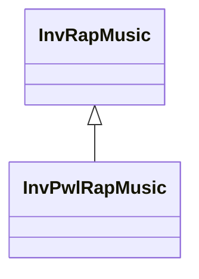

# InvRapMusic

**Namespace:** `INVLIB` &nbsp;·&nbsp; **Library:** Inverse Library

:::info[Python equivalent]
`mne.beamformer.rap_music` in MNE-Python.
:::

`#include <inv/inv_rap_music.h>`

```cpp
class INVLIB::InvRapMusic
```

RAP MUSIC (Recursively Applied and Projected Multiple Signal Classification) source localization algorithm.

Implements the RAP MUSIC scanning algorithm which iteratively identifies correlated source pairs by projecting the signal subspace and re-scanning the lead field. Each iteration finds one dipole (or dipole pair), projects it out of the signal subspace, and repeats until the desired number of sources is found or the residual correlation drops below threshold.

Reference: Mosher & Leahy, IEEE Trans. Signal Process. 47(2), 332-340, 1999.

```cpp title="src/examples/ex_inv_beamformer/main.cpp"
// Noise-free data from the two sources with different time courses; RAP-MUSIC scans source pairs.
const int nSamples = 60;
MatrixXd measured(G.rows(), nSamples);
for (int t = 0; t < nSamples; ++t)
    measured.col(t) = g1 * std::sin(0.21 * t) + g2 * std::sin(0.53 * t + 0.4);
QList<InvDipolePair<double>> pairs;
InvRapMusic rap(fwd, false, 1, 0.5); // one correlated pair, subspace correlation >= 0.5
rap.calculateInverse(measured, pairs);
QList<InvDipolePair<double>> powellPairs;
InvPwlRapMusic pwlRap(fwd, false, 1, 0.5); // Powell coordinate search: far fewer pairs, may stop at a local optimum
pwlRap.calculateInverse(measured, powellPairs);
```

### Inheritance



---

## Public Methods

### InvRapMusic()

Default constructor creates an empty [`InvRapMusic`](/docs/api/inv/inv-rap-music) algorithm which still needs to be initialized.

---

### InvRapMusic(p_pFwd, p_bSparsed, p_iN, p_dThr)

Constructor which initializes the [`InvRapMusic`](/docs/api/inv/inv-rap-music) algorithm with the given model.

**Parameters:**

- **p_pFwd** : *[MNEForwardSolution](/docs/api/mne/mne-forward-solution) &*
  The model which contains the gain matrix and its corresponding grid matrix.

- **p_bSparsed** : *bool*
  True when sparse matrices should be used.

- **p_iN** : *int*
  The number (default 2) of uncorrelated sources, which should be found. Starting with. the strongest.

- **p_dThr** : *double*
  The correlation threshold (default 0.5) at which the search for sources stops.

---

### ~InvRapMusic()

---

### init(p_pFwd, p_bSparsed, p_iN, p_dThr)

Initializes the RAP MUSIC algorithm with the given model.

**Parameters:**

- **p_pFwd** : *[MNEForwardSolution](/docs/api/mne/mne-forward-solution) &*
  The model which contains the gain matrix and its corresponding Grid matrix.

- **p_bSparsed** : *bool*
  True when sparse matrices should be used.

- **p_iN** : *int*
  The number (default 2) of uncorrelated sources, which should be found. Starting with. the strongest.

- **p_dThr** : *double*
  The correlation threshold (default 0.5) at which the search for sources stops.

**Returns:**

- *bool* — true if successful initialized, false otherwise.

---

### calculateInverse(p_fiffEvoked, pick_normal)

---

### calculateInverse(data, tmin, tstep, pick_normal)

---

### calculateInverse(p_matMeasurement, p_RapDipoles)

---

### getName()

---

### getSourceSpace()

---

### setStcAttr(p_iSampStcWin, p_fStcOverlap)

Sets the source estimate attributes.

**Parameters:**

- **p_iSampStcWin** : *int*
  Samples per source localization window (default - 1 = not set).

- **p_fStcOverlap** : *float*
  Percentage of localization window overlap.

---

## Example

- Full source: [`src/examples/ex_inv_beamformer/main.cpp`](https://github.com/mne-tools/mne-cpp/tree/staging/src/examples/ex_inv_beamformer/main.cpp)
- Build target: `ex_inv_beamformer` (runs under CTest)
- Data: [mne-cpp-test-data](https://github.com/mne-tools/mne-cpp-test-data)

## Used in examples

### [ex_inv_beamformer](../../examples/inv/ex_inv_beamformer.mdx)

Inverse library: LCMV and DICS beamformers and the RAP-MUSIC family of dipole scanners.

````cpp title="src/examples/ex_inv_beamformer/main.cpp, line 154"
for (int t = 0; t < nSamples; ++t)
    measured.col(t) = g1 * std::sin(0.21 * t) + g2 * std::sin(0.53 * t + 0.4);
QList<InvDipolePair<double>> pairs;
InvRapMusic rap(fwd, false, 1, 0.5); // one correlated pair, subspace correlation >= 0.5
rap.calculateInverse(measured, pairs);
QList<InvDipolePair<double>> powellPairs;
InvPwlRapMusic pwlRap(fwd, false, 1, 0.5); // Powell coordinate search: far fewer pairs, may stop at a local optimum
pwlRap.calculateInverse(measured, powellPairs);
ok &= expect(pairs.size() == 1 && isPair(pairs[0], 10, 50) && pairs[0].m_vCorrelation > 1.0 - 1e-6 && powellPairs.size() == 1 && powellPairs[0].m_vCorrelation > 0.99,
             QString("InvRapMusic/InvPwlRapMusic/InvDipolePair: the exhaustive scan finds sources 10 and 50 (correlation 1), Powell a pair at %1")
                 .arg(powellPairs.isEmpty() ? 0.0 : powellPairs[0].m_vCorrelation, 0, 'f', 4));
````

### [ex_inverse_rap_music](../../examples/inv/ex_inverse_rap_music.mdx)

Example of MNEForwardSolution and InvRapMusic application.

````cpp title="src/examples/ex_inverse_rap_music/main.cpp, line 87"
QCommandLineOption evokedFileOption("ave", "Path to the evoked/average <file>.", "file", QCoreApplication::applicationDirPath() + "/../resources/data/MNE-sample-data/MEG/sample/sample_audvis-ave.fif");
QCommandLineOption subjectDirectoryOption("subjDir", "Path to subject <directory>.", "directory", QCoreApplication::applicationDirPath() + "/../resources/data/MNE-sample-data/subjects");
QCommandLineOption subjectOption("subj", "Selected <subject>.", "subject", "sample");
QCommandLineOption stcFileOption("stcOut", "Path to stc <file>, which is to be written.", "file", ""); //"InvRapMusic.stc");
QCommandLineOption doMovieOption("doMovie", "Create overlapping movie.", "doMovie", "false");
QCommandLineOption annotOption("annotType", "FsAnnotation type <type>.", "type", "aparc.a2009s");
QCommandLineOption numDipolePairsOption("numDip", "<number> of dipole pairs to localize.", "number", "1");
QCommandLineOption surfOption("surfType", "FsSurface type <type>.", "type", "orig");
````

### [ex_clustered_inverse_rap_music_raw](../../examples/inv/ex_clustered_inverse_rap_music_raw.mdx)

Example of the computation of a raw clustered inverse rap music.

````cpp title="src/examples/ex_clustered_inverse_rap_music_raw/main.cpp, line 428"
//
// Compute inverse solution
//
InvRapMusic t_rapMusic(t_clusteredFwd, false, numDipolePairs);
````

Also used in [ex_inverse_pwl_rap_music](../../examples/inv/ex_inverse_pwl_rap_music.mdx).

## Authors of this file

- Christoph Dinh &lt;christoph.dinh@mne-cpp.org&gt;
