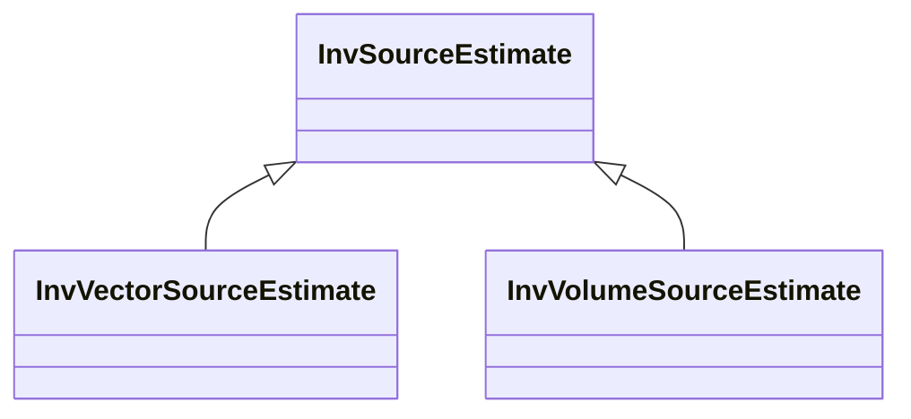

# InvSourceEstimate

**Namespace:** `INVLIB` &nbsp;·&nbsp; **Library:** Inverse Library &nbsp;·&nbsp; **Source:** [`inv/inv_source_estimate.h`](https://github.com/mne-tools/mne-cpp/blob/staging/src/libraries/inv/inv_source_estimate.h)

:::info[Python equivalent]
`mne.SourceEstimate` in MNE-Python.
:::

`#include <inv/inv_source_estimate.h>`

<Connections topics={["minimum-norm"]} context="api" current="InvSourceEstimate" />

```cpp
class INVLIB::InvSourceEstimate
```

Central source-space container produced by every `INVLIB` inverse solver.

Carries the dense (n_sources × n_times) data matrix plus vertex indices, time origin and step, and optional focal dipoles, coupling groups and connectivity layers so one value can represent the output of any algorithm in `INVLIB`. Replaces `mneStcDataRec` of MNE-C and implements round-trip STC / W binary I/O with mne-python and mne-c.

Source-space inverse-solution container with dense grid plus optional focal-dipole, coupling and connectivity layers.

```cpp title="src/examples/ex_inv_api/main.cpp"
FsLabel v1;
FsLabel::read(data + "/subjects/sample/label/lh.V1.label", v1);
QFile fwdFile(data + "/Result/ref-sample_audvis-meg-eeg-oct-6-fwd.fif");
const MNEForwardSolution fwd = MNEForwardSolution(fwdFile).pick_regions({v1}); // 70 sources x 3 orientations
QFile covFile(data + "/MEG/sample/sample_audvis-cov.fif");
const FiffCov noiseCov(covFile);
QFile aveFile(data + "/MEG/sample/sample_audvis-ave.fif");
const FiffEvoked evoked(aveFile, 0); // "Left Auditory"

const MNEInverseOperator inverse = MNEInverseOperator::make_inverse_operator(evoked.info, fwd, noiseCov, 0.2f, 0.8f);
const float lambda2 = 1.0f / 9.0f; // SNR 3
InvMinimumNorm dspm(inverse, lambda2, "dSPM");
const InvSourceEstimate stc = dspm.calculateInverse(evoked); // one row per source, combined over orientations
```

```cpp title="src/examples/ex_inv_api/main.cpp"
InvSourceEstimateIO::writeCsv(stc, tmp.filePath("v1-dspm.csv"));
const InvSourceEstimate fromCsv = InvSourceEstimateIO::readCsv(tmp.filePath("v1-dspm.csv"));
QFile stcFile(tmp.filePath("v1-dspm-lh.stc"));
InvSourceEstimate(stc).write(stcFile); // MNE .stc format, readable by mne.read_source_estimate
QFile stcBack(stcFile.fileName());
const InvSourceEstimate fromStc(stcBack);
```

### Inheritance



---

## Public Methods

### InvSourceEstimate()

Default constructor.

---

### InvSourceEstimate(p_sol, p_vertices, p_tmin, p_tstep)

Constructs a source estimation from given data.

**Parameters:**

- **p_sol** : *const Eigen::MatrixXd &*
  Source amplitudes (sources x time points).

- **p_vertices** : *const Eigen::VectorXi &*
  Source space vertex numbers of the rows of p_sol.

- **p_tmin** : *float*
  Time of the first sample in seconds.

- **p_tstep** : *float*
  Time between samples in seconds.

---

### InvSourceEstimate(p_SourceEstimate)

Copy constructor.

**Parameters:**

- **p_SourceEstimate** : *const InvSourceEstimate &*
  Source estimate data which should be copied.

---

### InvSourceEstimate(p_IODevice)

Constructs a source estimation, by reading from a IO device.

**Parameters:**

- **p_IODevice** : *QIODevice &*
  IO device to read from the source estimation.

---

### clear()

Initializes source estimate.

---

### reduce(start, n)

Reduces the source estimate to selected samples.

**Parameters:**

- **start** : *qint32*
  The start index to cut the estimate from.

- **n** : *qint32*
  Number of samples to cut from start index.

**Returns:**

- *[InvSourceEstimate](/docs/api/inv/inv-source-estimate)* — Copy of this estimate restricted to samples [start, start + n), with tmin updated accordingly.

---

### write(p_IODevice)

mne_write_stc_file

Writes a stc file

**Parameters:**

- **p_IODevice** : *QIODevice &*
  IO device to write the stc to.

**Returns:**

- *bool* — True if successful, false if the device could not be opened for writing.

---

### writeHemispherePair(sBasePath)

Write the estimate as an MNE-C / MNE-Python compatible hemisphere pair.

MNE-Python expects a surface source estimate to be stored as two files, "&lt;base&gt;-lh.stc" and "&lt;base&gt;-rh.stc", each containing only the vertices of its own hemisphere. This writes exactly that, splitting at `nVerticesLh`.

**Parameters:**

- **sBasePath** : *const QString &*
  Path without the "-lh.stc"/"-rh.stc" suffix. A trailing "-lh.stc", "-rh.stc" or ".stc" is stripped if present.

**Returns:**

- *bool* — true when both files were written, false otherwise. Fails when nVerticesLh is unknown (-1) or out of range, since the split point cannot then be determined.

---

### write_w(path)

Write the first time point of this source estimate to a .w file.

**Parameters:**

- **path** : *const QString &*
  Path to the .w file to write.

---

### isEmpty()

Returns whether SourceEstimate is empty.

**Returns:**

- *bool* — true if is empty, false otherwise.

---

### operator=(rhs)

Assignment Operator.

**Parameters:**

- **rhs** : *const [InvSourceEstimate](/docs/api/inv/inv-source-estimate) &*
  SourceEstimate which should be assigned.

**Returns:**

- *[InvSourceEstimate](/docs/api/inv/inv-source-estimate) &* — the copied source estimate.

---

### samples()

Returns the number of samples.

**Returns:**

- *int* — the number of samples.

---

### getIndicesByLabel(lPickedLabels, bIsClustered)

Returns the indices of sources in the data matrix based on their beloning label.

**Parameters:**

- **lPickedLabels** : *const QList&lt; [FsLabel](/docs/api/fs/fs-label) &gt; &*
  The labels base the selection on.

- **bIsClustered** : *bool*
  Whether the source space was clustered.

**Returns:**

- *Eigen::VectorXi* — the indices.

---

### hasGridData()

Returns true if the estimate contains grid-based data (distributed methods or RAP-MUSIC amplitudes).

**Returns:**

- *bool* — true if grid data is present.

---

### hasCouplings()

Returns true if the estimate contains source coupling annotations (e.g.

RAP-MUSIC pairs/N-tuples).

**Returns:**

- *bool* — true if couplings are present.

---

### hasFocalDipoles()

Returns true if the estimate contains focal (off-grid) dipole results.

**Returns:**

- *bool* — true if focal dipoles are present.

---

### hasPositions()

Returns true if the estimate carries explicit source positions (discrete source space).

**Returns:**

- *bool* — true if positions are present.

---

### hasConnectivity()

Returns true if the estimate contains connectivity results.

**Returns:**

- *bool* — true if connectivity data is present.

---

## Static Methods

### read(p_IODevice, p_stc)

mne_read_stc_file

Reads a source estimate from a given file

**Parameters:**

- **p_IODevice** : *QIODevice &*
  IO device to red the stc from.

- **p_stc** : *[InvSourceEstimate](/docs/api/inv/inv-source-estimate) &*
  the read stc.

**Returns:**

- *bool* — true if successful, false otherwise.

---

### read_w(path)

Read a .w file (single time-point source estimate).

The .w format stores vertex indices (3-byte big-endian) and float values (4-byte big-endian) for a single time point.

**Parameters:**

- **path** : *const QString &*
  Path to the .w file.

**Returns:**

- *[InvSourceEstimate](/docs/api/inv/inv-source-estimate)* — The source estimate with single-column data.

---

## Example

- Start here: [ex_inv_api](../../examples/inv/ex_inv_api.mdx) — Inverse library: minimum-norm estimates, resolution matrices, label time courses, sparse solvers and source-estimate I/O.
- Full source: [`src/examples/ex_inv_api/main.cpp`](https://github.com/mne-tools/mne-cpp/tree/staging/src/examples/ex_inv_api/main.cpp)
- Build target: `ex_inv_api` (runs under CTest)
- Data: [mne-cpp-test-data](https://github.com/mne-tools/mne-cpp-test-data)

## Used in examples

### [ex_inv_api](../../examples/inv/ex_inv_api.mdx)

Inverse library: minimum-norm estimates, resolution matrices, label time courses, sparse solvers and source-estimate I/O.

````cpp title="src/examples/ex_inv_api/main.cpp, line 120"
const MNEInverseOperator inverse = MNEInverseOperator::make_inverse_operator(evoked.info, fwd, noiseCov, 0.2f, 0.8f);
const float lambda2 = 1.0f / 9.0f; // SNR 3
InvMinimumNorm dspm(inverse, lambda2, "dSPM");
const InvSourceEstimate stc = dspm.calculateInverse(evoked); // one row per source, combined over orientations
// mne.minimum_norm.apply_inverse(evoked, inv, 1/9, "dSPM"): 70 x 421, sum |stc| = 372483.6, stc[0, 0] = 5.00927
ok &= expect(stc.data.rows() == 70 && stc.data.cols() == 421 && near(stc.data.cwiseAbs().sum(), 372483.6177246599, 1e-4) && near(stc.data(0, 0), 5.0092691144321755, 1e-4) && near(stc.tmin, -0.19979521, 1e-6),
             "InvMinimumNorm/InvSourceEstimate: dSPM on 70 V1 sources matches mne.minimum_norm.apply_inverse");
````

### [ex_clustered_inverse_mne_raw](../../examples/inv/ex_clustered_inverse_mne_raw.mdx)

Average a raw recording and compute an MNE, dSPM or sLORETA estimate with a parcellation-clustered forward solution.

````cpp title="src/examples/ex_clustered_inverse_mne_raw/main.cpp, line 474"
InvSourceEstimate sourceEstimate;
QList<qint64> qVecElapsedTime;
for (qint32 i = 0; i < 100; ++i) {
    //Benchmark time
    QElapsedTimer timer;
    timer.start();
    sourceEstimate = minimumNorm.calculateInverse(evoked.data, evoked.times(0), evoked.times(1) - evoked.times(0));
    qVecElapsedTime.append(timer.elapsed());
}
````

### [ex_clustered_inverse_pwl_rap_music_raw](../../examples/inv/ex_clustered_inverse_pwl_rap_music_raw.mdx)

Average a raw recording and localize dipole pairs with Powell RAP-MUSIC on a parcellation-clustered forward solution.

````cpp title="src/examples/ex_clustered_inverse_pwl_rap_music_raw/main.cpp, line 438"
#ifdef BENCHMARK
    InvSourceEstimate sourceEstimate;
    QList<qint64> qVecElapsedTime;
    for (qint32 i = 0; i < 100; ++i) {
        //Benchmark time
        QElapsedTimer timer;
        timer.start();
        sourceEstimate = t_pwlRapMusic.calculateInverse(pickedEvoked);
        qVecElapsedTime.append(timer.elapsed());
    }
````

Also used in [ex_connectivity](../../examples/connectivity/ex_connectivity.mdx), [ex_connectivity_comparison](../../examples/connectivity/ex_connectivity_comparison.mdx), [ex_make_inverse_operator](../../examples/inv/ex_make_inverse_operator.mdx), [ex_roi_clustered_inverse_pwl_rap_music](../../examples/inv/ex_roi_clustered_inverse_pwl_rap_music.mdx), [ex_st_clustered_inverse_pwl_rap_music](../../examples/inv/ex_st_clustered_inverse_pwl_rap_music.mdx), [ex_clustered_inverse_mne](../../examples/inv/ex_clustered_inverse_mne.mdx), [ex_clustered_inverse_rap_music_raw](../../examples/inv/ex_clustered_inverse_rap_music_raw.mdx), [ex_disp_3D](../../examples/disp3D/ex_disp_3D.mdx), [ex_dsp_analysis](../../examples/dsp/ex_dsp_analysis.mdx), [ex_inverse_cmne](../../examples/inv/ex_inverse_cmne.mdx), [ex_inverse_mne](../../examples/inv/ex_inverse_mne.mdx), [ex_inverse_mne_raw](../../examples/inv/ex_inverse_mne_raw.mdx), [ex_inverse_pwl_rap_music](../../examples/inv/ex_inverse_pwl_rap_music.mdx), [ex_inverse_rap_music](../../examples/inv/ex_inverse_rap_music.mdx), [ex_disp3d_scene](../../examples/disp3D/ex_disp3d_scene.mdx), [ex_histogram](../../examples/inv/ex_histogram.mdx).

## Authors of this file

- Christoph Dinh &lt;christoph.dinh@mne-cpp.org&gt;
