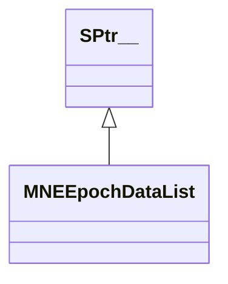

# MNEEpochDataList

**Namespace:** `MNELIB` &nbsp;·&nbsp; **Library:** MNE Library &nbsp;·&nbsp; **Source:** [`mne/mne_epoch_data_list.h`](https://github.com/mne-tools/mne-cpp/blob/staging/src/libraries/mne/mne_epoch_data_list.h)

`#include <mne/mne_epoch_data_list.h>`

<Connections topics={["epochs-averaging"]} context="api" current="MNEEpochDataList" />

```cpp
class MNELIB::MNEEpochDataList
```

Epoch data list, which corresponds to a set of events.

Ordered list of [`MNEEpochData`](/docs/api/mne/mne-epoch-data) objects sharing a common measurement info.

```cpp title="src/examples/ex_mne_api/main.cpp"
QFile rawFile(data + "/MEG/sample/sample_audvis_trunc_raw.fif");
const FiffRawData raw(rawFile);
FiffEvents events;
FiffEvents::detect_from_raw(raw, events); // rising edges on STI 014
// Epochs of event 1 from -100 to 300 ms, no rejection
MNEEpochDataList epochs = MNEEpochDataList::readEpochs(raw, events.events, -0.1f, 0.3f, 1, {});
const MNEEpochData& firstEpoch = *epochs.first();
FiffEvoked evoked = epochs.average(raw.info, raw.first_samp, raw.last_samp);
```

```cpp title="src/examples/ex_mne_api/main.cpp"
// Peak-to-peak rejection like mne.Epochs(reject=...): flagged epochs stay in the list with bReject set
const QMap<QString, double> reject{{"grad", 1.6e-14}, {"eeg", 1.6e-8}};
MNEEpochDataList checked = MNEEpochDataList::readEpochs(raw, events.events, -0.1f, 0.3f, 1, reject);
QList<int> keptEpochs;
for (int i = 0; i < checked.size(); ++i) {
    if (!checked.at(i)->bReject) {
        keptEpochs << i;
    }
}
const bool firstIsClean = !MNEEpochDataList::checkForArtifact(firstEpoch.epoch, raw.info, reject);
```

### Inheritance



---

## Public Methods

### MNEEpochDataList()

Default constructor.

---

### ~MNEEpochDataList()

Destroys the [`MNEEpochDataList`](/docs/api/mne/mne-epoch-data-list).

---

### average(p_info, first, last, sel, proj)

Averages epoch list.

Note that no baseline correction performed.

**Parameters:**

- **p_info** : *const [FiffInfo](/docs/api/fiff/fiff-info) &*
  measurement info.

- **first** : *FIFFLIB::fiff_int_t*
  First time sample.

- **last** : *FIFFLIB::fiff_int_t*
  Last time sample.

- **sel** : *Eigen::VectorXi*
  Which epochs should be averaged (optional).

- **proj** : *bool*
  Apply SSP projection vectors (optional, default = false).

**Returns:**

- *[FiffEvoked](/docs/api/fiff/fiff-evoked)* — Averaged evoked response; aspect_kind is FIFFV_ASPECT_STD_ERR with no data if the list is empty.

---

### applyBaselineCorrection(baseline)

Applies baseline correction to the evoked data.

**Parameters:**

- **baseline** : *const QPair&lt; float, float &gt; &*
  time definition of the baseline in seconds [from, to].

---

### dropRejected()

Drop/Remove all epochs tagged as rejected.

---

### pick_channels(sel)

Reduces alld epochs to the selected rows.

**Parameters:**

- **sel** : *const Eigen::RowVectorXi &*
  The selected rows to keep.

---

## Static Methods

### readEpochs(raw, events, tmin, tmax, event, mapReject, lExcludeChs, picks)

Read the epochs from a raw file based on provided events.

**Parameters:**

- **raw** : *const [FiffRawData](/docs/api/fiff/fiff-raw-data) &*
  The raw data.

- **events** : *const Eigen::MatrixXi &*
  The events provided in samples and event kind.

- **tmin** : *float*
  The start time relative to the event in seconds.

- **tmax** : *float*
  The end time relative to the event in seconds.

- **event** : *qint32*
  The event kind.

- **mapReject** : *const QMap&lt; QString, double &gt; &*
  Peak-to-peak rejection thresholds per channel type (e.g. "grad", "mag", "eeg").

- **lExcludeChs** : *const QStringList &*
  List of channel names to exclude.

- **picks** : *const Eigen::RowVectorXi &*
  Which channels to pick.

**Returns:**

- *[MNEEpochDataList](/docs/api/mne/mne-epoch-data-list)* — List of epochs with rejection flags set; empty if no matching events are found.

---

### checkForArtifact(data, pFiffInfo, mapReject, lExcludeChs)

Checks the givven matrix for artifacts beyond a threshold value.

**Parameters:**

- **data** : *const Eigen::MatrixXd &*
  The data matrix.

- **pFiffInfo** : *const [FiffInfo](/docs/api/fiff/fiff-info) &*
  The fiff info.

- **mapReject** : *const QMap&lt; QString, double &gt; &*
  The channel data types to scan for. EEG, MEG or EOG.

- **lExcludeChs** : *const QStringList &*
  List of channel names to exclude.

**Returns:**

- *bool* — Whether a threshold artifact was detected.

---

### averageCategories(raw, events, eventCodes, comments, tmin, tmax, mapReject, baseline, proj)

averageCategories

Multi-category offline averaging. Reads epochs from raw data for multiple event types and returns an [FiffEvokedSet](/docs/api/fiff/fiff-evoked-set) with one [FiffEvoked](/docs/api/fiff/fiff-evoked) per category. Ported from average.c (MNE-C).

**Parameters:**

- **raw** : *const [FiffRawData](/docs/api/fiff/fiff-raw-data) &*
  The raw data.

- **events** : *const Eigen::MatrixXi &*
  Event matrix (nEvents x 3): [sample, before, after].

- **eventCodes** : *const QList&lt; int &gt; &*
  List of event codes, one per category.

- **comments** : *const QStringList &*
  List of category names/comments, one per category.

- **tmin** : *float*
  Start of epoch relative to event (seconds).

- **tmax** : *float*
  End of epoch relative to event (seconds).

- **mapReject** : *const QMap&lt; QString, double &gt; &*
  Rejection thresholds (key = channel type string, value = threshold).

- **baseline** : *const QPair&lt; float, float &gt; &*
  Baseline interval [from, to] in seconds. If from==to, no baseline correction.

- **proj** : *bool*
  Apply SSP projection vectors (optional, default = false).

**Returns:**

- *[FiffEvokedSet](/docs/api/fiff/fiff-evoked-set)* — FiffEvokedSet containing one FiffEvoked per category.

---

### computeAverage(raw, matEvents, fTMinS, fTMaxS, eventType, bApplyBaseline, fTBaselineFromS, fTBaselineToS, mapReject, lExcludeChs, vecPicks)

Convenience function: reads epochs, optionally applies baseline correction and artifact rejection, then returns the averaged evoked response.

**Parameters:**

- **raw** : *const [FiffRawData](/docs/api/fiff/fiff-raw-data) &*
  The raw data.

- **matEvents** : *const Eigen::MatrixXi &*
  The events provided in samples and event kinds.

- **fTMinS** : *float*
  The start time relative to the event in seconds.

- **fTMaxS** : *float*
  The end time relative to the event in seconds.

- **eventType** : *qint32*
  The event type.

- **bApplyBaseline** : *bool*
  Whether to use baseline correction (mode=mean).

- **fTBaselineFromS** : *float*
  The start baseline correction time relative to the event in seconds.

- **fTBaselineToS** : *float*
  The end baseline correction time relative to the event in seconds.

- **mapReject** : *const QMap&lt; QString, double &gt; &*
  The thresholds per channel type to reject epochs.

- **lExcludeChs** : *const QStringList &*
  List of channel names to exclude.

- **vecPicks** : *const Eigen::RowVectorXi &*
  Which channels to pick.

**Returns:**

- *[FiffEvoked](/docs/api/fiff/fiff-evoked)* — The averaged evoked data.

---

## Example

- Start here: [ex_mne_api](../../examples/fs/ex_mne_api.mdx) — MNE library: BEM surfaces, surface projection, ICP, source spaces and epochs.
- Full source: [`src/examples/ex_mne_api/main.cpp`](https://github.com/mne-tools/mne-cpp/tree/staging/src/examples/ex_mne_api/main.cpp)
- Build target: `ex_mne_api` (runs under CTest)
- Data: [mne-cpp-test-data](https://github.com/mne-tools/mne-cpp-test-data)

## Used in examples

### [ex_mne_api](../../examples/fs/ex_mne_api.mdx)

MNE library: BEM surfaces, surface projection, ICP, source spaces and epochs.

````cpp title="src/examples/ex_mne_api/main.cpp, line 234"
FiffEvents events;
FiffEvents::detect_from_raw(raw, events); // rising edges on STI 014
// Epochs of event 1 from -100 to 300 ms, no rejection
MNEEpochDataList epochs = MNEEpochDataList::readEpochs(raw, events.events, -0.1f, 0.3f, 1, {});
const MNEEpochData& firstEpoch = *epochs.first();
FiffEvoked evoked = epochs.average(raw.info, raw.first_samp, raw.last_samp);
// mne.Epochs(event_id=1, tmin=-0.1, tmax=0.3, baseline=None, proj=False): 6 epochs of 376 x 121, MEG 0113 first sample -7.5857e-15
ok &= expect(epochs.size() == 6 && firstEpoch.eventSample == 14385 && firstEpoch.epoch.rows() == 376 && firstEpoch.epoch.cols() == 121 && near(firstEpoch.epoch(0, 0), -7.585747577225703e-15, 1e-6) && near(firstEpoch.epoch.topRows(306).norm(), 7.05600718833613e-13, 1e-6),
             "MNEEpochDataList/MNEEpochData: 6 epochs of event 1 match mne.Epochs");
// mne Epochs.average(): |MEG| = 6.0801e-13 over 6 epochs, times from -99.898 to 299.693 ms with 0 at sample 30
ok &= expect(evoked.nave == 6 && near(evoked.data.topRows(306).norm(), 6.080119131626428e-13, 1e-6) && evoked.times.size() == 121 && near(evoked.times[0], -0.09989760657919393, 1e-6) && near(evoked.times[120], 0.2996928197375818, 1e-6) && evoked.times[30] == 0.0f,
             "MNEEpochDataList::average matches mne Epochs.average");
````

### [ex_connectivity](../../examples/connectivity/ex_connectivity.mdx)

Sensor- or source-level functional connectivity of averaged MEG/EEG data with a selectable metric, shown as a 3D network.

````cpp title="src/examples/ex_connectivity/connectivitysettingsmanager.h, line 116"
TFplot::SPtr m_pTfPlot;
Eigen::MatrixXd m_matEvoked;
Eigen::MatrixXd m_matEvokedSource;
MNELIB::MNEEpochDataList epochs;
````

### [ex_averaging](../../examples/mne/ex_averaging.mdx)

Average stimulus-locked epochs of a raw FIFF recording into an evoked response, with event selection and EOG rejection.

````cpp title="src/examples/ex_averaging/main.cpp, line 151"
FiffEvoked evoked = MNEEpochDataList::computeAverage(raw,
                                                     events,
                                                     fTMin,
                                                     fTMax,
                                                     event,
                                                     false,
                                                     0.0f,
                                                     0.0f,
                                                     mapReject,
                                                     QStringList(),
                                                     picks);
````

Also used in [ex_clustered_inverse_mne_raw](../../examples/inv/ex_clustered_inverse_mne_raw.mdx), [ex_clustered_inverse_pwl_rap_music_raw](../../examples/inv/ex_clustered_inverse_pwl_rap_music_raw.mdx), [ex_clustered_inverse_rap_music_raw](../../examples/inv/ex_clustered_inverse_rap_music_raw.mdx), [ex_connectivity_comparison](../../examples/connectivity/ex_connectivity_comparison.mdx), [ex_inverse_mne_raw](../../examples/inv/ex_inverse_mne_raw.mdx), [ex_read_epochs](../../examples/mne/ex_read_epochs.mdx).

## Authors of this file

- Christoph Dinh &lt;christoph.dinh@mne-cpp.org&gt;
- Lorenz Esch &lt;lorenz.esch@tu-ilmenau.de&gt;
- Gabriel Motta &lt;gabrielbenmotta@gmail.com&gt;
- Juan GPC &lt;jgarciaprieto@mgh.harvard.edu&gt;
