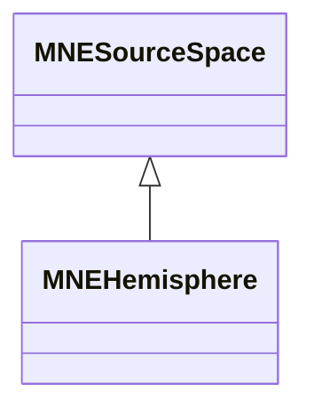

# MNEHemisphere

**Namespace:** `mne` &nbsp;·&nbsp; **Library:** MNE Library &nbsp;·&nbsp; **Source:** [`mne/mne_hemisphere.h`](https://github.com/mne-tools/mne-cpp/blob/staging/src/libs/mne/mne/mne_hemisphere.h)

`#include <mne/mne/mne_hemisphere.h>`

```cpp
class mne::MNEHemisphere
```

Hemisphere source space geometry information.

Hemisphere provides geometry information

```cpp title="src/examples/ex_mne_api/main.cpp"
const QString srcPath = data + "/subjects/sample/bem/sample-oct-6-src.fif";
const MNESourceSpaces src(srcPath.toStdU16String()); // with normals, triangle data and patches
const auto& lh = dynamic_cast<const MNEHemisphere&>(src[0]);
std::vector<VectorXi> vertno = src.get_vertno(); // used vertices per hemisphere
```

### Inheritance



---

## Public Methods

### MNEHemisphere()

Constructors the hemisphere source space.

---

### MNEHemisphere(p_MNEHemisphere)

Copy constructor.

**Parameters:**

- **p_MNEHemisphere** : *const MNEHemisphere &*
  Hemisphere source space which should be copied.

---

### MNEHemisphere(other)

Move constructor: takes over the fields the copy constructor copies.

**Parameters:**

- **other** : *MNEHemisphere &&*
  Hemisphere to move from; left valid but unspecified.

---

### ~MNEHemisphere()

Destroys the hemisphere source space.

---

### clone()

Creates a deep copy of this hemisphere, preserving the [`MNEHemisphere`](/docs/api/mne/mne-hemisphere) type.

**Returns:**

- *std::shared_ptr&lt; [MNESourceSpace](/docs/api/mne/mne-source-space) &gt;* — a shared_ptr&lt;MNESourceSpace&gt; pointing to a cloned [`MNEHemisphere`](/docs/api/mne/mne-hemisphere).

---

### add_geometry_info()

Add vertex normals and neighbourhood information to this hemisphere.

**Returns:**

- *bool* — true if succeeded, false otherwise.

---

### complete_source_space_info()

Complete triangulation information (triangle centers, normals, areas) for both the main and use triangulations.

**Returns:**

- *bool* — true if succeeded, false otherwise.

---

### compute_patch_info()

Compute patch statistics from the nearest-vertex data.

Fills pinfo (per-patch vertex lists) and patch_inds (patch index per vertex).

**Returns:**

- *bool* — true if patch info was computed, false if nearest data is empty.

---

### clear()

Initializes the hemisphere source space.

---

### isClustered()

is hemisphere clustered?

**Returns:**

- *bool* — true if hemisphere is clustered, false otherwise.

---

### transform_hemisphere_to(dest, p_Trans)

mne_transform_source_space_to

**Parameters:**

- **dest** : *mne::fiff_int_t*
  The id of the destination coordinate system (FIFFV_COORD_...).

- **p_Trans** : *const [FiffCoordTrans](/docs/api/fiff/fiff-coord-trans) &*
  The coordinate transformation structure to use.

**Returns:**

- *bool* — true if succeeded, false otherwise.

---

### writeToStream(stream)

mne_python _write_one_source_space

**Parameters:**

- **stream** : *[FiffStream](/docs/api/fiff/fiff-stream) &*
  The stream to write to.

---

### operator=(other)

Copy assignment operator.

**Parameters:**

- **other** : *const [MNEHemisphere](/docs/api/mne/mne-hemisphere) &*
  The [`MNEHemisphere`](/docs/api/mne/mne-hemisphere) to assign from.

**Returns:**

- *[MNEHemisphere](/docs/api/mne/mne-hemisphere) &* — Reference to this object.

---

### operator=(other)

Move assignment: takes over the fields the copy assignment copies.

**Parameters:**

- **other** : *[MNEHemisphere](/docs/api/mne/mne-hemisphere) &&*
  Hemisphere to move from; left valid but unspecified.

**Returns:**

- *[MNEHemisphere](/docs/api/mne/mne-hemisphere) &* — Reference to this object.

---

## Example

- Start here: [ex_mne_api](../../examples/fs/ex_mne_api.mdx) — MNE library: BEM surfaces, surface projection, ICP, source spaces and epochs.
- Full source: [`src/examples/ex_mne_api/main.cpp`](https://github.com/mne-tools/mne-cpp/tree/staging/src/examples/ex_mne_api/main.cpp)
- Build target: `ex_mne_api` (runs under CTest)
- Data: [mne-cpp-test-data](https://github.com/mne-tools/mne-cpp-test-data)

## Used in examples

### [ex_mne_api](../../examples/fs/ex_mne_api.mdx)

MNE library: BEM surfaces, surface projection, ICP, source spaces and epochs.

````cpp title="src/examples/ex_mne_api/main.cpp, line 200"
const QString srcPath = data + "/subjects/sample/bem/sample-oct-6-src.fif";
const MNESourceSpaces src(srcPath.toStdU16String()); // with normals, triangle data and patches
const auto& lh = dynamic_cast<const MNEHemisphere&>(src[0]);
std::vector<VectorXi> vertno = src.get_vertno(); // used vertices per hemisphere
// mne.read_source_spaces: lh 155407 vertices, 4098 in use (8192 used triangles), vertno 14, 54, 59; rh 156866 / 4098
ok &= expect(src.size() == 2 && lh.np == 155407 && lh.nuse == 4098 && lh.nuse_tri == 8192 && lh.coord_frame == FIFFV_COORD_MRI && vertno[0].head(3) == Vector3i(14, 54, 59) && src[1].np == 156866 && vertno[1].size() == 4098 && lh.pinfo.size() == 4098,
             "MNESourceSpaces/MNEHemisphere: oct-6 source space with patches like mne.read_source_spaces");
````

## Authors of this file

- Christoph Dinh &lt;christoph.dinh@mne-cpp.org&gt;
- Christof Pieloth &lt;pieloth@labp.htwk-leipzig.de&gt;
- Lorenz Esch &lt;lorenz.esch@tu-ilmenau.de&gt;
- Juan GPC &lt;jgarciaprieto@mgh.harvard.edu&gt;
- Gabriel Motta &lt;gabrielbenmotta@gmail.com&gt;
