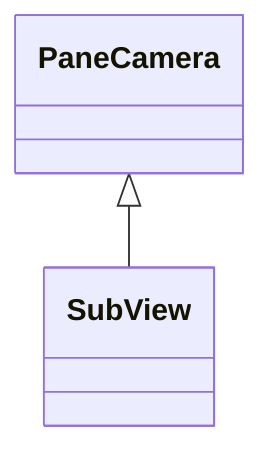

# PaneCamera

**Namespace:** `mne::scene` &nbsp;·&nbsp; **Library:** Scene Library &nbsp;·&nbsp; **Source:** [`scene/camera.h`](https://github.com/mne-tools/mne-cpp/blob/staging/src/libs/mne/scene/camera.h)

`#include <mne/scene/camera.h>`

```cpp
struct mne::scene::PaneCamera
```

Camera state of one pane of the 3-D view: preset, user rotation, zoom and pan.

The perspective preset orbits by `rotation` (applied on top of the preset orientation); the other presets pan by `pan` in the view plane. The single view uses `rotation` and `zoom` only.

### Inheritance



---

## Example

No example of its own: Camera state of a pane of the 3-D brain view; disp::SubView derives from it and test_scene_brain_view covers it.

## Authors of this file

- Christoph Dinh &lt;christoph.dinh@mne-cpp.org&gt;
