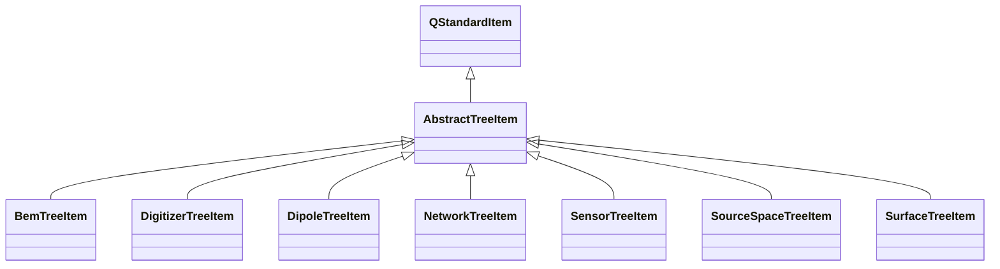

# AbstractTreeItem

**Namespace:** `mne::viz::qt` &nbsp;·&nbsp; **Library:** Visualization: Qt Backend &nbsp;·&nbsp; **Source:** [`viz/backends/qt/3d/model/items/abstracttreeitem.h`](https://github.com/mne-tools/mne-cpp/blob/staging/src/libs/mne/viz/backends/qt/3d/model/items/abstracttreeitem.h)

`#include <mne/viz/backends/qt/abstracttreeitem.h>`

```cpp
class mne::viz::qt::AbstractTreeItem
```

Base tree item providing check-state, visibility, and data-role storage for all 3-D scene items.

### Inheritance



---

## Public Methods

### AbstractTreeItem(text, type)

---

### ~AbstractTreeItem()

---

### type()

---

### setVisible(visible)

---

### isVisible()

---

### setTransform(transform)

---

### transform()

---

### setColor(color)

---

### color()

---

### setAlpha(alpha)

---

### alpha()

---

## Static Methods

### itemTypeId(type)

---

## Authors of this file

- Christoph Dinh &lt;christoph.dinh@mne-cpp.org&gt;
