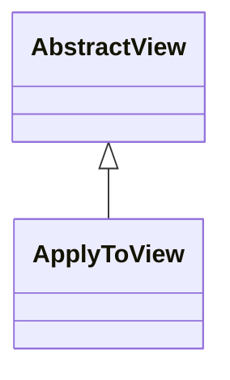

# ApplyToView

**Namespace:** `mne::viz::qt` &nbsp;·&nbsp; **Library:** Visualization: Qt Backend &nbsp;·&nbsp; **Source:** [`viz/backends/qt/viewers/applytoview.h`](https://github.com/mne-tools/mne-cpp/blob/staging/src/libs/mne/viz/backends/qt/viewers/applytoview.h)

`#include <mne/viz/backends/qt/applytoview.h>`

```cpp
class mne::viz::qt::ApplyToView
```

Three-way radio selector for scope = Selected / Visible / All channels.

Emits `selectionChanged(int)` when the active radio flips; the integer matches the `QButtonGroup` id of the chosen scope.

### Inheritance



---

## Public Methods

### ApplyToView(sSettingsPath, parent, f)

[`ApplyToView`](/docs/api/viz-qt/apply-to-view).

**Parameters:**

- **sSettingsPath** : *const QString &*
  path for saving view settings.

- **parent** : *QWidget **
  parent of widget.

- **f** : *Qt::WindowFlags*
  flag to denote window porperties of the widget.

---

### ~ApplyToView()

---

### saveSettings()

Saves all important settings of this view via QSettings.

---

### loadSettings()

Loads and inits all important settings of this view via QSettings.

---

### selectAll()

Selects all View Select checkboxes.

---

### selectClear()

Clear all View Select checkboxes.

---

### clearView()

Clears the view.

---

### getSelectedViews()

---

## Authors of this file

- Gabriel Motta &lt;gabrielbenmotta@gmail.com&gt;
- Juan GPC &lt;jgarciaprieto@mgh.harvard.edu&gt;
- Christoph Dinh &lt;christoph.dinh@mne-cpp.org&gt;
