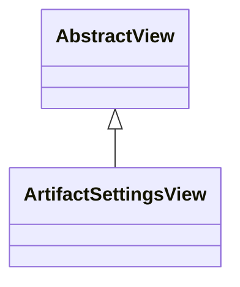

# ArtifactSettingsView

**Namespace:** `mne::viz::qt` &nbsp;·&nbsp; **Library:** Visualization: Qt Backend &nbsp;·&nbsp; **Source:** [`viz/backends/qt/viewers/artifactsettingsview.h`](https://github.com/mne-tools/mne-cpp/blob/staging/src/libs/mne/viz/backends/qt/viewers/artifactsettingsview.h)

`#include <mne/viz/backends/qt/artifactsettingsview.h>`

```cpp
class mne::viz::qt::ArtifactSettingsView
```

Per-modality peak-to-peak artefact-rejection threshold panel.

Builds one `QCheckBox` + `QDoubleSpinBox` row per supported channel modality and emits `changeArtifactThreshold(QMap)` when any threshold or activation flag changes.

### Inheritance



---

## Public Methods

### ArtifactSettingsView(sSettingsPath, fiffChInfoList, parent)

---

### ~ArtifactSettingsView()

Destroys the [`ArtifactSettingsView`](/docs/api/viz-qt/artifact-settings-view).

---

### setChInfo(fiffChInfoList)

---

### getThresholdMap()

---

### setThresholdMap(mapThresholds)

---

### getDoArtifactThresholdRejection()

---

### saveSettings()

Saves all important settings of this view via QSettings.

---

### loadSettings()

Loads and inits all important settings of this view via QSettings.

---

### clearView()

Clears the view.

---

## Authors of this file

- Lorenz Esch &lt;lorenz.esch@tu-ilmenau.de&gt;
- Matti Hamalainen &lt;msh@nmr.mgh.harvard.edu&gt;
- Gabriel Motta &lt;gabrielbenmotta@gmail.com&gt;
- Juan GPC &lt;jgarciaprieto@mgh.harvard.edu&gt;
- Christoph Dinh &lt;christoph.dinh@mne-cpp.org&gt;
