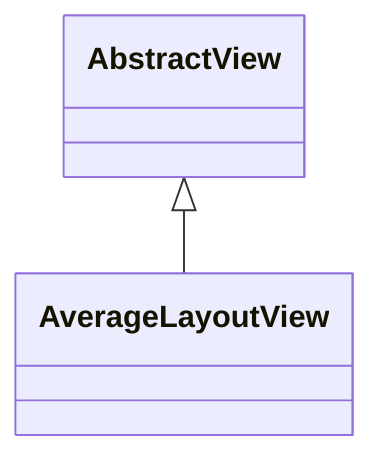

# AverageLayoutView

**Namespace:** `mne::viz::qt` &nbsp;·&nbsp; **Library:** Visualization: Qt Backend &nbsp;·&nbsp; **Source:** [`viz/backends/qt/viewers/averagelayoutview.h`](https://github.com/mne-tools/mne-cpp/blob/staging/src/libs/mne/viz/backends/qt/viewers/averagelayoutview.h)

`#include <mne/viz/backends/qt/averagelayoutview.h>`

```cpp
class mne::viz::qt::AverageLayoutView
```

Sensor-layout viewer drawing per-channel evoked traces at their physical 2-D positions.

Wraps an [`AverageLayoutWidget`](/docs/api/viz-qt/average-layout-widget) fed by an [`EvokedSetModel`](/docs/api/viz-qt/evoked-set-model) and a [`ChannelInfoModel`](/docs/api/viz-qt/channel-info-model); selection groups are pushed in as [`SelectionItem`](/docs/api/viz-qt/selection-item) to show only a subset of channels.

### Inheritance



---

## Public Methods

### AverageLayoutView(sSettingsPath, parent, f)

Constructs a [`AverageLayoutView`](/docs/api/viz-qt/average-layout-view) which is a child of parent.

**Parameters:**

- **sSettingsPath** : *const QString &*
  Settings path under which the widget persists its state (empty = no persistence).

- **parent** : *QWidget **
  parent of widget.

- **f** : *Qt::WindowFlags*
  Qt window flags passed to the QWidget constructor.

---

### ~AverageLayoutView()

Destroys the [`AverageLayoutView`](/docs/api/viz-qt/average-layout-view).

---

### updateViewport()

Update the viewport.

This, e.g., necessary if this widget was set to a QDockWidget which changes its floating state.

---

### setChannelInfoModel(pChannelInfoModel)

Sets the channel info model.

**Parameters:**

- **pChannelInfoModel** : *std::shared_ptr&lt; [ChannelInfoModel](/docs/api/viz-qt/channel-info-model) &gt; &*
  The new channel info model.

---

### setEvokedSetModel(pEvokedSetModel)

Sets the evoked set model.

**Parameters:**

- **pEvokedSetModel** : *const std::shared_ptr&lt; [EvokedSetModel](/docs/api/viz-qt/evoked-set-model) &gt; &*
  The new evoked set model.

---

### getEvokedSetModel()

Returns the currently set [`EvokedSetModel`](/docs/api/viz-qt/evoked-set-model).

**Returns:**

- *std::shared_ptr&lt; [EvokedSetModel](/docs/api/viz-qt/evoked-set-model) &gt;* — the currently set [`EvokedSetModel`](/docs/api/viz-qt/evoked-set-model).

---

### setBackgroundColor(backgroundColor)

Sets the background color of the scene.

**Parameters:**

- **backgroundColor** : *const QColor &*
  The new background color.

---

### getBackgroundColor()

Returns the background color of the scene.

**Returns:**

- *QColor* — The current background color.

---

### takeScreenshot(fileName)

Renders a screenshot of the scene and saves it to the passed path.

SVG and PNG supported.

**Parameters:**

- **fileName** : *const QString &*
  The file name and path where to store the screenshot.

---

### setScaleMap(scaleMap)

Sets the scale map to scaleMap.

**Parameters:**

- **scaleMap** : *const std::map&lt; int, float &gt; &*
  map with all channel types and their current scaling value.

---

### getAverageColor()

Get the current average colors.

**Returns:**

- *std::shared_ptr&lt; std::map&lt; std::string, QColor &gt; &gt;* — Pointer to the current average colors.

---

### getAverageActivation()

Get the current average activations.

**Returns:**

- *std::shared_ptr&lt; std::map&lt; std::string, bool &gt; &gt;* — Pointer to the current average activations.

---

### setAverageColor(qMapAverageColor)

Set the average colors.

**Parameters:**

- **qMapAverageColor** : *const std::shared_ptr&lt; std::map&lt; std::string, QColor &gt; &gt; &*
  Pointer to the new average colors.

---

### setSingleAverageColor(avgColor)

Sets the color used to draw the average to avgColor.

**Parameters:**

- **avgColor** : *const QColor &*
  [`Color`](/docs/api/viz/color) of averaged signal.

---

### setAverageActivation(qMapAverageActivation)

Set the average activations.

**Parameters:**

- **qMapAverageActivation** : *const std::shared_ptr&lt; std::map&lt; std::string, bool &gt; &gt; &*
  Pointer to the new average activations.

---

### setFiffInfo(pFiffInfo)

Stores [`FiffInfo`](/docs/api/fiff/fiff-info) to local variable to be used for getting channel info.

**Parameters:**

- **pFiffInfo** : *const std::shared_ptr&lt; [FiffInfo](/docs/api/fiff/fiff-info) &gt; &*
  shared pointer to Fiff Info of currently loaded data.

---

### channelSelectionManagerChanged(selection)

Shows the channels picked in the channel selection view.

**Parameters:**

- **selection** : *const [SelectionItem](/docs/api/viz-qt/selection-item) &*
  The picked channels with their layout positions.

---

### channelSelectionChanged(selectionData)

Sets the currently viewable channels using the corrent name and location parameters.

**Parameters:**

- **selectionData** : *const QVariant &*
  QVariant containing a [`SelectionItem`](/docs/api/viz-qt/selection-item) object with selected channel information.

---

### updateData()

call this function whenever the items' data needs to be updated

---

### saveSettings()

Saves all important settings of this view via QSettings.

---

### loadSettings()

Loads and inits all important settings of this view via QSettings.

---

### clearView()

Clears the view.

---

## Authors of this file

- Christoph Dinh &lt;christoph.dinh@mne-cpp.org&gt;
- Matti Hamalainen &lt;msh@nmr.mgh.harvard.edu&gt;
- Lorenz Esch &lt;lorenz.esch@tu-ilmenau.de&gt;
- Gabriel Motta &lt;gabrielbenmotta@gmail.com&gt;
- Juan GPC &lt;jgarciaprieto@mgh.harvard.edu&gt;
