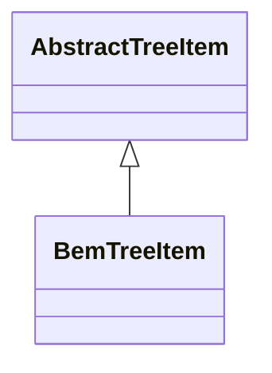

# BemTreeItem

**Namespace:** `mne::viz::qt` &nbsp;·&nbsp; **Library:** Visualization: Qt Backend &nbsp;·&nbsp; **Source:** [`viz/backends/qt/3d/model/items/bemtreeitem.h`](https://github.com/mne-tools/mne-cpp/blob/staging/src/libs/mne/viz/backends/qt/3d/model/items/bemtreeitem.h)

`#include <mne/viz/backends/qt/bemtreeitem.h>`

```cpp
class mne::viz::qt::BemTreeItem
```

Tree item representing a BEM surface layer in the 3-D scene hierarchy.

### Inheritance



---

## Public Methods

### BemTreeItem(text, bemSurf)

---

### ~BemTreeItem()

---

### bemSurfaceData()

---

## Authors of this file

- Christoph Dinh &lt;christoph.dinh@mne-cpp.org&gt;
