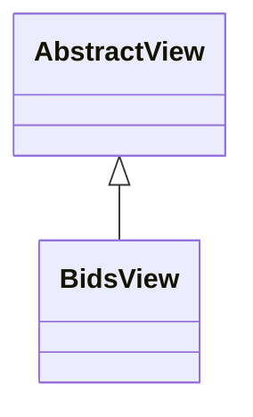

# BidsView

**Namespace:** `mne::viz::qt` &nbsp;·&nbsp; **Library:** Visualization: Qt Backend &nbsp;·&nbsp; **Source:** [`viz/backends/qt/viewers/bidsview.h`](https://github.com/mne-tools/mne-cpp/blob/staging/src/libs/mne/viz/backends/qt/viewers/bidsview.h)

`#include <mne/viz/backends/qt/bidsview.h>`

```cpp
class mne::viz::qt::BidsView
```

QTreeView wrapper around a [`BidsViewModel`](/docs/api/viz-qt/bids-view-model) for browsing a BIDS dataset.

Forwards double-click activations on data files / derivatives as `loadItem` signals so the surrounding plugin can open the chosen resource.

### Inheritance



---

## Public Methods

### BidsView(parent)

Constructs the DataManagerView.

**Parameters:**

- **parent** : *QWidget **
  If parent is not NULL the QWidget becomes a child of QWidget inside parent.

---

### ~BidsView()

Destroys the DataManagerView.

---

### setModel(pModel)

Sets the model to the tree view.

**Parameters:**

- **pModel** : *QAbstractItemModel **
  The new model.

---

### saveSettings()

Saves all important settings of this view via QSettings.

---

### loadSettings()

Loads and inits all important settings of this view via QSettings.

---

### updateGuiMode(mode)

Update the views GUI based on the set GuiMode (Clinical=0, Research=1).

**Parameters:**

- **mode** : *GuiMode*
  The new mode (Clinical=0, Research=1).

---

### updateProcessingMode(mode)

Update the views GUI based on the set ProcessingMode (RealTime=0, Offline=1).

**Parameters:**

- **mode** : *ProcessingMode*
  The new mode (RealTime=0, Offline=1).

---

### clearView()

Clears the view.

---

## Authors of this file

- Lars Debor &lt;Lars.Debor@tu-ilmenau.de&gt;
- Simon Heinke &lt;Simon.Heinke@tu-ilmenau.de&gt;
- Matti Hamalainen &lt;msh@nmr.mgh.harvard.edu&gt;
- Gabriel Motta &lt;gabrielbenmotta@gmail.com&gt;
- Juan GPC &lt;jgarciaprieto@mgh.harvard.edu&gt;
- Christoph Dinh &lt;christoph.dinh@mne-cpp.org&gt;
- Wayne Mead &lt;wayne.mead@uth.tmc.edu&gt;
- Lorenz Esch &lt;lorenz.esch@tu-ilmenau.de&gt;
